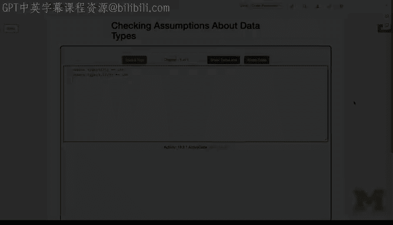
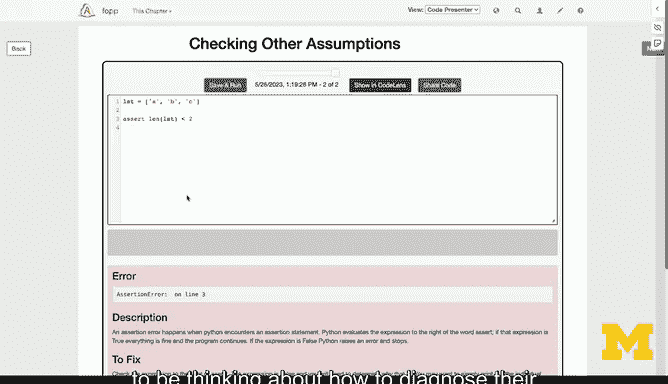

# Python 3 编程（课程1、2）｜第58课：使用 `assert` 进行自动化测试 🧪


在本节课中，我们将要学习如何使用 Python 的 `assert` 语句为程序编写自动化测试。我们将了解测试用例的概念，以及如何利用断言来验证代码在特定执行点的状态是否符合预期。



---

## 布尔值与自动化测试

上一节我们介绍了布尔值的概念，即一个要么为真（True）要么为假（False）的值。本节中我们来看看如何利用布尔值为计算机程序编写自动化测试。

测试用例以一种可以自动检查的方式，表达了对程序的要求。它指明了在程序执行的特定位置，某个对象的值应该是什么。

Python 使用 `assert` 语句来编写自动化测试，其工作原理如下。

---

## `assert` 语句的机制

在 `assert` 关键字之后，你需要提供一个布尔表达式。这个表达式的结果要么为真，要么为假。

通常，你会检查一个变量是否具有特定值，或者其值是否大于或小于另一个值。

当执行 `assert` 语句时，解释器会检查表达式的结果是否为真（True）。如果为真，解释器将继续执行下一行代码；如果不为真，解释器将引发一个运行时错误，从而停止执行。

以下代码演示了其工作机制：

```python
assert type(9 // 5) == int
assert type(9.0 // 5) == int
```

第一行断言 `9 // 5` 的结果是整数。`//` 运算符应用于两个整数时，总是返回一个整数，它会截断结果。例如，`9 // 5` 的结果是 `1`。

因此，当断言 `type(9 // 5) == int` 时，表达式为真，测试通过，程序继续执行第二行。

然而，第二行断言 `type(9.0 // 5) == int` 时，由于 `9.0` 是浮点数，`9.0 // 5` 的结果也是浮点数（`1.0`），所以表达式为假，程序会引发 `AssertionError`。

---

## 编写测试用例的好处

你可能会问，为什么要写这些 `assert` 语句？毕竟，最好的情况也只是继续执行下一行代码而不出错，最坏的情况则是引发错误。它似乎并不能直接推进代码本该完成的功能。

实际上，编写测试用例有几个重要的好处。

首先，写下测试用例迫使你更具体地思考程序应该做什么。如果你自己都不完全清楚程序应该实现什么功能，就很难正确地实现它。

其次，测试用例可以在你编写代码时提供即时反馈。你已经在一些活动代码窗口中使用过的自动评分器（autograder）就是这种体验，它们其实就是运行在后台的、你看不见的测试用例。现在，使用 `assert` 语句，你可以编写自己的测试了。

第三，编写测试用例是单元测试实践的良好入门。几乎所有大型软件项目都会使用单元测试。当代码量很大且有多人参与贡献时，项目需要知道我的代码是否破坏了其他人编写的、正在调用我的代码的函数。因此，大型项目通常拥有成千上万个单元测试，每次有人尝试对任何代码进行更改时，所有这些测试都会运行。

我们之前曾建议，在真正编写代码之前，最好先写下关于代码应该做什么的注释。你可以把编写测试用例看作是这条建议的延伸：不仅仅是写人类可读的注释，而是编写计算机可执行的测试用例。

---

## 更多 `assert` 语句示例

以下是使用 `assert` 语句的其他一些示例。

### 示例1：检查列表元素类型一致性

这个例子遍历一个列表，检查列表中的所有元素是否具有相同的类型。

```python
lst = ['a', 'b', 'c']
first_type = type(lst[0])
for item in lst:
    assert type(item) == first_type
```

代码首先获取列表中第一个元素的类型，然后遍历列表，断言每个元素的类型都与第一个元素的类型相同。如果所有元素类型一致，测试通过；否则，会引发 `AssertionError`。

如果使用一个混合类型的列表，例如 `lst2 = ['a', 'b', 17]`，当遍历到整数 `17` 时，断言就会失败。

### 示例2：检查列表长度

你并不总是需要断言两个东西相等。这里我们断言列表的长度小于 10。

```python
lst = [1, 2, 3]
assert len(lst) < 10  # 通过
assert len(lst) < 2   # 失败，引发 AssertionError
```

---

## 断言的目的与重要性

这些 `assert` 语句的核心目的是，当我们对程序执行到某一点时应处于的状态所做的假设被违反时，我们希望立即知道，而不是让程序带着错误的值（即与程序预期不符的值）继续运行。

它们的全部意义在于以自动化的方式为我们测试事物，并在出现问题时告诉我们。它们本身并不修复任何问题，只是提醒我们错误的存在。

在本专业课程的后续部分，我们将继续介绍更多测试相关的内容。我们认为，即使是新手程序员，思考如何诊断自己的代码并编写这些自动化测试也是非常有价值的。

---

## 总结

本节课中我们一起学习了 Python 中 `assert` 语句的使用。我们了解了如何利用它来编写自动化测试用例，验证代码的中间状态是否符合预期。我们还探讨了编写测试的三大好处：明确程序需求、获得即时反馈以及为大型项目的单元测试实践打下基础。记住，良好的测试习惯是构建健壮、可靠软件的关键一步。



我们下次再见。