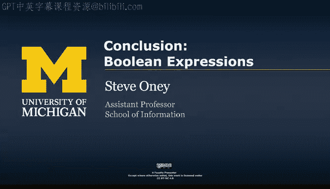

# Python 3 编程（课程 1、2）｜第 59 课：布尔表达式总结 🧠

在本节课中，我们将要学习布尔表达式。布尔值用于表示某件事是“真”还是“假”，它们是编程中进行逻辑判断的基础。

## 概述


布尔表达式是编程中用于逻辑判断的核心工具。它们的结果只有两种可能：`True`（真）或 `False`（假）。理解布尔表达式是学习后续条件执行和循环控制等复杂概念的关键。



## 布尔值简介

布尔值以数学家乔治·布尔命名，在 Python 中，它们被定义为两种常量：`True` 和 `False`。请注意，它们的首字母必须大写。

```python
# 布尔值示例
is_sunny = True
is_raining = False
```

## 比较运算符

比较运算符用于比较两个值，并返回一个布尔结果。以下是 Python 中常用的比较运算符。

*   `==`：检查两个值是否相等。
*   `!=`：检查两个值是否不相等。
*   `>`：检查左侧值是否大于右侧值。
*   `<`：检查左侧值是否小于右侧值。
*   `>=`：检查左侧值是否大于或等于右侧值。
*   `<=`：检查左侧值是否小于或等于右侧值。

```python
# 比较运算符示例
5 == 5    # 结果为 True
5 != 3    # 结果为 True
10 > 7    # 结果为 True
10 < 7    # 结果为 False
```

## 逻辑运算符

逻辑运算符用于组合多个布尔表达式。主要的逻辑运算符有三个。

*   `and`：当两边的表达式都为 `True` 时，结果为 `True`。
*   `or`：当至少一边的表达式为 `True` 时，结果为 `True`。
*   `not`：对布尔值取反，`True` 变 `False`，`False` 变 `True`。

```python
# 逻辑运算符示例
(5 > 3) and (2 < 4)  # True and True 结果为 True
(5 > 3) or (2 > 4)   # True or False 结果为 True
not (5 > 3)          # not True 结果为 False
```

## 布尔表达式的应用

上一节我们介绍了布尔值的基本概念和运算符，本节中我们来看看它们在实际中如何发挥作用。布尔表达式最常见的用途是作为条件判断的依据，控制程序的执行流程。

例如，它们可以用于判断用户输入是否有效，或者决定游戏中的角色是否可以执行某个动作。

## 总结

本节课中我们一起学习了布尔表达式。我们了解到布尔值只有 `True` 和 `False` 两种状态，并学习了如何使用比较运算符和逻辑运算符来构建复杂的逻辑判断。

正如本课引言中所说，单独看布尔值可能显得有些抽象，但当我们下一节课将它们与条件执行结合时，你就会真正认识到它们的价值。掌握布尔逻辑是成为一名高效程序员的重要一步。我们下节课再见。