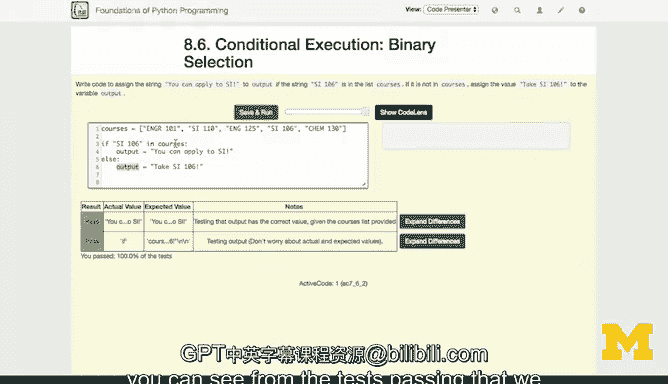

# 61：条件执行基础 🧠


在本节课中，我们将要学习Python中一个非常核心的概念：**条件执行**。它允许我们的程序根据不同的情况做出决策，执行不同的代码块。

上一节我们介绍了**布尔值**，它允许我们写出结果为真（`True`）或假（`False`）的表达式。但仅仅知道真假本身通常没有太大用处。大多数时候，我们会将布尔值与**条件执行**结合使用。

条件执行允许我们说：**如果**某个条件为真，就运行这段代码；**否则**，如果另一个条件为真，就运行另一段代码；或者**如果**条件为假，就运行其他代码。

## 使用 `if` 和 `else` 进行条件执行

我们通过 `if` 和 `else` 语句来实现条件执行。

以下是一个基础示例：

```python
x = 15
if x % 2 == 0:
    print(x, "is even")
else:
    print(x, "is odd")
```

在这段代码中：
1.  我们声明了一个变量 `x` 并将其值设为 `15`。
2.  然后我们使用 `if` 语句。`if` 后面的 `x % 2 == 0` 是一个布尔表达式。
    *   `%` 是取余运算符。例如，`15 % 2` 的结果是 `1`（因为15除以2余1），`14 % 2` 的结果是 `0`（因为14能被2整除）。
    *   因此，`x % 2 == 0` 在 `x` 为偶数时结果为 `True`，在 `x` 为奇数时结果为 `False`。
3.  如果这个条件为真（即 `x` 是偶数），程序会执行下面缩进的代码块，打印“x is even”。
4.  关键字 `else` 可以理解为“否则”。如果 `if` 的条件为假（即 `x` 是奇数），程序会执行 `else` 下面缩进的代码块，打印“x is odd”。

运行这段代码，因为 `x` 是15（奇数），所以会打印“15 is odd”。如果将 `x` 改为14（偶数），则会打印“14 is even”。

## 代码块与缩进

在Python中，我们通过**缩进**来指定哪些代码属于 `if` 或 `else` 块，就像定义 `for` 循环的代码块一样。

缩进块内可以包含任意多行代码。例如：

```python
x = 14
if x % 2 == 0:
    print(x, "is even")
    print("IT IS EVEN")
else:
    print(x, "is odd")
    print("IT IS ODD")
```

当 `x` 为14时，`if` 块内的两行 `print` 语句都会执行。`else` 块则会被忽略。

## 理解条件执行流程

让我们通过几个问题来加深理解。

**问题1：`if` 或 `else` 的缩进代码块中可以有多少行代码？**
答案是：**一行或多行**。我们必须至少有一行代码在块内，但也可以有任意多行。

**问题2：以下代码会打印什么？**
```python
if 4 + 5 == 10:
    print("True")
else:
    print("False")
```
分析过程：
1.  Python首先计算 `4 + 5`，得到 `9`。
2.  然后判断 `9 == 10`，这个表达式的结果是 `False`。
3.  因为 `if` 的条件为假，所以跳过 `if` 块，执行 `else` 块。
4.  因此，代码会打印 **`False`**。

**问题3：以下代码会打印什么？（注意缩进）**
```python
if 4 + 5 == 10:
    print("True")
else:
    print("False")
print("True")
```
分析过程：
1.  和上一题一样，`if` 条件为假，执行 `else` 块，打印 **`False`**。
2.  关键点在于最后一个 `print(“True”)` **没有缩进**，这意味着它不属于 `if-else` 结构，是一个独立的语句。
3.  无论 `if-else` 的结果如何，这行代码都会执行。
4.  因此，最终输出是 **`False`** 然后 **`True`**。

## 实践练习：课程申请检查

以下是应用条件执行的一个练习：

**任务**：编写代码，检查字符串 `"SI106"` 是否在列表 `courses` 中。如果在，将变量 `output` 赋值为 `"You can apply to SI!"`；如果不在，则赋值为 `"Take SI106!"`。

解决方案如下：

```python
courses = [“SI110”, “SI106”, “SI206”] # 示例列表
if “SI106” in courses:
    output = “You can apply to SI!”
else:
    output = “Take SI106!”
```

代码解释：
1.  `“SI106” in courses` 是一个布尔表达式，用于检查 `“SI106”` 是否在列表 `courses` 中。
2.  如果表达式为真（课程在列表中），则 `if` 块执行，`output` 被赋值为申请提示。
3.  如果表达式为假（课程不在列表中），则 `else` 块执行，`output` 被赋值为选课提示。

---



本节课中我们一起学习了Python的**条件执行**。我们掌握了如何使用 `if` 和 `else` 语句让程序根据条件做出不同决策，理解了**缩进**在定义代码块中的关键作用，并通过示例分析了条件执行的流程。这是编写智能、灵活程序的基础。