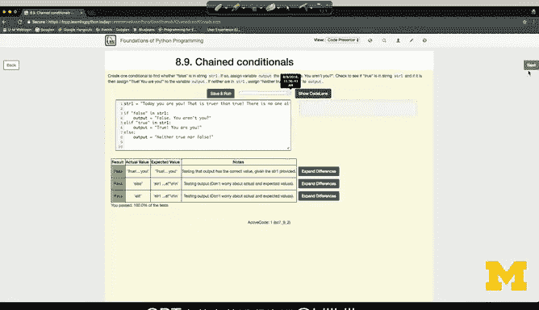

# 密歇根大学《Python3编程》课程1、2｜第62课：条件语句详解 🐍


在本节课中，我们将要学习Python中条件语句的三种核心结构：单分支选择、嵌套条件与链式条件。我们将通过简单的例子和清晰的解释，帮助你理解如何控制程序的执行流程。

---

## 单分支选择：只有 `if` 的情况

上一节我们介绍了条件语句的基础，本节中我们来看看一种简化形式。有时我们不需要 `else` 子句，可以只使用 `if` 语句。

在以下代码中，我们首先将变量 `x` 赋值为 10，然后检查 `x` 是否小于 0。如果条件为真，则执行打印语句。注意，这里没有 `else` 子句，后续的打印语句总是会执行。

```python
x = 10
if x < 0:
    print("the negative number", x, "is not valid here")
print("this is always printed")
```

当 `x` 为 10 时，`x < 0` 为假，因此只有 `"this is always printed"` 会被打印出来。如果将 `x` 改为 -10，则 `if` 块内的语句也会执行。

---

## 嵌套条件：条件中的条件

一个 `if` 或 `else` 代码块内部可以包含另一组条件语句，这被称为嵌套条件。你可以进行任意层级的嵌套。

以下是嵌套条件的一个例子：

```python
x = 10
y = 10
if x < y:
    print("x is less than y")
else:
    if x > y:
        print("x is greater than y")
    else:
        print("x and y must be equal")
```

代码执行流程如下：
1.  首先检查 `x < y`。如果为真，则打印 `"x is less than y"` 并跳过整个 `else` 块。
2.  如果 `x < y` 为假，则进入 `else` 块，并检查内部的 `if x > y` 条件。
3.  如果 `x > y` 为真，则打印 `"x is greater than y"`。
4.  如果 `x > y` 也为假，则执行内部的 `else` 块，打印 `"x and y must be equal"`。

---

## 链式条件：使用 `elif`

对于需要检查多个互斥条件的情况，使用嵌套条件会显得冗长。Python 提供了更简洁的表达方式：链式条件，使用 `elif` 关键字（`else if` 的缩写）。

以下是使用 `elif` 重写的相同逻辑：

```python
x = 10
y = 10
if x < y:
    print("x is less than y")
elif x > y:
    print("x is greater than y")
else:
    print("x and y must be equal")
```

这段代码的逻辑更扁平，更易读。执行顺序是线性的：
1.  检查 `if` 条件。
2.  如果 `if` 为假，则按顺序检查后续的 `elif` 条件。
3.  如果所有 `if` 和 `elif` 条件都为假，则执行 `else` 块。

关于 `if`、`elif`、`else` 的结构，需要记住以下规则：
*   每个条件组**必须**以且仅以一个 `if` 开始。
*   在 `if` 之后，可以有**零个或多个** `elif`。
*   在所有 `if` 和 `elif` 之后，可以有**零个或一个** `else`。

---

## 综合练习与理解

为了巩固理解，让我们分析几个问题。

**问题一：以下代码会报错吗？**

```python
x = -10
if x < 0:
    print("the negative number", x, "is not valid here")
else:
    print("x is a positive number")
else:
    print("this is always printed")
```

答案是**会**。因为每个 `else` 都必须有一个与之配对的 `if`。第二个 `else` 没有配对的 `if`，会导致语法错误。

**问题二：使用一个条件组重写嵌套条件**

给定以下嵌套条件代码：

```python
if x < 0:
    print("the negative number", x, "is not valid here")
else:
    if x > 0:
        print(x, "is a positive number")
    else:
        print(x, "is zero")
```

可以使用 `elif` 将其改写为更清晰的链式条件：

```python
if x < 0:
    print("the negative number", x, "is not valid here")
elif x > 0:
    print(x, "is a positive number")
else:
    print(x, "is zero")
```

**问题三：复杂条件判断**

考虑以下代码，当 `x=3, y=5, z=2` 时，会打印什么？

```python
if x < y and x < z:
    print("a")
elif y < x and y < z:
    print("b")
else:
    print("c")
```

执行过程：
1.  检查 `if` 条件：`(3 < 5) and (3 < 2)` -> `True and False` -> `False`。不执行。
2.  检查 `elif` 条件：`(5 < 3) and (5 < 2)` -> `False and ...` -> `False`。不执行。
3.  所有条件为假，执行 `else` 块，打印 **c**。

---

## 总结

本节课中我们一起学习了Python条件语句的三种重要形式：
1.  **单分支选择 (`if`)**: 用于仅当条件满足时需要执行操作的情况。
2.  **嵌套条件**: 在条件代码块内部再使用条件语句，实现更复杂的逻辑判断。
3.  **链式条件 (`if-elif-else`)**: 用于检查一系列互斥条件，是替代深层嵌套、使代码更清晰的首选方法。



记住，`else` 和 `elif` 都必须跟随在一个 `if` 语句之后。合理运用这些结构，你可以有效地控制程序在不同情况下的行为。