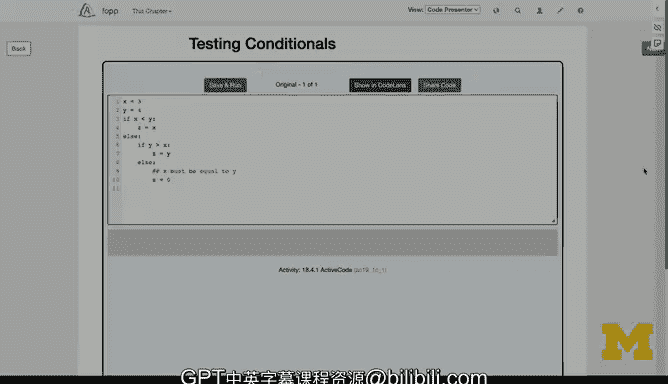
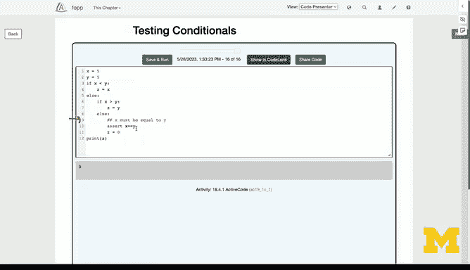

# 密歇根大学《Python3编程》课程1、2｜第63课：条件测试与断言调试 🐍

在本节课中，我们将学习如何在编写条件语句时，通过添加注释和断言来辅助推理和调试，确保代码逻辑的正确性。

---

编写条件语句时，你需要在脑海中推理，当解释器执行到代码的特定位置时，哪些条件必须为真。

有时你的推断是正确的。有时则不然。

推断错误可能是因为你忘记了某些边界情况，或者仅仅是因为代码中存在拼写错误或其他错误。

如果你养成在条件语句的特定位置添加注释的习惯，表达你的假设，这将有助于调试。

这些假设是关于你认为，如果执行流程能到达某个条件分支，就必须满足的约束条件。

例如，在这里。在第9行，我添加了一个小注释。如果 `x` 小于 `y`，执行一种操作。如果发生另一种情况，执行另一种操作。如果这两种情况都不成立，那么 `x` 必须等于 `y`。

所以我添加了那个小注释。但是，一旦你写下了注释，你可能想把它转换成一个 `assert` 断言语句。

这不仅迫使你表达得更精确，而且如果你的假设有误，你会立即收到错误通知。

你将把一个程序会继续执行并产生错误输出的语义错误，转换成一个执行会停止的运行时错误。

这对于调试非常有帮助。如果你知道某个特定假设被违反了，你将能更快地修复程序。

让我们在这个执行中尝试一些不同的 `x` 和 `y` 值。并且，我们将在每次执行结束时打印 `z`。

当 `x` 是 3，`y` 是 4 时，我们得到 `z` 是 3。如果我交换一下，`x` 是 4，`y` 是 3。那么我得到 0。如果我输入 7 和 3，我仍然得到 0。我输入 0 和 3，我得到 0。

然后出现了很多零。也许这应该让我有点担心。

让我们把这个注释翻译成一个断言。我认为当我执行到代码的这个位置时，`x` 必须等于 `y`。我可以带括号或不带括号来写这个断言。`x` 和 `y` 应该是相同的。

现在让我运行这个。当 `x` 等于 0，`y` 等于 3 时没问题。如果 `x` 是 2，`y` 是 3，也没问题。当 `x` 是 4，`y` 是 3 时，我得到了 0。我得到了错误，第 10 行出现断言错误。

这个断言失败了。`x` 和 `y` 不相同。好吧。我给自己写了这个注释，并且添加了这个断言，因为我认为无论何时执行到第 10 行，`x` 都应该等于 `y`。或者至少我原本是这么想的。

`y` 不大于 `x`。`x` 也不大于 `y`。哦，糟糕。我实际上没有检查。这里的两种不同可能性，我没有检查 `x` 是否小于 `y`，以及 `x` 是否大于 `y`。

我可以用 `if y < x:` 或者用 `if x > y:` 来检查。但我之前写的实际上检查的是同一个条件。所以如果我这样做，我现在修复了我的代码。这样我就真正做到了我原本想做的事情。

现在我得到，当 `x` 是 4，`y` 是 3 时，输出是 3。当 `x` 是 2，`y` 是 3 时，输出是 2。

所以 `z` 要么等于 `x`，要么等于 `y`，我们将永远不会再遇到断言语句失败的问题。在我修复代码之后，断言语句似乎总是通过，并且我只在 `x` 和 `y` 相同时得到 `z` 等于 0。

当 `x` 小于 `y` 时，我不会得到 0。当 `x` 大于 `y` 时，我也不会得到 0。但当它们相等时，我得到 0，并且断言总是为真。

只有当 `x` 的值与 `y` 的值相同时，我才会执行到第 10 行。

---

本节课中，我们一起学习了如何利用注释明确条件逻辑的假设，并通过 `assert` 语句将这些假设转化为运行时检查。这是一种强大的调试技术，可以将潜在的逻辑错误（语义错误）提前暴露为明确的运行时错误，从而帮助我们更快地定位和修复问题。记住，清晰的假设和及时的验证是编写健壮代码的关键。

我们下次再见。