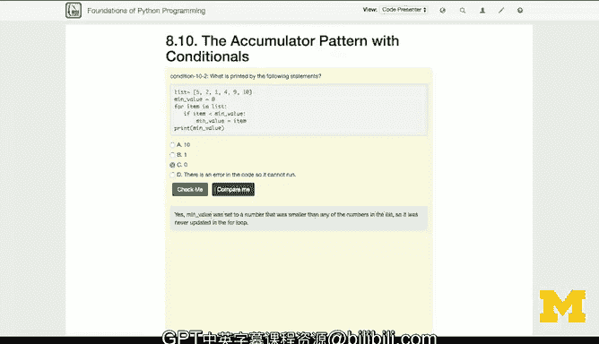

# 64：带条件判断的累加器模式与最大值累积 🧮


在本节课中，我们将要学习如何将累加器模式与条件判断结合使用，以解决更复杂的问题，例如统计特定字符或寻找列表中的最大值。

---

## 概述

上一节我们介绍了基础的累加器模式。本节中我们来看看如何将条件判断融入累加器模式，使其功能更加强大。我们将学习如何统计满足特定条件的元素数量，以及如何在一个序列中寻找最大值。

---

## 带条件判断的累加器模式

基础的累加器模式包含三个主要步骤：
1.  初始化一个累加器变量。
2.  遍历相关序列。
3.  在遍历过程中更新累加器变量。

当结合条件判断时，我们只在序列中的元素满足特定条件时才更新累加器。

### 示例1：统计非空格字符

假设我们有一个字符串，并想统计其中非空格字符的数量。

以下是实现此功能的步骤：

```python
phrase = "Python 3 Programming"
total = 0  # 步骤1：初始化累加器
for character in phrase:  # 步骤2：遍历序列
    if character != " ":  # 条件判断：检查字符是否为空格
        total = total + 1  # 步骤3：更新累加器
print(total)  # 输出结果
```

在这段代码中，`total` 变量仅在当前字符不是空格时才增加。最终，`total` 的值就是非空格字符的数量。

### 示例2：统计元音字母数量

现在，假设我们想统计一个字符串中元音字母（A, E, I, O, U）的数量。

以下是解决此问题的方法：

```python
s = "Hello, World!"
x = 0  # 初始化累加器
for i in s:  # 遍历字符串
    if i in ["A", "E", "I", "O", "U", "a", "e", "i", "o", "u"]:  # 条件判断：检查是否为元音
        x = x + 1  # 更新累加器
print(x)  # 输出元音数量
```

这段代码遍历字符串 `s` 中的每个字符，如果字符是元音字母，就将累加器 `x` 的值加1。

---

## 最大值累积模式

另一个结合条件判断的常见模式是**最大值累积**。这种模式用于寻找一个序列中的最大值。

### 寻找列表中的最大值

假设我们有一个数字列表，并想找出其中最大的数字。

以下是实现最大值累积的步骤：

```python
nums = [9, 3, 8, 11, 5, 29, 2]
best_num = nums[0]  # 步骤1：初始化累加器为列表的第一个元素
for n in nums:  # 步骤2：遍历列表
    if n > best_num:  # 条件判断：检查当前数字是否大于已知最大值
        best_num = n  # 步骤3：如果是，则更新最大值
print(best_num)  # 输出最大值
```

**执行过程模拟：**
1.  `best_num` 初始化为 `9`（列表第一个元素）。
2.  遍历列表：
    *   `n=9`：`9 > 9` 为假，不更新。
    *   `n=3`：`3 > 9` 为假，不更新。
    *   `n=8`：`8 > 9` 为假，不更新。
    *   `n=11`：`11 > 9` 为真，`best_num` 更新为 `11`。
    *   `n=5`：`5 > 11` 为假，不更新。
    *   `n=29`：`29 > 11` 为真，`best_num` 更新为 `29`。
    *   `n=2`：`2 > 29` 为假，不更新。
3.  循环结束，`best_num` 的值为 `29`，即列表中的最大值。

这个模式的核心思想是：始终记录当前遇到的最大值，并在遍历过程中不断用更大的值更新它。

---

## 练习与思考

为了巩固理解，让我们分析两个小练习。

### 练习1：字符统计

以下代码会输出什么？

```python
s = "we are learning"
x = 0
for i in s:
    if i in "abcde":
        x = x + 1
print(x)
```

**解答：**
这段代码统计字符串 `s` 中属于字母 `a, b, c, d, e` 的字符数量。在字符串 `"we are learning"` 中，这些字母出现了5次（注意：代码区分大小写）。因此，输出结果是 **5**。

### 练习2：最小值查找（有缺陷的代码）

以下代码试图找出列表中的最小值，但它有一个缺陷。它会输出什么？

```python
min_value = 0
lst = [5, 4, 3, 2, 1]
for item in lst:
    if item < min_value:
        min_value = item
print(min_value)
```

**解答：**
代码将 `min_value` 初始化为 `0`。然后遍历列表，但列表 `[5, 4, 3, 2, 1]` 中没有任何一个元素小于 `0`。因此，`if` 语句内的代码永远不会执行，`min_value` 始终保持为 `0`。最终输出是 **0**，但这显然不是列表的最小值。

**正确的做法**应该是将 `min_value` 初始化为列表的第一个元素：`min_value = lst[0]`，然后将条件判断改为寻找更小的值。

---

## 总结

本节课中我们一起学习了如何将条件判断与累加器模式结合使用。
*   我们首先回顾了基础累加器模式的三步框架。
*   然后，我们通过统计非空格字符和元音字母的例子，学习了如何在更新累加器前加入条件判断。
*   接着，我们深入探讨了**最大值累积**这一特定模式，学习了如何通过遍历和比较来寻找序列中的最大值。
*   最后，通过两个练习，我们实践了如何分析带有条件判断的累加器代码。



正如我们所看到的，条件判断的加入让累加器模式变得更加灵活和强大，能够解决更多样化的数据处理问题。