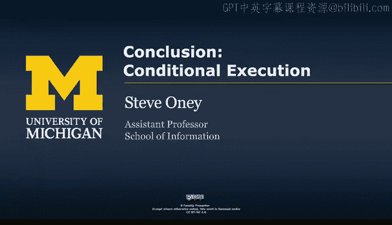

# 65：条件执行总结 🎯

在本节课中，我们将要学习条件执行的核心概念。条件执行是编程中的基础，它允许程序根据特定条件决定是否执行某段代码。掌握这一概念能极大地提升你编写程序的能力。

---


## 概述 📋

条件执行是编程语言中控制程序流程的核心机制。它允许我们编写仅在满足特定条件时才运行的代码。这种能力使得程序能够根据不同的输入或状态做出决策，从而实现更复杂、更智能的功能。



## 条件执行的基本原理

上一节我们介绍了编程的基本概念，本节中我们来看看条件执行的具体实现。在Python中，条件执行主要通过 `if` 语句来实现。其基本思想是：**如果某个条件为真（True），则执行其下方缩进的代码块；如果为假（False），则跳过该代码块。**

其核心结构可以用以下代码描述：

```python
if condition:
    # 当条件为真时执行的代码
```

这里的 `condition` 是一个表达式，其计算结果必须是布尔值（`True` 或 `False`）。

## 条件执行的关键组件

以下是构建条件语句时涉及的几个关键部分：

1.  **比较运算符**：用于比较两个值，并返回布尔值。
    *   `==` （等于）
    *   `!=` （不等于）
    *   `>` （大于）
    *   `<` （小于）
    *   `>=` （大于等于）
    *   `<=` （小于等于）

2.  **逻辑运算符**：用于组合多个条件。
    *   `and` （逻辑与）：所有条件都为真时，结果为真。
    *   `or` （逻辑或）：至少一个条件为真时，结果为真。
    *   `not` （逻辑非）：反转布尔值。

3.  **`else` 子句**：用于指定当 `if` 条件为假时要执行的代码块。
    ```python
    if condition:
        # 条件为真时执行
    else:
        # 条件为假时执行
    ```

4.  **`elif` 子句**：用于检查多个条件，是“else if”的缩写。
    ```python
    if condition1:
        # 条件1为真时执行
    elif condition2:
        # 条件1为假且条件2为真时执行
    else:
        # 所有条件都为假时执行
    ```

## 条件执行的重要性

条件执行在Python以及几乎所有编程语言中都至关重要。理解它能够显著提升你通过代码表达逻辑的能力。它使程序从简单的顺序执行，转变为能够根据不同情境做出判断和选择的智能流程。

## 一个经典的程序员笑话

更重要的是，现在你理解了条件执行，你将能看懂下面这个笑话：

> 一个程序员要去杂货店，他的室友告诉他：“买一加仑牛奶，如果他们有鸡蛋，就买一打。”
> 结果程序员带着13加仑牛奶回来了。

（笑话解析：程序员将室友的指令理解为：1. 买一加仑牛奶。2. 如果（商店）有鸡蛋，那么（就）买一打（加仑牛奶）。这错误地应用了条件执行的逻辑范围。）

---

## 总结 🏁

本节课中我们一起学习了条件执行。我们了解了如何使用 `if`、`elif` 和 `else` 语句来让程序根据条件做出决策，认识了比较运算符和逻辑运算符，并通过一个笑话看到了对条件逻辑的误解可能带来的有趣结果。这是你编程之旅中构建更复杂程序的关键一步。