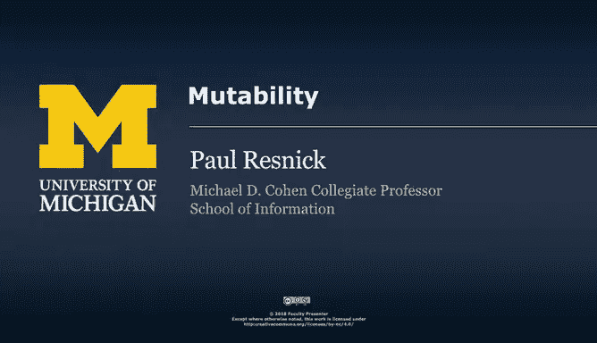
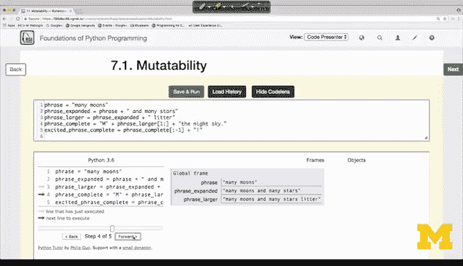

# 密歇根大学《Python3编程》课程1、2｜第67课：可变性概念 🧬




在本节课中，我们将要学习Python中一个核心概念：**可变性**。我们将探讨列表和字符串在可变性上的根本区别，并学习如何修改列表以及如何通过创建新字符串来“改变”字符串。

---

## 列表是可变的

列表是**可变**的。这意味着你可以改变列表的内容。你可以在任何位置重新赋值，将其内容替换为不同的值。

以下是修改列表元素的步骤：

1.  创建一个包含三个元素的列表 `fruit`。
2.  通过索引 `fruit[0]` 访问第一个元素。
3.  使用赋值语句 `fruit[0] = ‘pear’` 将第一个元素的值从 `‘banana’` 替换为 `‘pear’`。
4.  同样，可以使用负索引 `fruit[-1] = ‘orange’` 来替换最后一个元素。

**代码示例：**
```python
fruit = [‘banana‘, ’apple‘, ’cherry‘]
print(fruit)  # 输出: [‘banana‘, ’apple‘, ’cherry‘]
fruit[0] = ‘pear‘
fruit[-1] = ‘orange‘
print(fruit)  # 输出: [‘pear‘, ’apple‘, ’orange‘]
```

---

## 使用切片替换列表元素

上一节我们介绍了如何替换单个列表元素，本节中我们来看看如何使用切片来替换一个子序列。

切片不仅可以用于读取列表的一部分，还可以用于替换该部分。替换时，新序列的长度可以与原切片长度不同。

以下是使用切片替换列表元素的步骤：

1.  创建一个列表 `a_list`。
2.  使用切片 `a_list[1:3]` 选择索引1到2（不包括3）的子序列。
3.  通过赋值 `a_list[1:3] = [‘x‘, ’y‘]` 将该子序列替换为新的列表 `[‘x‘, ’y‘]`。

**代码示例：**
```python
a_list = [‘A‘, ’B‘, ’C‘, ’D‘, ’E‘, ’F‘]
a_list[1:3] = [‘x‘, ’y‘]
print(a_list)  # 输出: [‘A‘, ’x‘, ’y‘, ’D‘, ’E‘, ’F‘]
```

---

## 使用空列表删除元素

我们还可以利用切片赋值的特性来删除列表中的元素。方法是将一个切片替换为一个空列表 `[]`。

以下是删除列表元素的步骤：

1.  创建一个列表 `a_list`。
2.  使用切片 `a_list[1:3]` 选择要删除的元素范围。
3.  通过赋值 `a_list[1:3] = []` 将该切片替换为空列表，从而删除这些元素。

**代码示例：**
```python
a_list = [‘A‘, ’B‘, ’C‘, ’D‘, ’E‘, ’F‘]
a_list[1:3] = []
print(a_list)  # 输出: [‘A‘, ’D‘, ’E‘, ’F‘]
```

---

## 字符串是不可变的

与列表不同，字符串是**不可变**的。这意味着你不能直接修改字符串中的某个字符。尝试这样做会导致 `TypeError`。

**错误示例：**
```python
greeting = ‘Hello world‘
greeting[0] = ‘J‘  # 这行代码会引发错误：TypeError: ‘str‘ object does not support item assignment
```

---

## 如何“改变”字符串

既然字符串不可变，我们如何实现类似“将’Hello world‘改为’Jello world‘”这样的操作呢？答案是：创建一个新的字符串。

我们可以通过**切片**和**字符串拼接**来组合出一个新的字符串。

以下是创建新字符串的步骤：

1.  从原字符串 `greeting` 中提取从索引1开始到结尾的子串：`greeting[1:]`，得到 `‘ello world‘`。
2.  将新字母 `‘J‘` 与这个子串拼接起来，形成新字符串 `‘J‘ + greeting[1:]`。
3.  将这个新字符串赋值给一个新变量，例如 `new_greeting`。

**代码示例：**
```python
greeting = ‘Hello world‘
new_greeting = ‘J‘ + greeting[1:]
print(greeting)      # 输出: Hello world (原字符串未变)
print(new_greeting)  # 输出: Jello world (新字符串)
```

---

## 通过拼接构建更长的字符串

在实际编程中，我们经常需要将多个较短的字符串片段组合成一个更长的字符串。这通过连续的**字符串拼接**操作来实现。

以下是构建更长字符串的步骤：

1.  从一个基础字符串开始，例如 `phrase = ‘many moons‘`。
2.  通过拼接添加更多内容，创建新变量，例如 `phrase_expanded = phrase + ‘ ago‘`。
3.  可以继续拼接，创建更长的字符串，例如 `phrase_larger = phrase_expanded + ‘ in a galaxy far far away‘`。
4.  注意，每次拼接都创建了一个**新的字符串对象**，原始的变量值保持不变。

**代码示例：**
```python
phrase = ‘many moons‘
phrase_expanded = phrase + ‘ ago‘
phrase_larger = phrase_expanded + ‘ in a galaxy far far away‘
print(phrase)           # 输出: many moons
print(phrase_expanded)  # 输出: many moons ago
print(phrase_larger)    # 输出: many moons ago in a galaxy far far away
```

---



## 总结

本节课中我们一起学习了Python中**可变性**的核心概念。我们了解到：
*   **列表是可变的**，可以通过索引赋值 (`list[index] = new_value`) 或切片赋值 (`list[start:end] = new_list`) 来直接修改其内容，甚至删除元素。
*   **字符串是不可变的**，无法直接修改其中的字符。任何“修改”操作实际上都是通过**切片**和**拼接**创建了一个全新的字符串对象。
理解可变与不可变的区别，是掌握Python数据操作和避免常见错误的关键。