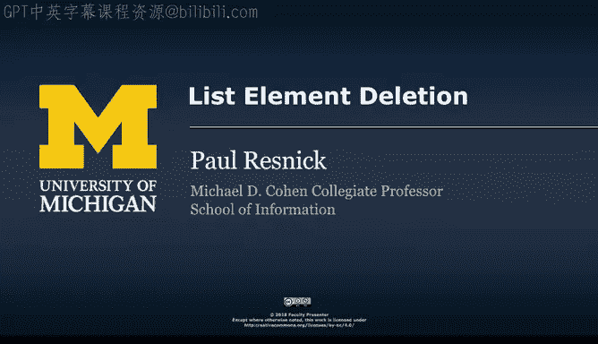
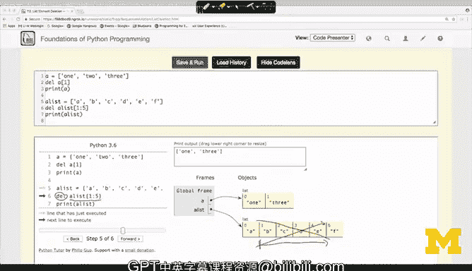

# Python 3 编程（课程1、2）｜第68课：使用 `del` 操作符删除列表元素 🗑️

在本节课中，我们将学习如何使用 Python 的 `del` 操作符来删除列表中的元素。我们将了解其基本用法，以及如何用它删除单个或多个连续的元素。


---



## 概述：为什么需要 `del` 操作符

上一节我们介绍了列表的基本操作。本节中我们来看看如何从列表中移除元素。使用切片（Slicing）来删除列表中的元素既笨拙又容易出错。因此，Python 提供了一个特殊的操作符来完成这个任务，它就是 `del` 操作符。

`del` 操作符允许我们根据索引位置直接删除列表中的元素，操作更直观，代码更简洁。

---

## 删除单个列表元素

以下是 `del` 操作符删除单个元素的基本语法。

```python
# 创建一个列表
a = [1, 2, 3]
# 使用 del 删除索引为 1 的元素（即第二个元素，值为 2）
del a[1]
```

在这段代码中，我们首先创建了一个名为 `a` 的列表，其中包含三个元素：`1`、`2` 和 `3`。然后，我们调用 `del` 操作符来删除索引为 `1` 的元素。

让我们逐步分析这个过程：
1.  列表初始状态为 `[1, 2, 3]`。
2.  索引 `a[1]` 指向列表中的第二个元素，即值 `2`。
3.  执行 `del a[1]` 后，该元素被移除。
4.  原来位于索引 `2` 的元素 `3` 会向前移动，占据索引 `1` 的位置。
5.  最终，列表 `a` 变为 `[1, 3]`。

---

## 删除多个连续列表元素

`del` 操作符不仅可以删除单个元素，还可以删除一个连续的元素序列（即一个切片）。

以下是删除多个连续元素的语法。

```python
# 创建一个列表
letters = ['A', 'B', 'C', 'D', 'E', 'F']
# 使用 del 删除索引从 1 到 5（不包括5）的元素
del letters[1:5]
```

在这段代码中：
1.  列表 `letters` 初始为 `['A', 'B', 'C', 'D', 'E', 'F']`。
2.  切片 `letters[1:5]` 指的是从索引 `1` 开始，到索引 `5` 之前结束的所有元素，即 `['B', 'C', 'D', 'E']`。
3.  执行 `del letters[1:5]` 后，这些元素被一次性删除。
4.  最终，列表 `letters` 只剩下 `['A', 'F']` 两个元素。

---

## 总结



本节课中我们一起学习了 `del` 操作符的用法。我们了解到，相比于手动切片，`del` 是删除列表元素的更佳选择。我们掌握了如何使用 `del a[index]` 删除单个元素，以及如何使用 `del a[start:end]` 删除一个连续的元素范围。正确使用 `del` 操作符可以让列表管理变得更加高效和清晰。