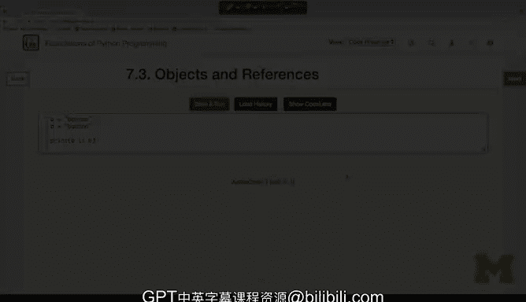
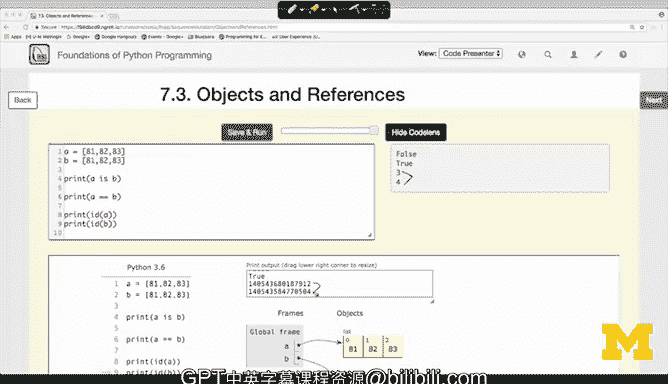

# 密歇根大学《Python3编程》课程1、2｜第69课：对象与引用 🧠




在本节课中，我们将要学习Python中一个核心概念：**对象与引用**。我们将探讨变量如何指向内存中的对象，以及如何区分两个变量是引用了“同一个对象”还是“值相等的不同对象”。理解这一点对于掌握Python的数据模型和避免程序中的潜在错误至关重要。

---

## 不可变对象与引用 🔒

上一节我们介绍了变量与对象的基本关系，本节中我们来看看当多个变量指向同一个**不可变对象**时会发生什么。

例如，我们有两个变量 `a` 和 `b`，它们都指向字符串 `"banana"`。Python解释器会识别出这是同一个字符串，并让 `a` 和 `b` 都指向内存中的同一个对象。

为了检查两个变量是否指向内存中的**同一个对象**，我们可以使用 `is` 运算符。

```python
a = "banana"
b = "banana"
print(a is b)  # 输出：True
```

`is` 运算符检查 `a` 和 `b` 是否为同一个对象的别名。对于这个不可变字符串的例子，结果为 `True`。

---

## 可变对象与引用 🔄

当我们开始处理列表和其他**可变对象**时，情况会变得稍微复杂一些。

假设我们有两个变量 `a` 和 `b`，它们各自被绑定到值相等的列表上。但关键在于，它们可能指向**两个不同的列表对象**，尽管列表的内容相同。

让我们通过代码来观察这一点：

```python
a = [81, 82, 83]
b = [81, 82, 83]
print(a is b)      # 输出：False
print(a == b)      # 输出：True
```

以下是关键区别：
*   `==` 运算符检查两个变量所绑定的对象**值是否相等**。
*   `is` 运算符检查两个变量是否是**完全同一个对象**的别名。

在这个例子中，`a` 和 `b` 的值相等（`==` 为 `True`），但它们不是同一个对象（`is` 为 `False`）。

---

## 理解对象ID 🆔

每个对象在内存中都有一个唯一的标识符（ID），我们可以使用 `id()` 函数来查看它。

```python
a = [81, 82, 83]
b = [81, 82, 83]
print(id(a))
print(id(b))
# 输出两个不同的长数字（ID）
```

运行环境（例如在浏览器中或远程服务器上）可能会影响ID的具体数值，但核心结论不变：**如果两个变量的ID不同，它们就指向不同的对象**。

---

## 核心概念总结 📝

本节课中我们一起学习了Python中对象与引用的关键知识：

1.  **变量是对象的引用**：变量名本身不“存储”值，而是指向内存中存储值的对象。
2.  **`is` 与 `==` 的区别**：
    *   `a == b` 检查 **值相等性**。
    *   `a is b` 检查 **对象同一性**（是否是同一个内存对象）。
3.  **不可变 vs 可变对象**：对于字符串等不可变对象，Python可能会优化内存，让多个引用指向同一个对象。对于列表等可变对象，即使值相同，每次创建通常都会生成新对象。
4.  **`id()` 函数**：用于获取对象的唯一内存标识符，是判断对象同一性的底层方法。




理解这些概念对于调试程序、理解参数传递以及高效管理内存都非常有帮助。虽然你平时可能不会频繁使用 `is` 运算符或 `id()` 函数，但它们是理解Python运行机制的重要工具。