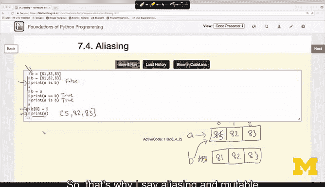
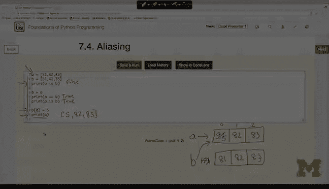

# 密歇根大学《Python3编程》课程1-2 | 第70课：理解Python中的别名现象 🔄

在本节课中，我们将要学习Python中一个重要的概念——**别名现象**。我们将探讨当两个变量指向同一个对象时会发生什么，以及为什么这可能导致代码行为变得难以预测。


---


## 为什么区分“相同对象”与“等价对象”很重要？ 🤔

你可能会疑惑，为什么我们要如此强调变量A和B是**指向同一个对象**，还是指向**两个等价但不同的对象**。

答案是，当它们互为别名，即指向同一个对象时，情况会变得相当令人困惑。因为当你改变其中一个对象时，另一个对象也会随之改变。

让我们来看看这是如何发生的。

---

## 实验：观察别名现象

以下是演示别名现象的关键步骤。

**步骤1：创建两个等价但不同的列表**

首先，我们将变量 `a` 绑定到列表 `[81, 82, 83]`。同时，变量 `b` 被绑定到一个内容等价但完全不同的新列表。

```python
a = [81, 82, 83]
b = [81, 82, 83]
```

此时，`a` 和 `b` 的值相等，但它们是内存中两个独立的对象。

**步骤2：检查对象身份**

使用 `is` 运算符可以检查两个变量是否指向同一个对象。

```python
print(a is b)  # 输出：False
```

输出结果为 `False`，这证实了 `a` 和 `b` 是两个不同的列表对象。

**步骤3：创建别名**

现在，我们让 `b` 成为 `a` 的别名。这意味着我们将 `b` 重新绑定到 `a` 所指向的那个对象上。

```python
b = a
```

执行这行代码后，`a` 和 `b` 不仅值相等，而且它们**指向内存中完全相同的列表对象**。此时 `a is b` 的结果将变为 `True`。

**步骤4：通过别名修改对象**

接下来，我们通过变量 `b` 来修改这个共享的列表对象。我们将列表的第一个元素（索引0）改为5。

```python
b[0] = 5
```

**步骤5：观察连锁反应**

最后，我们打印变量 `a` 的值。

```python
print(a)  # 输出：[5, 82, 83]
```

你会发现，尽管我们从未直接对变量 `a` 进行赋值操作，但 `a` 所指向的列表内容却改变了。这是因为 `a` 和 `b` 是同一个对象的两个名字，通过任何一个名字所做的修改，都会反映到另一个名字上。

---

## 为什么别名现象令人困惑？ 🚨

我说这令人困惑的原因是：如果你从上到下阅读这段代码，我们只在一开始设置了 `a = [81, 82, 83]`，之后再也没有对 `a` 进行过任何赋值语句。然而，当我们最后打印 `a` 时，它的值却不同了。

在这段简短的代码中，`a` 和 `b` 靠得很近，我们还能理清发生了什么。但你可以想象在一个庞大得多的程序中，你有一个变量，而在代码的另一个地方，该变量的某个别名导致它所指向的对象被意外修改，而你完全不知道原因何在。

因此，**别名现象与可变对象**的结合，可能会带来一些难以调试的问题。

---

## 总结 📝

本节课中我们一起学习了Python中的**别名现象**。我们了解到：



1.  **`is` 与 `==` 的区别**：`is` 检查对象身份（是否同一个），`==` 检查对象值（是否等价）。
2.  **别名的创建**：通过赋值（如 `b = a`）可以使两个变量指向同一个可变对象（如列表、字典）。
3.  **潜在风险**：通过任何一个别名修改可变对象，所有指向该对象的变量都会看到变化，这可能在大型程序中导致意外的副作用。

请务必留意代码中的别名情况，尤其是在处理列表、字典等可变对象时。理解对象在内存中的指向关系，是写出可靠Python代码的关键。



我们下次再见。