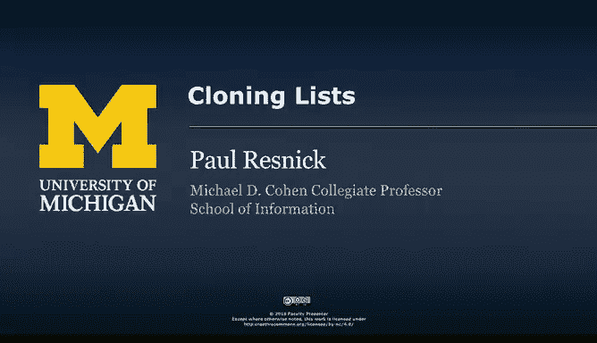
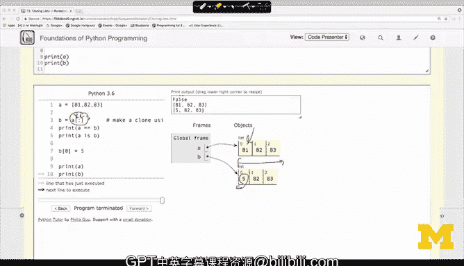

# 71：列表克隆 🧬




在本节课中，我们将要学习如何创建一个列表的克隆（或称副本），而不是一个别名。我们将理解为什么这很重要，并掌握使用切片操作符来实现列表克隆的具体方法。

## 列表克隆的概念

上一节我们介绍了列表别名，本节中我们来看看如何创建列表的独立副本。

假设你希望制作一个列表的克隆，而不是它的别名。你需要另一个变量，它拥有一个与原列表内容相同的新列表，即原列表的副本或克隆。关键是你希望这两个列表相互独立。

## 使用切片操作符进行克隆

以下是创建列表克隆的核心方法。

我们可以使用切片操作符来实现克隆。切片操作符总是从列表中选取一部分元素，并用这些被选取的元素创建一个新列表。

```python
A = [81, 82, 83]
B = A[:]  # 使用切片操作符创建列表A的克隆
```

在这个例子中，切片从列表的开头开始，一直延伸到列表的结尾，因此我们获取了所有三个元素（索引0、1和2）。这些元素被复制到一个新列表中。因此，B现在不是A的别名，而是指向一个具有相同内容的新列表。

## 验证克隆的独立性

让我们通过代码来验证克隆列表的独立性。

如果我们执行 `print(A == B)`，结果为 `True`，因为它们的内容是等价的。但 `A is B` 的结果是 `False`，这证明它们指向内存中两个不同的列表对象。

现在，如果我们改变B的第一个元素：
```python
B[0] = 5
```
与之前别名的情况不同，当B[0]被设置为5时，只有B会受到影响。A列表中的81依然保持不变。打印A会得到原始列表 `[81, 82, 83]`，而B则变为 `[5, 82, 83]`。

B最初是A的一个内容相同的克隆，此后它们变得相互独立。对B的修改不会对A产生任何影响。

## 总结

本节课中我们一起学习了列表克隆。



我们了解到，通过使用切片操作符 `A[:]`，可以创建一个原列表的完整克隆。如果不指定切片的开始或结束索引，则会获取整个列表，从而得到列表的一个克隆或副本。这确保了新旧列表是两个独立的对象，对一个列表的修改不会影响另一个。