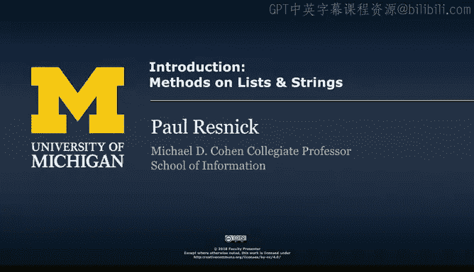

# 73：列表与字符串方法导论 📚

在本节课中，我们将要学习一系列关于列表和字符串的实用方法。课程结束时，你将能够使用列表的多种方法（如`append`、`insert`、`reverse`、`sort`、`remove`、`pop`）以及一些非破坏性方法（如`index`和`count`）来读写代码。对于字符串，你将掌握`upper`、`lower`、`count`、`index`、`strip`和`replace`等方法。最重要的是，你将学会区分一个方法是会改变（变异）原对象，还是会创建一个修改后的副本。

## 方法概述与核心概念 🔍

上一节我们介绍了课程目标，本节中我们来看看方法的核心概念。在Python中，方法是与特定数据类型关联的函数。对于列表和字符串，有些方法会直接修改原对象，这被称为“变异”；而有些方法则返回一个新的、修改后的对象，原对象保持不变。


理解这一点至关重要：**元组和字符串的方法永远不会改变它们本身，只会创建修改后的副本**。而列表的某些操作，比如我们之前学过的赋值和删除，以及本节课将介绍的新方法，则会改变列表本身。

以下是本节课将涉及的会改变列表的方法：
*   `append`
*   `insert`
*   `reverse`
*   `sort`
*   `remove`
*   `pop`



## 列表的变异方法 📝

上一节我们了解了方法是否会变异的概念，本节中我们来看看列表的具体变异方法。这些方法会直接修改调用它们的列表。

以下是列表变异方法的示例：

```python
# 创建一个示例列表
my_list = [1, 2, 3]

# append: 在列表末尾添加一个元素
my_list.append(4)
print(my_list)  # 输出: [1, 2, 3, 4]

# insert: 在指定位置插入一个元素
my_list.insert(1, 'a')
print(my_list)  # 输出: [1, 'a', 2, 3, 4]

# reverse: 反转列表元素的顺序
my_list.reverse()
print(my_list)  # 输出: [4, 3, 2, 'a', 1]

# sort: 对列表进行排序（要求元素类型可比较）
# 注意：当前列表包含字符串和整数，无法直接排序，我们先处理一个纯数字列表
num_list = [3, 1, 4, 1, 5]
num_list.sort()
print(num_list)  # 输出: [1, 1, 3, 4, 5]

# remove: 移除列表中第一个匹配的元素
my_list.remove('a')
print(my_list)  # 输出: [4, 3, 2, 1]

# pop: 移除并返回指定索引处的元素（默认为最后一个）
popped_item = my_list.pop(0)
print(popped_item)  # 输出: 4
print(my_list)      # 输出: [3, 2, 1]
```

## 列表的非破坏性方法 🔄

上一节我们学习了会改变列表的方法，本节中我们来看看列表的非破坏性方法。这些方法不会修改原列表，而是返回一个新的值或信息。

以下是列表的非破坏性方法：

*   **`index`**: 返回指定元素在列表中首次出现的索引。公式可表示为 **`list.index(element)`** 返回 `i`，其中 `list[i] == element`。
*   **`count`**: 返回指定元素在列表中出现的次数。公式可表示为 **`list.count(element)`** 返回 `n`，其中 `n` 是 `element` 在 `list` 中出现的总次数。

```python
my_list = ['apple', 'banana', 'cherry', 'apple', 'date']

# index 方法
index_of_banana = my_list.index('banana')
print(index_of_banana)  # 输出: 1

# count 方法
count_of_apple = my_list.count('apple')
print(count_of_apple)   # 输出: 2
```

## 字符串方法 🧵

上一节我们介绍了列表的方法，本节中我们来看看字符串的常用方法。与元组类似，字符串也是不可变的，因此所有字符串方法都不会改变原字符串，而是返回一个新的字符串。

以下是字符串方法的示例：

```python
my_string = "  Hello, World!  "

# upper: 将字符串转换为大写
print(my_string.upper())        # 输出: "  HELLO, WORLD!  "

# lower: 将字符串转换为小写
print(my_string.lower())        # 输出: "  hello, world!  "

# strip: 移除字符串首尾的空白字符（包括空格、换行符等）
print(my_string.strip())        # 输出: "Hello, World!"

# replace: 替换字符串中的子串
new_string = my_string.replace("World", "Python")
print(new_string)               # 输出: "  Hello, Python!  "

# count: 计算子串在字符串中出现的次数
print(my_string.count('l'))     # 输出: 3 (统计 'l' 出现的次数)

# index: 返回子串首次出现的索引（如果找不到会引发错误）
stripped = my_string.strip()
print(stripped.index('World'))  # 输出: 7
```

## 扩展列表的两种方式 ➕

上一节我们学习了字符串方法，本节中我们来看看如何扩展一个列表。你可以使用变异方法 `append` 逐个添加元素，也可以使用拼接运算符 `+` 来连接两个列表，后者会创建一个新列表。

```python
# 方法一：使用 append (变异原列表)
list1 = [1, 2, 3]
list1.append(4)
print(list1)  # 输出: [1, 2, 3, 4]

# 方法二：使用 + 拼接 (创建新列表)
list2 = [1, 2, 3]
new_list = list2 + [4]
print(list2)     # 输出: [1, 2, 3] (原列表未改变)
print(new_list)  # 输出: [1, 2, 3, 4] (新列表)
```


## 总结 🎯

本节课中我们一起学习了Python中列表和字符串的核心方法。我们明确了关键区别：列表的某些方法（如`append`、`sort`）会改变原对象，而字符串和元组的所有方法以及列表的`index`、`count`等方法则不会。我们还学习了如何使用`append`或拼接操作来扩展列表。掌握这些方法及其行为差异，对于编写正确、高效的Python代码至关重要。