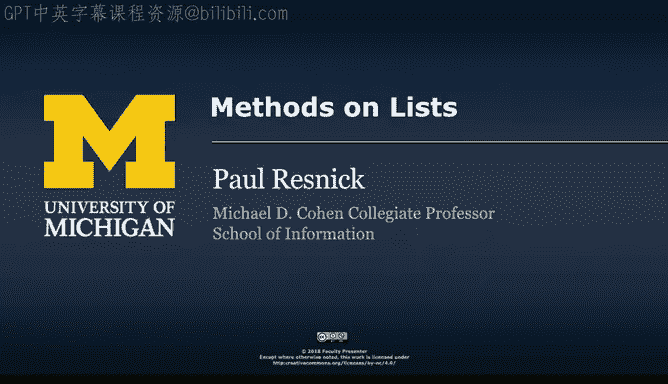
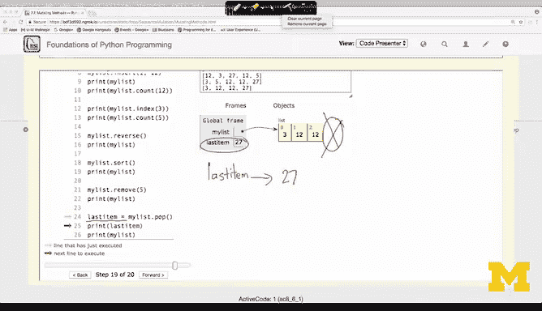

# 课程1：Python列表方法详解 📚




在本节课中，我们将学习Python列表的各种操作方法。列表是Python中非常灵活和强大的数据结构，掌握其内置方法对于高效编程至关重要。我们将通过具体的代码示例，逐一讲解这些方法如何工作，以及它们如何改变列表或返回特定值。

---

## 创建列表与添加元素

上一节我们介绍了列表的基本概念，本节中我们来看看如何创建列表并向其中添加元素。

首先，我们创建一个空列表。

```python
my_list = []
```

接下来，我们使用`append`方法向列表末尾添加元素。`append`方法会直接修改原列表。

```python
my_list.append(5)
```

执行后，列表变为`[5]`。我们可以继续添加更多元素。

```python
my_list.append(27)
my_list.append(3)
```

此时，列表内容为`[5, 27, 3]`。变量`my_list`始终指向同一个列表对象，改变的是列表内部的内容。

---

## 在指定位置插入元素

`append`方法总是在末尾添加元素。如果需要在特定位置插入元素，可以使用`insert`方法。

以下是`insert`方法的使用示例。

```python
my_list.insert(1, 12)
```

这行代码会在索引为1的位置（即第二个位置）插入值`12`。原有元素会向后移动，不会被覆盖。执行后，列表变为`[5, 12, 27, 3]`。

---

## 统计元素出现次数

有时我们需要知道某个值在列表中出现了多少次，这时可以使用`count`方法。

以下是`count`方法的使用示例。

```python
count_of_12 = my_list.count(12)
```

该方法会遍历整个列表，统计值`12`出现的次数。在我们的例子中，结果为`1`。

---

## 查找元素索引

要查找某个值在列表中首次出现的位置，可以使用`index`方法。

以下是`index`方法的使用示例。

```python
position_of_3 = my_list.index(3)
```

该方法会返回值`3`在列表中的索引位置。注意，如果值不存在，程序会引发错误。

---

## 反转列表顺序

`reverse`方法可以将列表中的元素顺序完全颠倒。

以下是`reverse`方法的使用示例。

```python
my_list.reverse()
```

执行后，列表`[5, 12, 27, 3]`会变为`[3, 27, 12, 5]`。此操作直接修改原列表。

---

## 对列表进行排序

`sort`方法可以将列表中的元素按升序重新排列。

以下是`sort`方法的使用示例。

```python
my_list.sort()
```

执行后，列表`[3, 27, 12, 5]`会变为`[3, 5, 12, 27]`。此操作同样直接修改原列表。

---

## 移除列表中的元素

Python提供了几种从列表中移除元素的方法。

以下是几种移除方法的使用示例。

*   **`remove(value)`**：移除列表中第一个匹配到的指定值。
    ```python
    my_list.remove(5)  # 移除第一个出现的5
    ```
*   **`pop()`**：移除列表中的最后一个元素，并返回该元素的值。
    ```python
    last_item = my_list.pop()  # 移除并返回最后一个元素
    ```
*   **`del`语句**：根据索引位置删除元素（这不是一个方法，而是一个语句）。
    ```python
    del my_list[1]  # 删除索引为1的元素
    ```

---

## 总结与回顾

本节课中我们一起学习了Python列表的核心操作方法。

我们重点介绍了以下几类方法：
*   **修改列表的方法**：如`append`、`insert`、`reverse`、`sort`、`remove`和`pop`。这些方法会直接改变原列表的内容。
*   **返回信息的方法**：如`count`和`index`。这些方法不会修改列表，只返回查询结果。
*   **兼具修改与返回值的方法**：如`pop`，它在移除元素的同时返回被移除的值。

其中，`append`方法是最常用和最重要的方法之一，在动态构建列表时会频繁使用。熟练掌握这些方法，能让你更高效地处理和操作数据集合。



我们下次课再见。