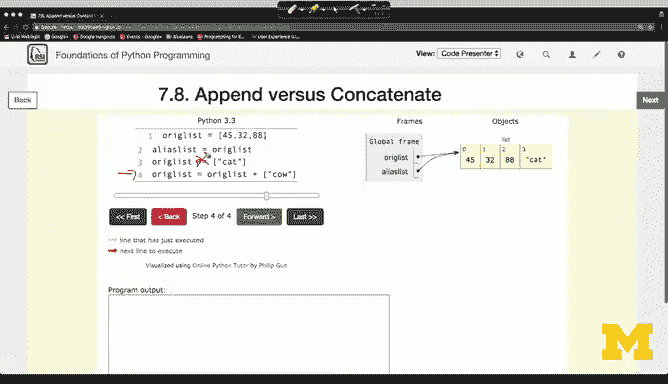

# Python 3 编程（课程1、2）｜第75课：列表的追加与连接对比 📝


在本节课中，我们将要学习向列表末尾添加元素的两种不同方法：`append` 方法和使用 `+` 运算符进行连接。我们将通过对比它们的操作方式和结果，理解两者之间的关键区别，特别是关于列表可变性以及变量引用的概念。

---

## 两种添加元素的方法

向列表末尾添加元素主要有两种方式。

以下是这两种方法的基本介绍：

1.  **`append` 方法**：此方法直接在**原列表**的末尾添加一个新元素，会修改原列表。
2.  **连接（Concatenation）**：使用 `+` 运算符将两个列表合并，**生成一个新列表**，原列表保持不变。

---

## 方法一：使用 `append`

上一节我们介绍了两种方法的基本概念，本节中我们来看看第一种方法 `append` 的具体操作。

`append` 方法会修改调用它的原始列表。其语法如下：

```python
列表变量.append(要添加的元素)
```

让我们通过一个例子来观察：

```python
orange_list = [45, 32, 88]  # 创建一个包含三个元素的列表
orange_list.append("cat")    # 使用 append 方法在列表末尾添加 “cat”
print(orange_list)           # 输出：[45, 32, 88, 'cat']
```

在这个例子中，`orange_list` 这个变量始终指向同一个列表对象。`append("cat")` 操作直接在这个原始列表的末尾添加了字符串 `"cat"`。

---

## 方法二：使用连接（`+`）

理解了 `append` 会修改原列表后，本节我们来看看使用 `+` 运算符进行连接有何不同。

连接操作使用 `+` 运算符将两个列表合并，并**返回一个新的列表**，而不会改变原来的列表。其基本形式是：

```python
新列表 = 列表A + 列表B
```

以下是使用连接的例子：

```python
orange_list = [45, 32, 88]          # 创建原始列表
orange_list = orange_list + ["cat"] # 连接并重新赋值
print(orange_list)                  # 输出：[45, 32, 88, 'cat']
```

请注意第三行代码：`orange_list + ["cat"]` 创建了一个包含四个元素的新列表。然后通过赋值语句 `orange_list = ...`，变量 `orange_list` 被重新绑定到这个新列表上。原来的列表（`[45, 32, 88]`）如果没有其他变量引用它，将会被Python的垃圾回收机制处理。

---

## 关键区别：变量引用与别名

为了更清晰地展示 `append` 和连接的本质区别，我们来看一个涉及变量别名（多个变量指向同一个对象）的例子。

假设我们有两个变量指向同一个列表：

```python
orange_list = [45, 32, 88]  # 原始列表
alias_list = orange_list     # alias_list 是 orange_list 的别名，指向同一个列表
print(id(orange_list), id(alias_list)) # 输出相同的内存标识符

# 使用 append 方法
orange_list.append("cat")
print(orange_list)  # 输出：[45, 32, 88, 'cat']
print(alias_list)   # 输出：[45, 32, 88, 'cat']， alias_list 也看到了变化

# 使用连接操作
orange_list = [45, 32, 88]
alias_list = orange_list
orange_list = orange_list + ["cat"] # 创建新列表并重新赋值给 orange_list
print(orange_list)  # 输出：[45, 32, 88, 'cat']
print(alias_list)   # 输出：[45, 32, 88']， alias_list 仍然指向未改变的旧列表
```

**核心区别在于**：
*   `append` **修改了原始列表对象**，所有指向该对象的变量（别名）都会看到这个变化。
*   连接操作 **创建了一个新的列表对象**，并将变量重新绑定到这个新对象。其他指向旧对象的别名不受影响。

---

## 一个特殊的陷阱：`+=` 运算符

对于数字等不可变类型，`x += 1` 完全等同于 `x = x + 1`。但在处理可变列表时，情况有所不同。

对于列表，`+=` 运算符（如 `list_a += list_b`）的行为更像是 `extend` 方法，它会**就地修改**左侧的列表，而不是创建一个新列表。

以下是 `+=` 带来的影响：

```python
orange_list = [45, 32, 88]
alias_list = orange_list      # 创建别名

orange_list += ["cat"]        # 使用 +=，这会就地修改 orange_list
# 等价于 orange_list.extend(["cat"]) 或 orange_list.append("cat")（对于单个元素）

print(orange_list)  # 输出：[45, 32, 88, 'cat']
print(alias_list)   # 输出：[45, 32, 88, 'cat']！别名也受到了影响
```

因为 `+=` 修改了原始列表对象，所以所有指向它的别名（如 `alias_list`）都会反映出添加了新元素。这与使用 `orange_list = orange_list + ["cat"]` 的效果完全不同。

> **建议**：为了避免混淆，在处理列表时，建议明确使用 `append` 来添加单个元素，或使用 `列表 = 列表 + 新列表` 的形式进行连接，而**尽量避免使用 `+=` 运算符**。

---

## 总结

本节课中我们一起学习了向列表添加元素的两种核心操作：
1.  **`append(item)`**：**原地修改**列表，在末尾添加单个元素。效率高，会影响所有该列表的别名。
2.  **连接 (`listA + listB`)**：**创建新列表**，将两个列表合并。原列表不变，变量需要重新赋值以指向新列表。

我们还揭示了 `+=` 运算符对列表的特殊行为（就地修改），并建议初学者在处理列表时谨慎使用它，以保持代码逻辑清晰。



理解 `append` 与连接的区别，关键在于掌握Python中对象的**可变性**和变量的**引用**概念。这有助于你编写出更可预测、更少副作用的代码。