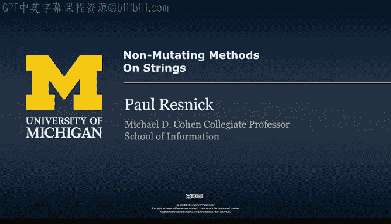
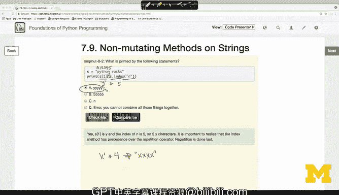

# 76：字符串非变异方法 🧵




在本节课中，我们将要学习字符串的非变异方法。这些方法不会改变原始字符串，而是基于原始字符串生成一个新的字符串。我们将通过具体的例子来理解这些方法的工作原理。

上一节我们介绍了字符串的基本概念，本节中我们来看看字符串上一些非常有用的方法。

## 字符串的非变异特性

首先，请记住，所有这些方法都**不会**改变或“变异”原始字符串。它们只能基于旧字符串生成一个新的字符串。

## 大小写转换：`upper()` 和 `lower()`

我们先来学习 `upper` 和 `lower` 方法。我们通过代码示例来演示。

```python
ss = "Hello World"
```

如果我在 `ss` 上调用 `upper()` 方法，所有字母都会变成大写字母。所以输出结果是 `HELLO WORLD`。但请注意，`ss` 本身并没有改变，它仍然是小写字母。

我也可以调用 `lower()` 方法，这会将大写字母 `H` 和 `W` 变成小写字母。在这个例子中，我将结果赋值给了一个新变量 `tt`。

```python
tt = ss.lower()
```

我可以打印出 `tt`。同样，`ss` 仍然保持其原始值。

## 计数、修剪和替换：`count()`、`strip()` 和 `replace()`

接下来，我将展示 `count`、`strip` 和 `replace` 方法。

在这个例子中，字符串 `" Hello World "` 的开头和结尾都有一些空格。

`count` 方法的工作方式与列表上的 `count` 方法类似。你指定一个参数作为要查找的值。在这个例子中，我们查找字母 `'l'`，它出现了三次。所以 `count` 方法返回值 `3`，我们将其赋值给变量 `els`。

```python
els = ss.count('l')
```

第6行的代码稍微复杂一些。这里，我们将打印一些内容，但我们的变量不会改变。需要理解的是，我们使用了两次 `+` 运算符，所以我们将有三个不同的字符串拼接在一起。中间的部分是调用 `ss` 的 `strip` 方法返回的结果。

`strip` 方法的作用是查看字符串，并移除开头和结尾的任何空白字符，只保留中间的部分。中间的空白字符不会被移除。

```python
print("*" + ss.strip() + "*")
```

在第8行，我们调用了 `replace` 方法。它会查找字符串中所有出现字母 `'o'` 的地方，并用 `***` 替换它们。字符串永远不会被改变，所以我们将获得一个包含这些替换的新字符串，并将其绑定到我们的变量 `news`。

```python
news = ss.replace('o', '***')
```

我们可以看到，`'o'` 被替换成了三个星号。但 `ss` 所绑定的原始字符串仍然保持不变。

## 一个综合练习

与其他页面一样，这里还有更多有用的练习。我想在这里做一个我认为特别有启发性的练习。

这里 `s` 被绑定到字符串 `"Python rocks"`。我们将打印出一个复杂的表达式。你需要习惯将这些大表达式分解成部分来理解。

`*` 运算符：如果我说 `"x" * 4`，那会给我一个字符串 `"xxxx"`。它只是将字符串重复你指定的次数。所以，我们需要确保 `*` 左边的部分解析为某个字符串，右边的部分解析为一个数字。

`s[1]` 是 `'y'`。`s.index('n')` 返回字母 `'n'` 在字符串 `s` 中的位置，即 `5`。所以表达式是 `'y' * 5`。当我们打印它时，会得到不带引号的 `'yyyyy'`。

```python
s = "Python rocks"
print(s[1] * s.index('n'))
```

## 总结

本节课中我们一起学习了字符串的非变异方法。所有字符串方法都是非变异的，它们会保持原始字符串不变，并生成新的字符串。

如果你想持续改变绑定到某个变量的字符串，你需要生成字符串的新版本，并将其重新赋值给同一个变量名。

我们学习的方法包括：
*   `upper()` 和 `lower()`：将字符串全部转换为大写或小写字母。
*   `count()`：计算某个子字符串在较大字符串中出现的次数。
*   `index()`：查找子字符串在字符串中首次出现的位置。
*   `strip()`：移除字符串开头和结尾的所有空白字符。
*   `replace()`：将字符串中所有出现的某个子字符串替换为另一个子字符串。



我们下次再见。