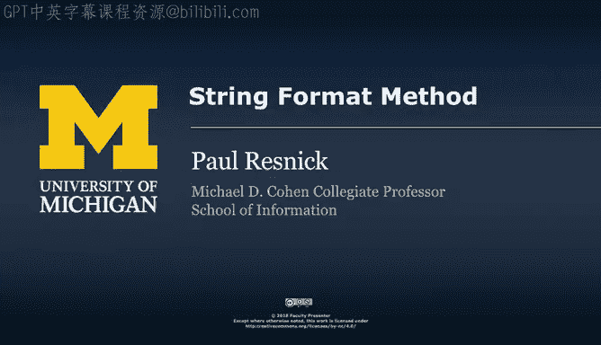
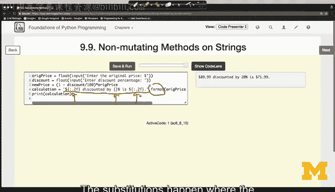

# 密歇根大学《Python3编程（课程1、2）》｜第77课：字符串格式化方法 📝




在本节课中，我们将要学习Python中一个更复杂但非常重要的字符串处理方法——`format`方法。我们将了解如何使用它来创建包含固定文本和可变部分的字符串，并控制数字的显示格式，使代码更清晰、更易读。

---

## 字符串拼接的局限性

上一节我们介绍了字符串的基本操作，本节中我们来看看如何更优雅地组合字符串。

我们可以使用加号（`+`）将字符串拼接在一起，包括一些固定的文本和一些变量部分。

```python
name = "Rodney Dangerfield"
score = -1
message = "Hello, " + name + ". Your score is " + str(score) + "."
print(message)
```

运行这段代码，会输出：`Hello, Rodney Dangerfield. Your score is -1.`。

这种方法存在几个问题：
*   代码可读性较差，难以一眼看出最终输出的样子。
*   需要小心处理标点符号（如句点）和空格。
*   如果变量不是字符串（如这里的`score`是数字），必须先用`str()`函数将其转换为字符串。

为了编写更清晰、更易维护的代码，我们将引入一个新的方法。

---

## 使用 `format` 方法

接下来，我们将学习如何使用`format`方法来替代字符串拼接，使代码更整洁。

我们将用一个更复杂的例子来演示。假设我们有一个包含姓名和分数的元组列表，并需要为每个人打印一条消息。

以下是使用`format`方法改进后的代码：

```python
people = [("Rodney Dangerfield", -1), ("Marlon Brando", 1), ("You", 100)]

for name, score in people:
    message = "Hello, {}. Your score is {}.".format(name, score)
    print(message)
```

我们刚刚用一行更清晰的代码替换了原来的拼接操作。这里有一个被称为**格式字符串**的部分，它包含一些用花括号`{}`标记的占位符，表示这里将进行替换。

格式字符串是一个完整的字符串，你可以通过它大致了解最终输出的结构。花括号`{}`指示了替换发生的位置。我们使用的是**位置参数**，这意味着第一个值将替换第一个花括号，第二个值替换第二个花括号。

具体来说，`"Hello, {}. Your score is {}."`是一个格式字符串。我们调用了它的`.format()`方法，并传入了两个参数值（`name`和`score`）。当代码运行时，第一次循环中，`name`（“Rodney Dangerfield”）和`score`（-1）会被分别替换到第一和第二个花括号中。

运行此代码，会得到与之前拼接方法相同的结果，但代码本身更加易读。在后续课程中，我们将越来越多地使用这种格式字符串，而不是将字符串各部分拼接起来。

我们来总结一下这里的核心概念：
*   **格式字符串**：包含`{}`占位符的字符串。
*   **参数**：传递给`.format()`方法的值。
*   **替换引用**：花括号`{}`指定了参数值被插入的位置。

---

## 控制数字格式

现在，我们来看一个更复杂的例子，学习如何通过给`format`方法一些“提示”来控制数字（特别是小数）的显示格式。

在这个程序中，我们首先要求用户输入商品的原价和折扣百分比，然后计算折后价，最后生成并打印一个包含这些信息的句子。

```python
original_price = float(input("Enter the original price: "))
discount_percent = float(input("Enter the discount percentage: "))
new_price = original_price * (1 - discount_percent / 100)

message = "The price ${:.2f} discounted by {:.0f}% is ${:.2f}.".format(original_price, discount_percent, new_price)
print(message)
```

我们创建的字符串是一个完整的句子，其中包含了原价、折扣和折后价的信息，这些信息将被替换到相应的位置。原价替换到第一个`{}`，折扣百分比替换到第二个，新价格替换到第三个。

这里的新内容是花括号内的`:.2f`。它的含义是：
*   `:` 表示开始格式说明。
*   `.2` 表示小数点后保留两位数字。
*   `f` 表示这是一个浮点数。

如果我们运行这段代码，输入原价`89.99`和折扣`20`，输出将是：`The price $89.99 discounted by 20% is $71.99.`。实际上，89.99打8折的精确结果是71.992，但因为我们指定了两位小数，它被四舍五入为71.99。

如果我们希望显示更多小数位，可以修改格式说明。例如，使用`:.4f`会显示四位小数，结果将是`71.9920`。因此，我们可以通过在花括号内指定格式来控制小数点后的位数。

如果我们完全移除关于小数位数的提示（只写`{}`或`{:f}`），Python将使用其默认精度。例如，它可能会显示三位小数`71.992`。当我们没有给出指令时，Python会使用其内置算法来决定显示方式。如果我们想精确控制输出格式，就需要使用这种格式说明。对于美元和美分，保留两位小数是合乎情理的。

---

## 总结

本节课中我们一起学习了Python的字符串`format`方法。

我们来回顾一下核心要点：一个格式化操作始于一个**格式字符串**，然后我们调用它的`.format()`方法，并传入需要替换的值。替换发生在格式字符串中**花括号 `{}`** 的位置。我们可以使用像`:.2f`这样的**格式说明符**来控制数字的显示方式，例如保留特定的小数位数。



使用`format`方法能让组合字符串的代码更清晰、更易读，也更容易维护，是处理复杂字符串输出的推荐方式。