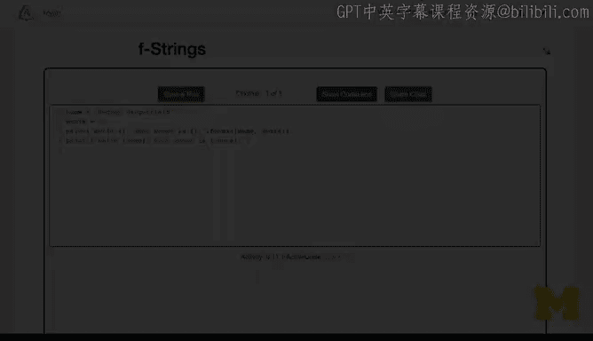
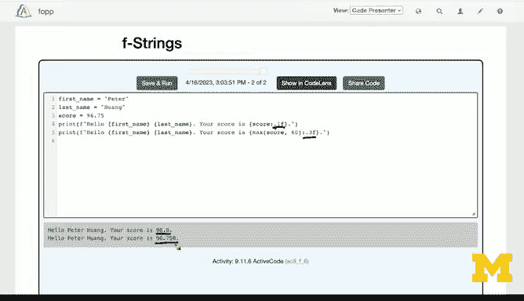

# 课程1：Python 3编程 | 第78讲：F字符串格式化 🧵




在本节课中，我们将要学习Python 3.6版本引入的一种更便捷的字符串格式化方法——F字符串。我们将了解它的基本语法、优势，以及如何用它来创建清晰易读的字符串。

## 概述：什么是F字符串？

从Python 3.6版本开始，出现了一种更简单的方法来创建复杂的字符串，称为F字符串。

在之前的视频中，我们学习了 `.format()` 方法。它使用花括号 `{}` 来指示一个需要被替换的位置，而实际替换的值则作为参数传递给 `.format()` 方法。例如，我们需要将 `name` 和 `score` 与对应的花括号位置关联起来。

## F字符串的基本语法

与 `.format()` 方法不同，使用F字符串时，你可以将Python表达式直接放在字符串内部的花括号中。

以下是F字符串的声明方式：在字符串的引号前加上字母 `f`。这个 `f` 告诉Python解释器，这是一个可能包含替换内容的F字符串。

```python
# 使用 .format() 方法
message = "{} scored {}".format(name, score)

# 使用 F 字符串
message = f"{name} scored {score}"
```

上面两行代码（第3行和第4行）的功能完全相同。运行它们会产生完全相同的输出。

## 在花括号中使用表达式

在F字符串的花括号中，你不仅可以放入变量名，还可以放入任何有效的Python表达式。

让我们看一些例子。

以下代码在花括号中直接放入了一个字符串字面量和一个数字，这同样可以正常工作。

```python
print(f"Hello, {'Alice'}! You have {5} new messages.")
```

这里，花括号内是一个更复杂的表达式——两个字符串的连接。

```python
first_name = "Peter"
last_name = "Wong"
print(f"Full name: {first_name + ' ' + last_name}")
```

虽然技术上可行，但我不建议在花括号内放入过于复杂的表达式。F字符串的目的是让代码更易读，过于复杂的表达式会降低可读性。更好的做法是使用变量，或者将复杂逻辑提前计算好。

## 包含函数和方法调用

花括号内的表达式也可以包含函数或方法调用。

例如，这里我们调用了内置的 `min` 函数，它会返回分数和60中较小的那个值。

```python
score = 85
print(f"Adjusted score: {min(score, 60)}")
```

从代码风格上讲，在F字符串中包含简单的函数或方法调用是可以接受的，但要小心不要使表达式过于复杂。目标是让他人阅读代码时，能轻松想象出输出结果。

## 格式说明符

F字符串支持与 `.format()` 方法相同的格式说明符，用于控制数字、字符串等的显示格式。

例如，`:0.1f` 表示将数字四舍五入到一位小数。

```python
score = 96.75
print(f"Score: {score:0.1f}")  # 输出: Score: 96.8
print(f"Score: {score:0.3f}")  # 输出: Score: 96.750
```

## 总结与建议

本节课我们一起学习了F字符串格式化。

我们了解到，F字符串提供了一种更直观、更易读的方式来格式化字符串，允许将表达式直接嵌入字符串中。你可能会在现有代码中遇到 `.format()` 方法或F字符串，因此学会阅读两者都很重要。

对于你编写的新代码，我推荐使用F字符串，因为它通常更简洁、更清晰。



下次见。