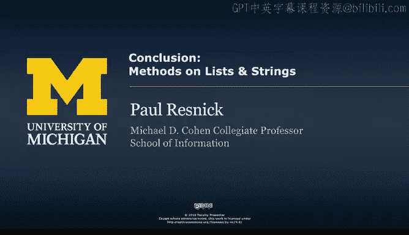

# 课程79：列表与字符串方法总结 📚

在本节课中，我们将总结Python中列表与字符串最核心的方法。我们将回顾哪些方法会修改原对象，哪些会创建新对象，并帮助你掌握这些方法的实际应用。

## 概述

你已经学习了列表和字符串中最重要的一些方法，以及少数不常用但偶尔会遇到的冷门方法。现在，你应该能够阅读和编写使用这些方法的代码。

## 列表与字符串方法的核心区别

上一节我们介绍了方法的基本使用，本节中我们来看看列表与字符串方法的一个关键区别：可变性。

列表的方法可以改变列表本身，而字符串和元组的方法永远不会改变原对象，它们只会返回修改后的新副本。这是因为字符串和元组是不可变对象。

以下是区分方法行为的关键点：

*   **列表的变异方法**：这些操作会直接修改原列表。
    *   `list.append(x)`：在列表末尾添加元素。
    *   `list.insert(i, x)`：在指定索引位置插入元素。
    *   `list.remove(x)`：删除列表中第一个值为x的元素。
    *   `list.pop([i])`：删除并返回指定索引位置的元素（默认为最后一个）。
    *   `list.reverse()`：将列表中的元素反向排列。
    *   通过索引赋值（如 `list[0] = ‘new’`）和 `del` 语句删除元素也会改变原列表。

*   **列表的非变异方法**：这些操作不会修改原列表，只返回信息或新列表。
    *   `list.index(x)`：返回第一个值为x的元素的索引。
    *   `list.count(x)`：返回值x在列表中出现的次数。
    *   使用 `+` 进行列表拼接会创建一个新列表。

*   **字符串与元组的方法**：所有方法都是非变异的，因为它们是不可变的。
    *   例如 `str.upper()`, `str.replace(old, new)`, `tuple.count(x)` 等，都返回一个新的字符串或元组，原对象保持不变。

## 扩展列表的两种方式

你应该能够使用 `append()` 方法或 `+` 拼接运算符来向列表末尾添加更多元素。记住，`append()` 会修改原列表，而 `+` 会创建一个包含所有元素的新列表。

## 总结

本节课中我们一起学习了如何区分会改变原列表的“变异”方法和不会改变原对象的“非变异”方法。对于列表，你需要留意 `append`、`insert`、`remove`、`pop`、`reverse` 以及赋值和删除操作会直接修改它。而对于字符串和元组，所有方法都安全地返回新对象。掌握这一区别对于编写正确、高效的Python代码至关重要。

**今日笑话**：如何让两只猫进入同一个房间？你可以把它们“连接”（cat-enate）起来。下节课见！