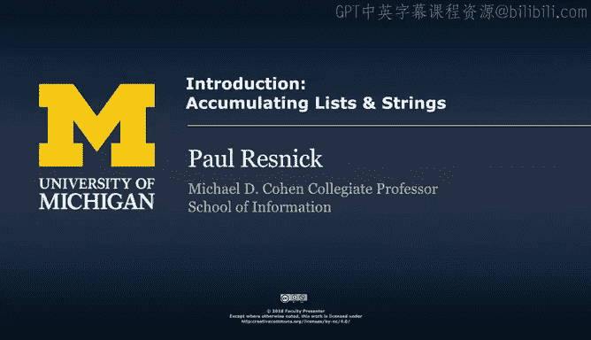

# 课程1：Python 3编程 - P80 🧩 列表与字符串累积导论

在本节课中，我们将学习如何使用“累积模式”来处理列表和字符串。我们将从回顾数字的累积开始，然后重点介绍如何将这种模式应用于列表和字符串的构建。

---

## 累积模式回顾


在之前的课程中，你已经学习了如何累积数字，例如进行计数或求和。其核心模式是初始化一个变量（通常为0），然后在循环中不断更新它。

**公式示例：**
```
总和 = 0
对于 每个项目 在 序列中:
    总和 = 总和 + 项目
```



接下来，我们将看看如何把这种强大的思想应用到列表和字符串上。

---

## 列表的累积 🧱

对于列表，累积模式意味着我们从一个空列表开始，然后通过反复添加新元素来逐步构建它。

具体方法是：初始化一个空列表，然后在循环中，使用 `append()` 方法或类似操作，每次向列表中添加一个新项目。

**代码示例：**
```python
# 初始化一个空列表
结果列表 = []

# 假设我们有一个数据源
数据 = [1, 2, 3, 4]

# 使用累积模式构建新列表
对于 数字 在 数据 中:
    如果 数字 % 2 == 0:  # 筛选偶数
        结果列表.append(数字)

# 最终，结果列表将包含 [2, 4]
```

通过这种方式，我们可以根据条件筛选、转换或收集数据，逐步构建出我们需要的最终列表。

---

## 字符串的累积 🔤

字符串的累积与列表非常相似。我们从一个空字符串开始，然后通过拼接（连接）操作，不断向其尾部添加新的字符或子字符串。

需要注意的是，在Python中字符串是不可变的，因此我们通常通过“拼接并重新赋值”的方式来实现累积。

**代码示例：**
```python
# 初始化一个空字符串
结果字符串 = ""

# 假设我们有一个单词列表
单词列表 = ["Hello", "World", "!"]

# 使用累积模式构建新字符串
对于 单词 在 单词列表 中:
    结果字符串 = 结果字符串 + 单词 + " "

# 最终，结果字符串将是 "Hello World ! "
```

这种方法常用于从多个部分组装一个完整的句子、路径或输出信息。

---

## 核心要点总结

本节课我们一起学习了“累积模式”在列表和字符串中的应用。

*   **列表累积**：始于空列表 `[]`，通过 `append()` 等方法逐步添加元素。
*   **字符串累积**：始于空字符串 `""`，通过拼接操作 `+` 逐步连接内容。

掌握这种模式，你将能够轻松编写出用于构建、筛选和转换数据的代码，这是编程中一项非常基础且重要的技能。