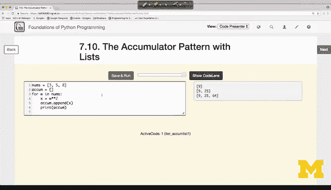

# 81课：列表累加器模式 📝


在本节课中，我们将学习如何使用“累加器模式”来构建一个列表。与之前将数字累加求和不同，这次我们将把一系列新元素逐个添加到一个初始为空的列表中，最终生成一个新的列表。

---

## 从数字累加到列表累加 🔄

上一节我们介绍了用于求和的数字累加器模式。本节中我们来看看如何将这种模式应用于列表。

列表累加器模式的核心思想是：我们从一个空列表开始，然后遍历某个序列（例如另一个列表），在每次迭代中计算一个新值，并将其添加到我们的累加器列表中。

以下是实现此模式的关键步骤：

1.  **初始化累加器**：创建一个空列表。
2.  **迭代序列**：遍历原始数据序列。
3.  **计算并追加**：在每次迭代中，根据当前元素计算新值，并将其追加到累加器列表末尾。
4.  **获得结果**：迭代完成后，累加器列表即为最终结果。

---

## 代码示例：计算平方列表 🔢

让我们通过一个具体的例子来理解。假设我们有一个包含数字 `[3, 5, 8]` 的列表，目标是生成一个新列表，包含这些数字的平方值 `[9, 25, 64]`。

以下是实现此功能的代码：

```python
# 1. 定义原始数据序列
nums = [3, 5, 8]

# 2. 初始化累加器为一个空列表
accum = []

# 3. 开始迭代
for w in nums:
    # 计算当前元素的平方
    x = w * w
    # 将计算结果追加到累加器列表中
    accum.append(x)

# 4. 迭代结束，打印最终结果
print(accum)
```

运行这段代码，输出结果为：
```
[9, 25, 64]
```

代码执行过程如下：
*   第一次迭代：`w` 为 `3`，`x` 计算为 `9`，`accum` 变为 `[9]`。
*   第二次迭代：`w` 为 `5`，`x` 计算为 `25`，`accum` 变为 `[9, 25]`。
*   第三次迭代：`w` 为 `8`，`x` 计算为 `64`，`accum` 变为 `[9, 25, 64]`。

---

## 调试技巧：观察累加过程 🐛

为了更清晰地理解累加器是如何逐步构建的，一个有效的调试方法是在每次迭代后打印累加器的当前状态。

我们可以将 `print` 语句放入循环内部：

```python
nums = [3, 5, 8]
accum = []

for w in nums:
    x = w * w
    accum.append(x)
    # 在每次追加后打印当前累加器内容
    print(accum)
```

运行修改后的代码，输出结果为：
```
[9]
[9, 25]
[9, 25, 64]
```

这三行输出直观地展示了累加器列表 `accum` 是如何从 `[9]` 逐步增长到 `[9, 25]`，最后到 `[9, 25, 64]` 的。这种方法有助于确认程序的逻辑是否符合预期。

---

## 核心概念总结 ✨

本节课中我们一起学习了列表累加器模式。

要累加生成一个列表，你需要遵循以下步骤：
1.  将累加器变量初始化为一个空列表 `[]`。
2.  使用 `for` 循环遍历你的数据序列。
3.  在循环体内，计算想要添加的新值，并使用 `append()` 方法将其添加到累加器列表末尾。
4.  循环结束后，累加器列表中即包含了所有累积的结果。



这种模式功能强大，是处理数据、转换列表和构建新数据集合的基础技术。