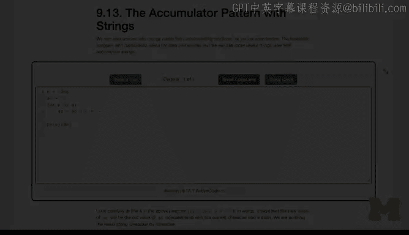
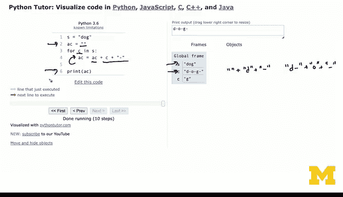
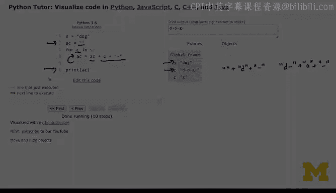

# 课程1：Python 3编程 - P82：字符串累加器模式 🧵




在本节课中，我们将学习如何使用累加器模式来处理字符串。累加器模式是一种编程技巧，它允许我们通过循环逐步构建一个最终结果。我们将看到，虽然其核心思想与处理数字或列表时类似，但在处理不可变的字符串时，具体的操作步骤会有所不同。

上一节我们介绍了累加器模式的基本概念，本节中我们来看看如何将其应用于字符串。

## 字符串累加器的工作原理

字符串累加器模式的核心是：从一个空字符串开始，在循环的每一次迭代中，将新的内容连接到这个字符串的末尾，从而逐步构建出最终的字符串结果。

以下是实现字符串累加器模式的关键步骤：

1.  **初始化累加器变量**：首先，你需要创建一个变量（通常命名为 `accumulator` 或简写为 `ac`），并将其初始值设为一个空字符串 `""`。
2.  **遍历序列**：使用 `for` 循环遍历一个序列（例如一个字符串、列表等）。
3.  **更新累加器**：在每次循环中，获取累加器变量的当前值，将其与新的内容（通常与迭代变量相关）连接起来，形成一个新的字符串。
4.  **重新赋值**：由于字符串在Python中是不可变的（无法直接修改），你必须将这个新字符串重新赋值给累加器变量。
5.  **获取结果**：循环结束后，累加器变量中存储的就是最终构建好的字符串。

## 代码示例与解析

让我们通过一个具体的例子来理解这个过程。假设我们有一个字符串 `"dog"`，我们想在每个字母后面加上一个短横线 `-`，最终得到 `"d-o-g-"`。

```python
s = "dog"
ac = ""  # 步骤1：初始化累加器为空字符串

for c in s:  # 步骤2：遍历字符串中的每个字符
    ac = ac + c + "-"  # 步骤3 & 4：连接并重新赋值
    # 第一次循环: ac = "" + "d" + "-" -> "d-"
    # 第二次循环: ac = "d-" + "o" + "-" -> "d-o-"
    # 第三次循环: ac = "d-o-" + "g" + "-" -> "d-o-g-"

print(ac)  # 步骤5：输出最终结果 "d-o-g-"
```

**代码执行流程解析**：
*   初始时，`ac` 是空字符串 `""`。
*   第一次迭代：`c` 是 `'d'`。执行 `ac = "" + 'd' + '-'`，`ac` 变为 `"d-"`。
*   第二次迭代：`c` 是 `'o'`。执行 `ac = "d-" + 'o' + '-'`，`ac` 变为 `"d-o-"`。
*   第三次迭代：`c` 是 `'g'`。执行 `ac = "d-o-" + 'g' + '-'`，`ac` 变为 `"d-o-g-"`。
*   循环结束，`ac` 中保存了最终结果。

请注意，在整个过程中，原始字符串 `s` 的值 `"dog"` 从未改变，这体现了字符串的不可变性。我们通过创建新的字符串并重新赋值给 `ac` 来实现“累加”。

## 与列表累加器的区别

字符串累加器与列表累加器的一个关键区别在于**重新赋值**的必要性。
*   对于列表，你可以使用 `append()` 方法直接修改（改变）原列表。
*   对于字符串，由于无法修改，你只能通过连接操作创建新字符串，并必须将其重新赋值给累加器变量。

**列表累加示例（对比）**：
```python
result_list = []  # 初始化空列表
for item in some_data:
    result_list.append(processed(item))  # 直接修改原列表，无需重新赋值
```

**字符串累加示例（回顾）**：
```python
result_str = ""  # 初始化空字符串
for char in some_string:
    result_str = result_str + processed(char)  # 创建新字符串并重新赋值
```

## 总结





本节课中我们一起学习了字符串累加器模式。我们了解到，要使用这种模式累加字符串，需要遵循以下步骤：首先将累加器变量初始化为空字符串；然后在每次循环迭代中，将累加器的旧值与新的内容连接起来，生成一个全新的字符串，并重新赋值给累加器变量；最终，循环结束后的累加器变量就包含了我们逐步构建的完整结果。记住，由于字符串的不可变性，**重新赋值**是必不可少的关键操作。