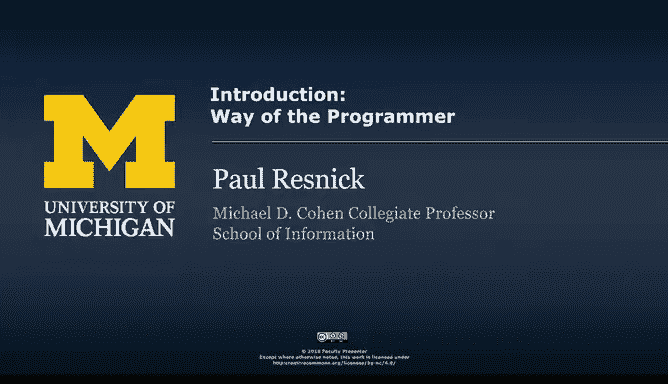

# 84：程序员之道进阶导论 🧭

在本节课中，我们将学习如何通过绘制引用关系图来澄清代码逻辑，并掌握如何识别及有效运用“累积模式”。课程结束时，你将养成绘制引用图的习惯，并能根据问题描述中的关键词判断何时使用累积模式。

***

欢迎回来。在本周的“程序员之道”课程中，我们将鼓励大家养成绘制引用关系图的习惯，并提供一些技巧，帮助你识别何时使用累积模式以及如何用好它。


本课的学习目标是：课程结束时，你应该养成绘制引用关系图以解决潜在困惑的习惯，并且能够根据问题描述中的词语，识别出何时应该使用累积模式。

我们课程结束时见。



***

上一节我们介绍了本课的学习目标，本节中我们来看看为什么需要绘制引用关系图。

当代码涉及多个变量或复杂的数据结构时，很容易在脑海中混淆它们之间的关系。绘制一个简单的引用关系图，可以直观地展示每个变量指向哪个对象，从而避免逻辑错误。

***

以下是绘制引用关系图的核心步骤：

1.  为每个变量画一个方框，并标上变量名。
2.  为每个数据对象（如列表、字典、字符串）画一个圆圈或云状图。
3.  用箭头从变量方框指向其引用的数据对象。
4.  如果对象内部包含对其他对象的引用（如列表中的元素），也用箭头表示出来。

例如，对于代码 `a = [1, 2]; b = a`，其引用图可表示为：
```
a -----> [1, 2]
         ^
b --------|
```

***

理解了引用关系图后，我们接下来探讨累积模式。这是一种常见的编程模式，用于通过循环逐步构建最终结果。

累积模式的核心思想是：**初始化一个“累积器”变量，然后在循环中不断更新它**。其通用结构可以用以下伪代码表示：

```python
accumulator = initial_value  # 初始化累积器
for item in sequence:        # 遍历序列
    accumulator = accumulator operator item  # 更新累积器
# 循环结束后，accumulator 即为最终结果
```

***

那么，如何从问题描述中识别出需要使用累积模式呢？关键在于寻找特定的“信号词”。

以下是常见的关键词列表，它们通常暗示着累积模式：

*   **总计**、**总和**、**合计**
*   **乘积**
*   **连接**（字符串）
*   **收集**、**聚集**
*   **最大值**、**最小值**
*   **计数**

当你看到这类词语时，就应该考虑初始化一个变量（如 `total`, `product`, `longest_string`），然后在循环中更新它。

***

本节课中我们一起学习了两个重要的编程实践。首先，我们介绍了绘制引用关系图的方法，这是一种可视化变量与对象之间关系的强大工具，能有效帮助调试和理解代码。接着，我们深入探讨了累积模式，学习了其通用结构 `accumulator = accumulator operator item`，并掌握了通过问题描述中的关键词（如“总计”、“连接”）来识别该模式的技巧。

养成绘制引用图的习惯和熟练运用累积模式，将显著提升你解决复杂编程问题的能力。