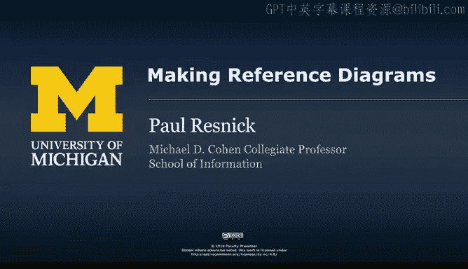
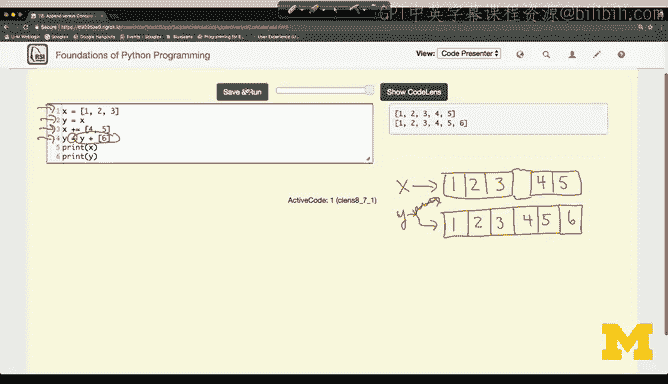

# Python 3 编程（课程1、2）｜第85课：制作引用关系图 📊


在本节课中，我们将学习一个在理解复杂代码时至关重要的技巧：制作引用关系图。当代码涉及变量别名、列表修改和重新赋值时，通过绘制图表来追踪对象和变量的关系，能帮助我们清晰地理解程序的执行过程。



## 概述：为何需要引用关系图？

当对代码行为感到不确定时，就应该制作一个引用关系图。即使只是稍有疑虑，也值得这样做。

绘制图表的过程起初可能显得缓慢甚至繁琐。观看他人操作时如此，自己初次尝试时更是如此。然而，这项投入是值得的，因为它提供了一种理解复杂概念的有效方法，否则这些概念可能会相当令人困惑。

## 代码示例分析

下面是一个简短的代码示例，包含四行核心代码，然后打印结果。直接推断其输出结果并不容易，因此我们将通过制作关系图来逐步分析。

```python
x = [1, 2, 3]
y = x
x += [4, 5]
y = y + [6]
print(x)
print(y)
```

我们将模拟代码执行环境（如Code Lens工具的功能），手动追踪每一步。

## 逐步绘制引用关系图

以下是绘制引用关系图的具体步骤，我们将追踪每个变量指向的对象如何变化。

### 步骤一：初始赋值

第一行，变量 `x` 被绑定到一个包含三个元素 `[1, 2, 3]` 的列表对象。

第二行，变量 `y` 成为 `x` 的一个别名。这意味着 `y` 和 `x` 指向内存中的**同一个列表对象**。

### 步骤二：使用 `+=` 操作符

第三行，我们遇到了 `x += [4, 5]`。虽然之前建议在处理列表时尽量避免使用 `+=`，但有时需要阅读他人的代码，他们可能未遵循此建议。

`+=` 操作符会就地修改列表。它取出原列表 `[1, 2, 3]`，并将新元素 `4` 和 `5` 追加到末尾，从而形成一个包含五个元素的新列表 `[1, 2, 3, 4, 5]`。**关键点在于**：`x` 仍然指向**同一个**列表对象，只是该对象的内容被修改了。

由于 `y` 是 `x` 的别名，指向同一个对象，因此 `y` 现在也“看到”了一个包含五个元素的列表。

### 步骤三：使用 `+` 操作符与重新赋值

第四行，我们使用了更易于理解的版本：`y = y + [6]`。

首先，计算等号右边的表达式：`y + [6]`。这会取出 `y` 当前指向的列表 `[1, 2, 3, 4, 5]`，并与列表 `[6]` 连接，**创建一个全新的列表对象** `[1, 2, 3, 4, 5, 6]`。

然后，赋值操作 `=` 将变量 `y` 重新绑定到这个新创建的列表对象。因此，`y` 不再指向原来的列表，而是指向了这个新值。

此时，变量 `x` 仍然指向最初那个已被修改为 `[1, 2, 3, 4, 5]` 的旧列表对象。

### 步骤四：打印结果

第五行，打印 `x`，输出包含五个元素的列表：`[1, 2, 3, 4, 5]`。

第六行，打印 `y`，输出包含六个元素的新列表：`[1, 2, 3, 4, 5, 6]`。

让我们验证这个分析是否正确。运行代码，结果确实如此：第五行打印出5个元素，第六行打印出6个元素。

## 核心要点总结

试图在脑中推演这类代码，尤其是当代码超过四行并涉及此类操作时，会非常困难。

因此，请记住这个核心建议：**如果遇到任何哪怕只有一点点令人困惑的代码，就制作一个引用关系图**。即使当前看起来并不复杂，提前练习这项技能也会让你在未来受益匪浅。

---



**本节课中，我们一起学习了：**
1.  **引用关系图的重要性**：它是理清变量别名和对象修改的视觉化工具。
2.  **`+=` 与 `+` 的区别**：
    *   `x += [a, b]` 会**就地修改** `x` 指向的列表。
    *   `y = y + [c]` 会**创建新列表**，并将 `y` 重新绑定到它。
3.  **绘图分析步骤**：从变量初始绑定开始，逐步追踪每个操作（修改或重新赋值）如何改变变量与对象之间的关系。


掌握通过画图来分析代码的方法，能极大地提升你理解和调试复杂程序的能力。🎯