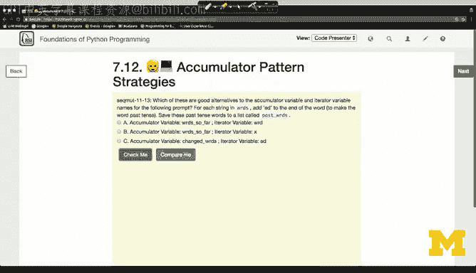

# 密歇根大学《Python3编程》课程1、2｜第86课：累加器模式识别策略 🧠

在本节课中，我们将学习如何识别何时应该使用累加器模式，并掌握一些正确使用该模式的技巧。我们将通过分析问题描述中的关键词，来判断应该采用哪种累加器模式，并学习如何为变量选择清晰易懂的名称。

---

## 识别累加器模式的关键词

上一节我们介绍了累加器模式的基本概念，本节中我们来看看如何通过问题描述中的特定短语来识别它。

以下是常见的问题描述短语及其对应的累加器模式：

*   **“有多少个”或“频率是多少”**：这通常暗示需要使用**计数累加器**。
*   **“总和”或“总计”**：这通常暗示需要使用**求和累加器**。
*   **“生成一个列表”**：这通常暗示需要使用**列表累加器**。
*   **“连接”或“合并”**：这通常暗示需要使用**字符串累加器**。

---

## 编写代码前的思考步骤

在开始编写任何代码之前，遵循一个清晰的思考过程至关重要。以下是三个关键问题，可以帮助你规划累加器模式的实现：

1.  **确定迭代序列**：你需要遍历哪个序列（例如，一个列表、一个字符串）？
2.  **确定累加值类型**：你将要累加的是什么类型的值？是一个数字、一个列表，还是一个字符串？
3.  **选择恰当的变量名**：为你的累加器变量和迭代器变量选择清晰、有意义的名称。

---

## 为变量选择好名称

好的变量名能让代码更易读、更易维护。以下是一些命名建议：

*   **迭代器变量**：通常使用单数名词。例如，如果你在遍历一个单词列表，使用 `word` 作为迭代器变量名就很合适，它能提醒你每次迭代处理的是一个单词。
*   **累加器变量**：可以使用一个通用的名字如 `acc`，但更推荐使用能体现其用途的名字。例如：
    *   `count_so_far` （用于计数）
    *   `total_so_far` （用于求和）
    *   `cubes_so_far` （用于收集立方数列表）

在累加器变量名后加上 `_so_far`（到目前为止）是一个好习惯，它能提醒你这个变量在程序执行过程中是逐步增加的，直到循环结束后才得到最终结果。

---

## 理解检查与示例分析

为了巩固所学，让我们通过几个例子来分析如何应用上述策略。

**示例 1：生成过去式单词列表**

> 对于 `words` 列表中的每个字符串，在单词末尾添加 “ED” 以构成其过去式，并将这些过去式单词保存到名为 `past_words` 的列表中。

*   **问题**：这暗示需要使用累加器模式吗？如果是，为什么？
*   **选项**：A) 因为要将一些东西保存到列表中。 B) 因为要在单词末尾添加 “ED”。
*   **答案与分析**：**A**。关键词“保存到列表”表明我们需要使用**列表累加器**来收集所有转换后的单词。而“添加ED”描述的是对每个元素的具体操作，并非模式识别的核心。

**示例 2：计算座位总数**

> 编写代码对列表 `seat_counts` 中的所有数字求和，并将结果存储在变量 `total_seat_counts` 中。

*   **问题**：这暗示需要使用累加器模式吗？如果是，为什么？
*   **答案与分析**：是的。关键词“求和”明确表明我们需要使用**求和累加器**来得到所有数字的总计。

**示例 3：统计元音数量**

> 编写代码统计句子 `s` 中的元音数量，并将结果赋值给变量 `num_vowels`。

*   **问题 1**：累加器变量中应存储什么类型的对象？
*   **答案**：**整数**。因为“计数”结果是一个数字。
*   **问题 2**：在累加结果时，你将遍历哪个序列？
*   **选项**：A) 句子 `s` B) 变量 `num_vowels`
*   **答案**：**A**。你将遍历句子 `s` 中的字符序列，而累加结果会逐步更新到 `num_vowels` 中。

**示例 4：变量命名实践（回顾示例1）**

> 对于 `words` 列表中的每个字符串，在单词末尾添加 “ED” 以构成其过去式，并将这些过去式单词保存到名为 `past_words` 的列表中。

*   **问题**：为累加器变量和迭代器变量选择最佳名称。
*   **累加器变量选项**：`words_so_far` 或 `changed_words`
*   **迭代器变量选项**：`word` 或 `ed`
*   **建议**：
    *   **累加器变量**：`words_so_far` 是一个理想的选择。`so_far` 表明它是累加器，`words` 表明累加的内容是单词。
    *   **迭代器变量**：`word` 是很好的选择，因为它清晰地表明每次迭代处理的是 `words` 列表中的一个元素（一个单词）。

---

## 总结

本节课中我们一起学习了识别和应用累加器模式的策略。我们了解到，通过寻找问题描述中的关键词（如“总计”、“列表”、“计数”），可以判断出所需的累加器类型。在编码前，应明确迭代的序列和累加值的类型。最后，为迭代器变量和累加器变量选择具有描述性的名称（如 `item` 和 `result_so_far`），能极大地提升代码的可读性和可维护性。通过反复练习这些识别和设计步骤，你将能熟练地运用累加器模式解决各种问题。