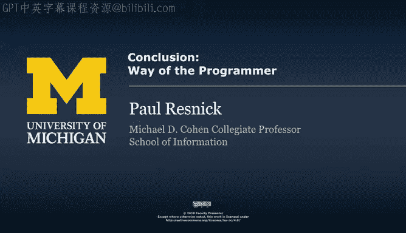

# 课程1：Python 3编程（第87讲）｜程序员之道进阶总结 🧑‍💻

在本节课中，我们将对“程序员之道”这一进阶主题进行总结，回顾并巩固编程中的核心思维习惯与技巧。

---

欢迎回来。希望你正走在程序员之路上。

养成绘制参考图的习惯，选择恰当的变量名。

训练自己识别累积问题的典型特征。

最重要的是，要练习编程。借用并大幅改编圣雄甘地的一句话：**编程无他法，编程即其道**。

我没有找到一个很棒的笑话。

所以我将给你一个我一直很喜欢的随机双关语。

1，1 是一匹赛马，2，2 是 1，2。1，1，1，1 是赛跑，2，2，1，1，2。

---

上一节我们强调了实践的重要性，本节中我们来看看一个具体的思维练习。

以下是这个双关语的解释，它体现了程序员对模式和逻辑的思考：

*   1，1 被解读为 “one one”，听起来像 “won one”，即“赢得一次”，所以是“一匹赛马”。
*   2，2 被解读为 “two two”，听起来像 “one two”，即“一二”。
*   1，1，1，1 被解读为 “one one one one”，听起来像 “won one won one”，即“赢一次，赢一次”，引申为“赛跑”。
*   2，2，1，1，2 则延续了这种数字谐音的逻辑。

---

本节课中我们一起学习了程序员进阶之路的核心：通过**绘制参考图**、**选用好变量名**、**识别问题模式**以及**持续不断的练习**，将编程思维内化为习惯。记住，**编程本身就是掌握编程的方法**。