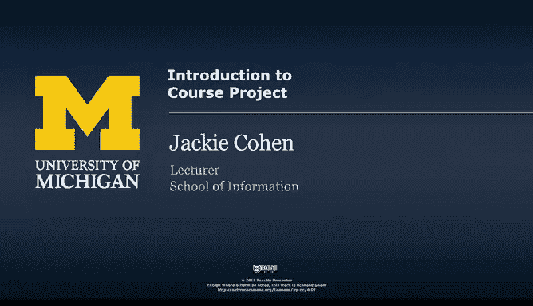

# 课程1、2：最终课程作业导论 🎯

在本节课中，我们将介绍密歇根大学《Python 3编程》课程的最终项目。这个项目旨在综合运用你在整个课程中学到的核心概念，通过解决一系列贴近现实生活的编程问题来巩固你的技能。

---

上一节我们介绍了课程项目的总体目标，本节中我们来看看项目的特点和完成它的一些实用建议。

这个最终课程项目将涵盖你在课程中已经学习过的许多概念。你需要完成一系列不同类型、涉及不同概念的问题。但所有这些问题都是许多人在现实生活中实际使用的那种程序。

例如，数据累加、数据收集、在程序中改变数据表现形式等。因此，你即将在项目中编写的这类程序，很可能非常适用于你日常的学习、工作或其他场景。

---

在开始着手这个项目时，我想提醒你一些可能有用的技巧。

以下是完成项目时的一些核心建议：

1.  **一次只修改一处**：你应该始终在程序中一次只修改一个地方。预测修改后程序最终运行时会有什么结果，然后进行尝试。如果你只修改了一处，做出了预测并进行了测试，你就能清楚地知道修改是否有效、你的预测是否正确。这样你就能了解自己是否真正理解了当前正在处理的内容。如果你一次性做了多处修改再测试，就可能需要排查所有改动，才能找出哪些是好的、哪些不好，以及需要做什么才能完成程序并使其按预期运行。所以，请始终遵循 **`一次修改 -> 预测 -> 测试`** 的流程。

2.  **使用清晰的变量名**：例如，如果你在使用累加器模式或任何`for`循环，永远不要让迭代变量使用复数名称，因为它总是绑定到一个单一的事物。为一个单一的事物使用复数变量名，会在你思考和讨论代码时造成混淆。同样，我建议你不要在变量名中使用可能产生误导的单词。例如，如果一个变量不可能是列表类型，就不要在它的名字里使用“list”这个词，因为以后阅读代码时，你会误以为它是一个列表，而实际上它不是，这也会造成混淆。

3.  **识别模式并建立联系**：你即将在最终项目中完成的所有问题都各不相同，但它们与你之前见过或做过的其他问题有着相似的模式。在处理这些问题时，我建议你思考它们与你做过的其他练习有何相似之处，这将使你更容易取得进展。

---

上一节我们讨论了项目完成的一般性技巧，本节中我们来看看解决具体问题的分步方法。

对于每个问题，你都应该按以下步骤进行：

1.  **制定分步计划（用文字）**：首先，为如何解决问题制定一个分步计划，完全不要写代码。例如，在一个累加问题中，你应该像在对一个机器人说话一样，逐步说明程序需要完成的每个小任务。

2.  **将计划翻译成代码**：确保你可以将计划中的每一步都翻译成代码。思考如何将你的文字描述转化为一个可以运行的程序。

3.  **迭代测试**：继续遵循“一次修改一处并测试”的原则，确保代码能够运行。

---

最后，如果你遇到一个复杂的问题，例如，这个最终课程项目中可能出现的最后一个问题，它要求你对一组事物中的每一个都执行一项复杂任务。

以下是处理此类复杂任务的策略：

*   **先解决单个实例**：你应该先为单个任务制定计划。例如，先考虑如何对**一个**字符串完成那个复杂任务，并确保仅针对一个字符串时，一切都能正常工作。
*   **再扩展到整体**：如果你的代码能够成功地对一个字符串执行一次任务，那么你就可以着手构建完整的代码，将其放入一个`for`循环中，并实现完整的解决方案，从而使你的代码对整个程序都成功。

---

所有这些问题的解决方案，几乎都能以某种方式应用于几乎每个人的日常生活中，非常实用。我认为它们很有趣，希望你能享受这个过程，并祝你好运。

---

本节课中我们一起学习了最终课程项目的概况、完成项目的重要技巧（如**一次修改一处**、使用清晰的变量名）、解决问题的分步方法（先文字计划再翻译为代码），以及处理复杂任务时“先单点后整体”的策略。这些方法将帮助你更有信心和条理地完成这个综合性的编程项目。