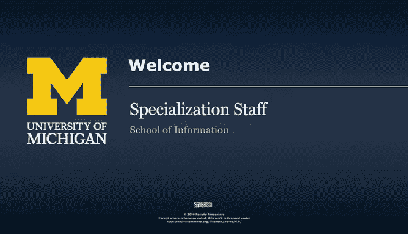
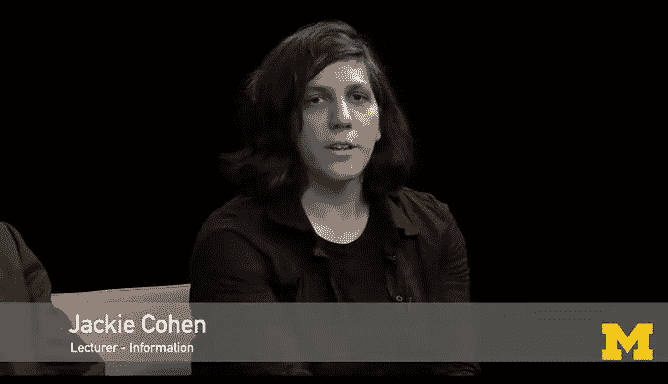
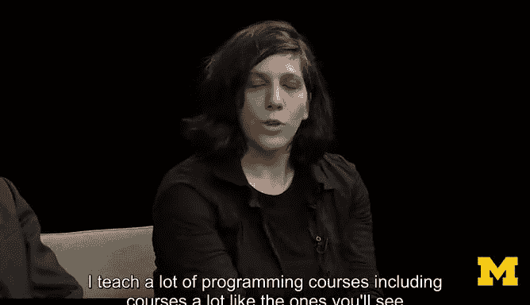
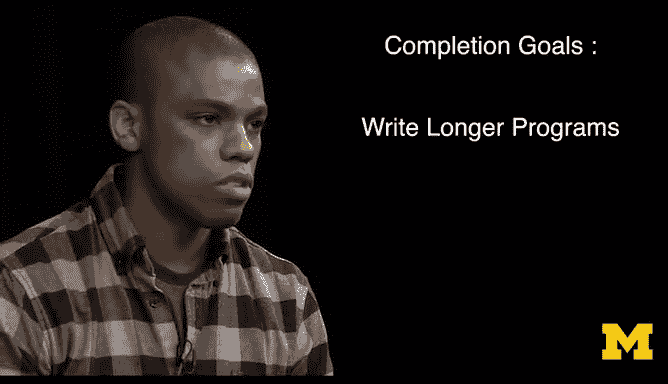
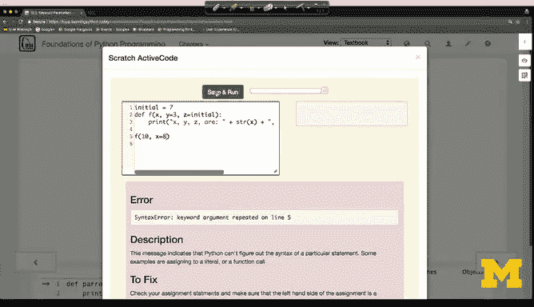
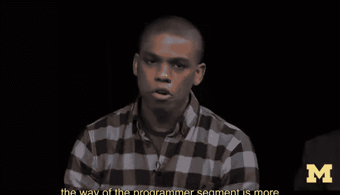
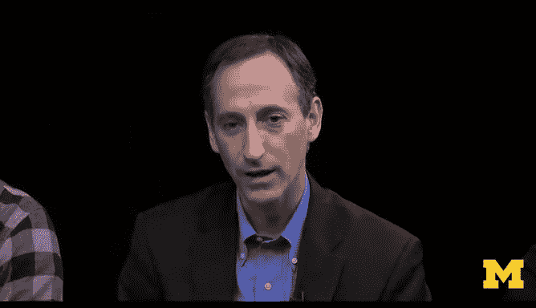
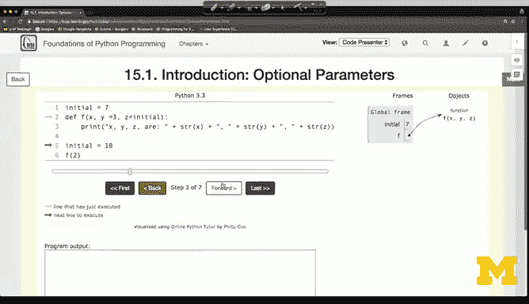

# 课程1：Python 3 编程专业课程简介 🐍

在本节课中，我们将了解密歇根大学《Python 3 编程》专业课程的整体概览、教学团队以及课程特色。我们将学习课程的目标、使用的工具以及如何通过本课程成为一名合格的Python程序员。

---

## 教学团队介绍 👨‍🏫

大家好，我是密歇根大学信息学院的助理教授 Steveonni。我在信息学院教授一些编程入门课程。我非常高兴你能加入我们，因为我认为编程将日益成为一种基础且重要的素养，也是我们处理日常生活中日益增长的数据的一种方式。在我的个人生活中，我喜欢踢足球，和Resnick教授一样，我也是一名狂热的自行车爱好者。你们将在课程一、二和四中见到我。我的大部分研究致力于提高编程工具的可用性，换句话说，就是围绕人们的思维方式和我们实际的编程方式来设计编程工具。

大家好，我是 Paul Resnick。我是密歇根大学信息学院的教授兼研究副院长。作为院长，我授课的机会不多。但我非常享受在这个专业课程中将要教给你们的内容，也很高兴有机会与你们分享。你们将在课程一、二、几乎整个课程三以及课程四的一部分中见到我。我喜欢书呆子式的双关幽默，也就是所谓的“老爸笑话”，所以我将在一些课程结束时与你们分享一些。在我的研究中，我可能以现在所谓的“推荐系统”而闻名。我早在90年代初就发表了这方面的文章，比如亚马逊上显示的“购买此书的顾客也购买了这些书”。最近，我一直在研究在线社区和教育技术。在我的个人生活中，我喜欢打网球和骑自行车，我骑得很慢。四年前，我骑上了环法自行车赛的标志性爬坡之一旺图山；几年前，我又骑上了比利牛斯山脉的图尔马莱山口。我的旅行远不如 Chuck 博士多。但我期待尝试采纳他的做法，在我旅行时在各地举行实时办公时间，所以也许我有机会见到你们。课程中见。

大家好，我叫 Jackie Cohen，是密歇根大学信息学院的讲师。我教授很多编程课程，包括与你们在这里看到的非常相似的课程。我还构建、设计和支持许多课程资源。所有这些意味着我见过很多不同的学生完成许多不同的编程项目。我在这里要做的是引导你们了解期末项目，并给你们一些在完成项目时可能有用的提示和建议。我希望你们喜欢它们，因为我认为它们真的很有趣，并且会为你们在日常生活中使用编程提供很多工具。

大家好，我是 Chris Brooks，我是密歇根大学的教员。在这个专业课程中，我将教授最后一门课。在那门课程中，你们将学习图像处理库和大型图像集，并使用Python将其转换为有用的信息。我的研究重点是教育技术，我教授很多数据科学课程，包括这个平台上的一些课程。我对像你们这样的学习者如何接触技术、与技术互动以及利用技术促进学习非常感兴趣。我期待在最后一门课程中见到你们。

大家好，我叫 Charles Severance，你们可能之前在《Python for Everybody》专业课程中见过我。你们中的一些人可能上过那门课，然后来到了这个班级。我真的很享受我在这门课中所做的事情，实际上我并不教授任何核心内容，而是做我们称之为“程序员之道”的部分。这有点像我可以稍微玩一下，而不是真正教你们什么，而是向你们展示一些很酷的东西，这给了我很大的自由来展示我认为有趣的东西。正如你们一些人可能知道的，我的研究领域是教育技术。你们正在使用的平台是我非常好奇如何改进、如何让它变得更好的东西。我有很多爱好，但我最近的爱好是在赛道上开赛车。所以如果你找找看，可能会发现一张我在赛车里的照片。

大家好，我是 Lauren Murphy。几年前我参加了这个课程的校园版本，并最终作为一名教学助理帮助其他学生学习这些材料。后来我回来帮助建设这门课程，构建了你们将要完成的测验、评估和项目。我非常高兴你们有机会学习同样的材料，我希望你们学得愉快。

---

## 课程目标与内容 🎯

在这个Python 3编程专业课程中，你们将通过详细学习语言的基础知识，学会如何成为一名合格的Python程序员。你们将学习如何导航复杂的数据结构并从中累积结果。你们还将学习如何将数据转换为可供其他程序使用的格式。在专业课程结束时，你们将能够编写几百行的Python程序。你们将能够在代码中使用和集成Python模块。你们也将能够通过阅读文档来使用外部工具，如API。

我们从零开始，不预设任何先验知识，但我们会深入探讨Python的基础知识，以确保你们理解代码的每一个方面。

---

## 学习环境与工具 🛠️

接下来，我们介绍一下我们的Runestone交互式环境。Runestone交互式教科书允许你将学习材料与活跃的代码评估交织在一起，这将使你能够实际编写代码。我们发现编写代码非常重要，因为即使你可以在理论上理解一个概念是如何工作的，比如你可能知道Python的某个特定功能如何工作，但实际编写代码对于获得更多实践理解以及知道如何在实践中应用这些概念至关重要。

---

## 程序员之道与最佳实践 🧑‍💻

课程中还有“程序员之道”的部分。课程的大部分内容是关于如何使用Python和学习Python功能。“程序员之道”部分则更多是关于程序员可以且应该如何工作。编程更像是一门艺术而非纯粹的科学，有很多正确的方法来做事情，但存在最佳实践。例如，如何以增量方式编写程序。在“程序员之道”部分，你们还将学习如何编写良好的自动化测试用例。

这将在课程4中出现。在此之前，我们将为你们编写这些测试用例。Lauren创建了大量的评估，不仅可以在浏览器中运行代码，还会告诉你是否正确，你会得到即时反馈，并且可以尝试任意多次。事实上，我们已经设定了评估，你必须全部做对，100%正确才能通过评估。这样做的原因是我们真的希望你们建立精通度，这样你们在真正扎实掌握早期材料之前，不会进入后面的内容。

---

## 实践与应用 🔄

你们还会注意到，在你们所做的所有项目中，你们会找到方法，将在课程和专业课程中学到的概念转化为现实生活。例如，构建程序的不同方式，这些方式可能在你的工作、学习或你所做的任何事情中很有趣。

我真的很喜欢的一点是，正如我观察你们所有人将这些整合在一起，以及在《Python for Everybody》中一样。在《Python for Everybody》中，我真的专注于程序。如果你完成了程序，就像你赢了，你得到了金星。我们没有时间或条件去真正理解程序内部发生了什么。我们就像完成了程序，然后必须继续下一件事。但在Runestone中你们拥有的一些东西，你们可以说出程序内部到底发生了什么，以及这到底是如何工作的。精通的一部分就是，如果你不能作为一个程序员，在某种程度上将自己置身于程序内部，理解程序实际上是如何运行的，那么编写更复杂的程序就会很困难。所以，即使这在技术上是一门入门课程，我认为人们参加不止一门入门课程真的很重要，因为从某种意义上说，你每次学习都需要带着更深的理解去反复学习相同的材料。

我们有一个很棒的代码透镜工具，我想你指的是它。它可以让你可视化程序执行过程中每一行发生的事情，你可以前进和后退，看看那个变量的实际值是什么，我的列表内容是什么时候改变的。所以它给了你一种思考方式。它对于调试非常有用，这样你就不必只是通过试错来改变代码中的某些东西，你可以真正思考程序是什么。

另一件学生们总是在课程结束时问我的事情是：接下来做什么？我认为很酷的是，你们在这个专业课程中内置了关于他们接下来要做什么的步骤。是的，我们在课程最后增加了一门项目课程，这真的是为了专注于如何获取其他可能存在的API或包，并使用它们做一些新颖的事情，而不仅仅是学习。这触及了你提到的重复练习。为此，我们实际上是在Jupyter环境中进行的。就像你需要对API和Python基础进行重复练习一样，有很多不同的地方可以编写和运行Python代码。Runestone是其中之一，你在《Python for Everybody》中使用的工具也是其中之一。Jupyter是一个相当常见的环境，我们在数据科学专业课程中教授它，学生可以接着学习。还有其他环境。所以我们试图真正展示Python编程学习环境和生产环境的多样性。编程不是一个单一的环境，不是你输入东西就完事了。在现实世界中，每份工作通常都有不同种类的环境。练习在编程的背景下非常重要，我认为Lauren在整个课程中为你们编写了一些很好的练习题。我们还有一个很棒的练习工具，你会看到，它会向你展示一些你过去已经见过的问题以供复习，如果你有困难，它会更频繁地呈现给你；如果你表现出精通，它会减少呈现频率。这是一种真正巩固你所学知识的方式。所以，请留意那个练习工具，它还有这些有趣的烟花，会在你完成当天所有练习题时显示。

---

## 总结与鼓励 ✨

正如你们所看到的，我们都非常兴奋能与你们分享这些材料，我们希望你们玩得开心，并祝你们好运。

在密歇根大学，我们的校色是玉米黄和蓝色。你们可能认为它们是黄色和蓝色，但我们称之为玉米黄和蓝色。如果我旅行到任何地方，身上有密歇根大学的标志，机场就会有人走过来对我说：加油，蓝色！所以，数到三，一，二，三，加油，蓝色！

在本节课中，我们一起了解了《Python 3 编程》专业课程的全体教学团队、课程的核心目标、特色学习工具（如Runestone交互式环境和代码透镜），以及课程强调的实践、重复练习和“程序员之道”的理念。希望这为你接下来的学习之旅奠定了清晰的基础。