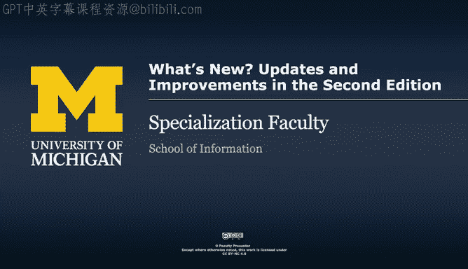

# 课程1：Python 3 编程入门 🐍 - P90：第二版新增内容、更新与改进

在本节课中，我们将介绍密歇根大学《Python 3 编程》专项课程第二版的主要更新与改进。我们将了解新增的教学内容、技术更新以及对学习体验的优化。

---

## 课程第二版介绍

我们很高兴向大家介绍本《Python 3 编程》专项课程的第二版。我们新增了大量新内容，并迎来了新的教学成员。

大家好，我的名字是迈克尔·赫斯。我在密歇根大学信息学院担任讲师已有约十年时间。我教授的课程涵盖敏捷项目管理、机器学习流程、应用机器学习入门、SQL与数据库、服务器与Shell脚本等。我很高兴能加入这里。

---

## 内容改进与更新

上一节我们介绍了课程的新成员，本节中我们来看看课程内容的具体更新。我们根据数十万使用初版课程的学习者反馈，进行了大量细微的内容改进，你们应当感谢他们。

同时，我们也增加并更新了内容，以反映Python语言的最新变化。

---

## 开发环境与工具

为了让您能获得更多实践，我们将在专项课程中更早地引入Jupyter开发环境。这样您就可以使用与数百万专业Python程序员日常相同的开发环境进行练习。

我将讲解如何在您自己的设备上本地运行Python，以及如何构建一个云端API来运行Python。

---

## 课程5的项目更新

接下来，我们看看课程项目的重大变化。我最兴奋的更新之一是我们对第5门课程所做的一些改动，我们引入了一个不同的项目。

这次，我们将一起构建一个游戏，并尝试构建一个AI来解决这个游戏。

---

## 课程互动与趣味性

最后，也许最重要的是，我们听到了大家关于保罗的“老爸笑话”的反馈。我决定亲自加入这些笑话。这对我来说很合适，因为在第一版和第二版课程之间，我自己也成为了一名父亲。

尽管成为了父亲，我仍然有时间做有趣的事情。例如，我最近去听了一场音乐会，只花了45美分。你可能会认为这涉及某个你从未听说过的艺术家，但实际上，这是50美分乐队与尼克巴克乐队的合作演出。

这样的笑话还有很多，您将在课程中陆续听到。在专项课程每一周的结束时，我们都会以这些笑话作为结尾。

---

## 总结

本节课中我们一起学习了《Python 3 编程》专项课程第二版的主要更新。我们了解了新增的教学团队、根据反馈优化的课程内容、对Python最新特性的涵盖、更早引入的Jupyter开发环境、全新的游戏与AI构建项目，以及新增的趣味互动环节。祝大家学习愉快，密歇根大学，加油！