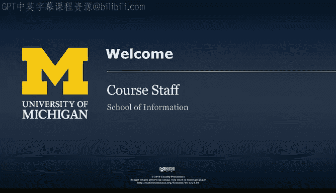
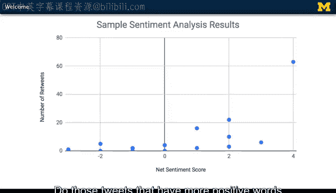

# 课程1：Python 3 编程入门（第91讲） 🐍

## 概述

在本节课中，我们将学习密歇根大学《Python 3 编程》课程的核心内容。课程将涵盖Python的基础知识、函数、文件操作、字典数据结构以及排序等高级主题。无论你是刚刚加入的新手，还是已经掌握Python基础的学习者，本课程都将帮助你进一步提升编程技能。

---

## 欢迎与课程介绍

如果你已经和我们一起学习了Python的基础知识，欢迎回来。如果你是第一次加入，并且已经掌握了Python的基本概念，如条件语句、循环、字符串和列表，那么同样欢迎你。请确保观看介绍Runestone教科书环境的视频，因为我们将在整个课程中使用该环境。

我是Paul Resnick，我是Steveonni，我们都是密歇根大学信息学院的教师。在本课程中，我们将涵盖Python的其余基础知识，重点关注执行模型，帮助你推理和调试程序。

---

## 课程内容概览

### 文件操作

我们将学习如何读取和写入文件。文件操作是处理数据的重要部分，尤其是在处理大量数据时。

### 字典数据结构

我们将学习Python的字典数据结构。字典是一种键值对的数据结构，可以高效地存储和检索数据。

### 累积模式

我们将学习使用累积模式从复杂数据结构中累积结果，并将结果累积到字典中或从字典中累积结果。

### 函数定义

你将学习如何定义函数。我认为这是从仅仅玩弄编程到成为真正程序员的分界线。

### 函数的细节

我们将深入探讨函数的一些细节，包括可选和默认参数、基于关键字的参数传递以及匿名Lambda函数。

### 排序

你将学习如何使用Python的内置排序功能。虽然你不会学习排序算法，但你会学习如何传递正确的参数，以便按你想要的顺序获取项目。

---

## 最终项目：情感分析程序

最终项目将是一个小型的情感分析程序。我们将给你一堆虚假的推文，你需要编写代码来计算其中有多少正面和负面词汇。你将编写一个逗号分隔值文件，将其上传到电子表格中，并生成图表，以便分析那些包含更多正面词汇的推文是否获得更多回复和转发。

这既有趣，又能综合你在整个课程中学到的所有知识。

---

## 课程形式

与第一门课程类似，我们主要通过代码示例的屏幕录制进行教学，但偶尔会出现在屏幕上分享智慧之言并介绍主题。我还会讲一些更多的爸爸笑话。

那么，让我们开始吧，再见！

---

## 总结

在本节课中，我们一起学习了密歇根大学《Python 3 编程》课程的核心内容，包括文件操作、字典数据结构、累积模式、函数定义与细节、排序以及最终的情感分析项目。希望这些知识能帮助你在编程道路上更进一步。