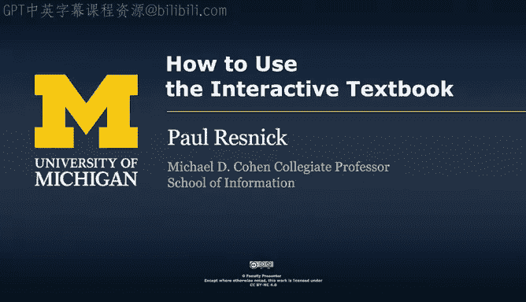
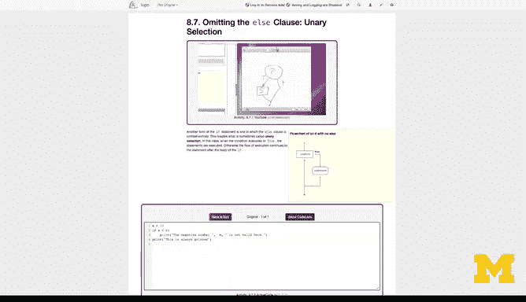

# 课程1：Python 3编程入门 | 第5课：交互式教材使用指南 📚

在本节课中，我们将学习如何使用本专项课程提供的免费交互式教材。该教材包含文本、代码示例和多种互动功能，能帮助你更有效地学习Python编程。

---

## 概述

本课程使用的Runestone交互式教材环境由Brad Miller创建，并得到了包括讲师在内的众多贡献者的完善。教材内容与前四门课程紧密对应，无论你从哪门课开始，本指南都将帮助你掌握其核心互动功能。

---

## 访问与登录

每次访问Runestone教材，你都需要通过Coursera上的特定页面链接进入。

点击页面上的对勾标记，然后启动应用。系统将自动跳转至教材页面。

由于是从Coursera跳转，系统会自动识别并登录你的账户。

---

## 核心互动功能

教材中不仅包含文本和图表，还设计了多种互动元素来辅助学习。

以下是教材中的主要互动功能：

*   **活动代码窗口**：这是一个可以编辑和运行代码的窗口。例如，你可以输入 `print("Hello")`，点击“保存并运行”，结果将显示在输出窗口中。
*   **代码历史记录**：你运行过的所有代码版本都会被永久保存。页面重新加载后，你可以点击“加载历史”来查看和恢复之前的代码版本。
*   **代码透镜**：这是一个由加州大学圣地亚哥分校的Philip Guo教授开发的强大工具。它允许你逐行步进执行程序，观察每行代码执行后的状态，这对于理解条件执行、循环和函数等复杂概念至关重要。
*   **选择题**：教材中嵌入了许多选择题。你可以选择答案并点击“检查我”来获得即时反馈，从而检验自己的理解。

---

## 导航与进度管理

在Runestone网站内，你可以自由浏览教材内容。

教材页面底部有一个“标记页面完成”的按钮。点击后，该页面在目录中的颜色会发生变化，便于你追踪学习进度，但这不影响课程考核，你可以选择使用或忽略此功能。

除了通过Coursera提供的链接进入特定页面，你还可以使用教材页面上的“前进”和“后退”按钮进行导航。点击教材标题可以查看详细的目录，其中列出了每一页甚至子章节。

此外，教材还提供搜索功能和索引，方便你快速查找特定概念或术语。

---

## 练习工具

练习工具是巩固所学知识的关键。你可以通过两种方式访问它：一是在Coursera中打开多处出现的“练习活动”；二是在任何Runestone教材页面点击“练习”选项。

该工具会根据你已打开的教材页面内容向你推送问题。它的核心机制是**间隔重复**：
*   答对问题，该主题下次出现的时间间隔会变长。
*   答错问题，该主题可能会在较短时间内再次出现。

工具界面会显示各个主题下次被提问的时间。坚持每天使用此工具进行少量练习，被证明能显著提高学习效果。完成每日练习（例如正确回答5个问题）后，还会有庆祝动画。

---

## 作业与评估

对于寻求证书的学习者，课程会在每课或每组课程后提供评分作业的链接。

在前四门课程中，所有评估和项目都位于Runestone教材内，并由系统自动评分。通常，你需要获得100%的分数才能通过评估，但你可以多次尝试，直到完全掌握。

提交评估时，系统会采用你历史上提交的最佳答案进行评分。

---

## 教材内的视频资源

许多教材页面顶部都包含视频：
*   **推荐观看**：由Steve制作的精美动画，以及由Google教育团队在Brad Miller指导下制作的带解说动画。这些视频质量很高。
*   **可选跳过**：一些仅仅是教材内容的讲解视频，且部分视频分辨率较低。建议你优先观看Coursera平台上的课程视频讲解。

---

## 总结

本节课我们一起探索了Runestone交互式教材环境的核心功能。我们学习了如何访问教材、使用活动代码窗口和代码透镜进行实践、利用练习工具巩固记忆、完成自动评分的作业，以及如何高效地导航和使用各种学习资源。

这个环境是多年来许多人辛勤付出的开源成果。希望它能帮助你扎实掌握Python编程基础。

最后，分享一点幽默的建议：不要拖延，今天就立即开始本课程的第一课吧！我们下次见。