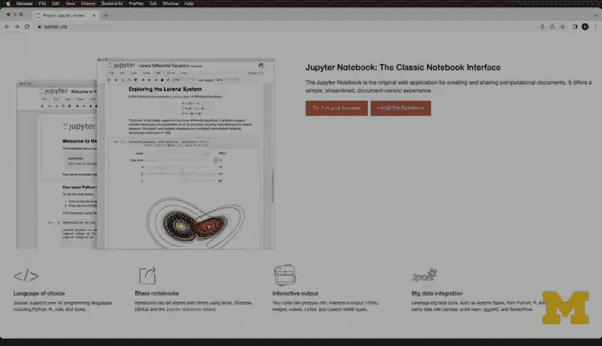
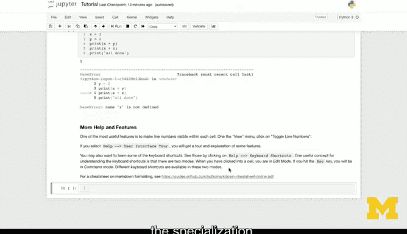

# 课程1：Python 3编程入门｜第6课：Jupyter环境入门指南 🚀




在本节课中，我们将学习一个全新的Python代码执行环境——Jupyter Notebook。我们将了解它的基本结构、如何运行代码、它与之前使用的Runestone环境有何不同，以及如何利用其强大的功能来辅助学习。

---

## 概述

Jupyter Notebook是一个交互式的编程环境，它将代码、文本说明和输出结果整合在一个文档中。Coursera平台提供了无需本地安装即可运行Jupyter Notebook的功能。本课程包含许多称为“实验”（Labs）的Notebook，它们原本是为线下课程设计的，旨在巩固所学知识。虽然这些实验是可选的，但强烈建议完成，因为课程的最终评估和项目也将以Jupyter Notebook的形式进行。

---

## Jupyter Notebook的基本结构

Jupyter Notebook由一个个“单元格”（cell）组成。单元格是构成Notebook的基本单位。

以下是两种主要的单元格类型：

1.  **Markdown单元格**：用于编写格式化的文本，可以包含标题、列表、加粗、链接等。
2.  **代码单元格**：用于编写和执行Python代码。

---

## 运行代码单元格

在代码单元格中，你可以编写Python代码。点击单元格，然后点击“运行”（Run）按钮，即可执行该单元格内的所有代码。

Jupyter的代码单元格与Runestone的“活动代码窗口”有两个关键区别：

1.  **表达式输出**：在Jupyter中，如果单元格的最后一行是一个表达式（例如 `x + 1`），执行该单元格时会自动显示该表达式的结果。而在Runestone中，必须使用 `print()` 语句才能看到输出。
    ```python
    # 在Jupyter中，以下单元格会输出 9, 10, 和 11
    x = 9
    print(x)
    print(x + 1)
    x + 2  # 这一行没有print，但Jupyter仍会显示结果 11
    ```

2.  **变量绑定的持久性**：在Jupyter中，不同单元格之间共享变量绑定。一个单元格中定义的变量，可以在后续的单元格中直接使用。而在Runestone中，每个活动代码窗口都是独立的。

    ```python
    # 单元格 A
    x = 9
    ```
    ```python
    # 单元格 B (可以访问单元格A中定义的x)
    print(x + 10)  # 输出 19
    ```

---

## 管理执行顺序与状态

由于变量绑定在单元格间共享，如果打乱单元格的执行顺序，可能会得到令人困惑的结果。

Notebook会为每个单元格的输出编号，这显示了单元格的执行顺序。例如，输出标记为 `[4]` 的单元格在标记为 `[5]` 的单元格之前执行。

如果执行顺序变得混乱，你可以重启内核来清除所有输出和变量绑定，然后从头开始按顺序执行单元格。操作方法是：点击 **Kernel -> Restart & Clear Output**。

---

## 保存与错误信息

Jupyter Notebook会自动保存你的工作。你也可以手动保存或创建检查点（checkpoint），以便回退到之前的版本。

Jupyter使用的是官方的Python解释器，因此其错误信息会比Runestone的“友好版”更原始、更技术化。例如，遇到未定义变量时，你会看到类似下面的错误：

```python
NameError: name ‘z’ is not defined
```

为了更清晰地定位错误，建议在 **View** 菜单中开启 **Toggle Line Numbers** 选项，显示代码行号。

---

## 使用Markdown格式化文本

Markdown单元格让你能用简单的语法创建美观的文档。双击一个Markdown单元格可以查看和编辑其源代码。

以下是一些常用的Markdown语法示例：

*   **标题**：使用 `#` 符号。`#` 数量越多，标题级别越低。
    ```
    # 一级标题
    ### 三级标题
    ```
*   **代码高亮**：用反引号 `` ` `` 包裹文本。
    ```
    这是一个 `代码片段`。
    ```
*   **斜体**：用单个星号 `*` 包裹文本。
    ```
    *这是斜体文本*
    ```
*   **链接**：直接粘贴URL会自动转换为可点击的链接，也可以使用 `[链接文字](URL)` 的格式。

你可以通过在线“速查表”学习更多Markdown语法。

---

## 键盘快捷键与进阶环境

熟练使用键盘快捷键可以极大提升在Jupyter中工作的效率。本视频中为了演示清晰使用了菜单点击，但日常操作推荐使用快捷键。

Jupyter Notebook非常适合本课程及后续专项课程中程序开发的规模。对于更大型的项目，你可能会需要使用集成开发环境（IDE），例如 PyCharm 或 VS Code，它们允许你将大量代码写入文件并一次性执行。你将在本专项课程的后续部分简要了解这些IDE。

---

## 总结

本节课我们一起学习了Jupyter Notebook这一强大的交互式编程环境。我们了解了它的单元格结构、如何运行和调试代码、变量绑定的持久性特点，以及如何使用Markdown来编写格式化的说明文档。掌握Jupyter将为你完成本课程的实验、作业和最终项目打下坚实的基础。



我们下次课再见！