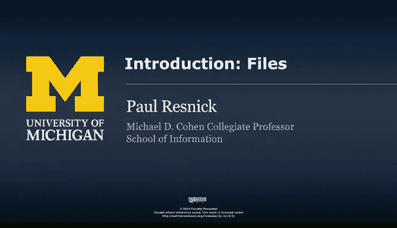

# 94：06_01_01_文件处理导论 📂

## 概述

在本节课中，我们将要学习Python程序如何处理文件。到目前为止，我们的程序所处理的数据和输入，要么来自我们直接写入程序的字面量，要么来自用户在执行过程中通过`input`函数键入的内容。而程序的输出也只显示在输出窗口中，一旦你翻到教科书的其他页面，这些输出就会消失。文件则包含了在你的程序多次执行之间都能持久保存的数据。作为一个计算机用户，你已经熟悉文件的概念，可能处理过图像文件、电子表格文件和文字处理文件。本节课你将学习如何在Python程序中操作文件。我们只处理文本文件，不涉及音频或其他二进制格式。学完本课后，你将能够编写程序来读取文件内容（无论是作为单个字符串还是逐行读取），能够使用相对路径来指定文件位置，并且能够向文件写入新的文本。

---

## 文件是什么？💾

上一节我们概述了课程目标，本节中我们来看看文件的基本概念。

文件是存储在计算机上的数据集合，这些数据在程序执行结束后依然存在。这与我们之前使用的`input`函数或程序变量中的数据不同，那些数据是临时的。

作为一个计算机用户，你可能已经接触过各种文件，例如：
*   图像文件（如.jpg, .png）
*   电子表格文件（如.xlsx, .csv）
*   文字处理文件（如.docx, .txt）

在Python编程中，我们将重点学习如何处理**文本文件**，即内容是人类可读字符的文件。

---

## 本节课的学习目标 🎯

了解了文件的基本概念后，我们来看看通过本节课的学习，你将掌握哪些具体技能。

以下是本节课结束后你应该能够完成的任务列表：
1.  编写程序读取文件的全部内容，并将其作为一个字符串处理。
2.  编写程序逐行读取文件内容。
3.  使用**相对路径**来指定文件在项目中的位置。
4.  向一个文件写入新的文本内容。

---

## 总结

本节课中，我们一起学习了Python文件处理的基础知识。我们明确了文件是用于持久化存储数据的重要工具，并设定了本课的学习目标：读取文件（整体或逐行）、使用相对路径定位文件以及向文件写入内容。掌握这些技能将使你的程序能够与外部数据进行交互，极大地扩展程序的功能和应用场景。我们将在接下来的课程中深入探讨每个目标的实现方法。