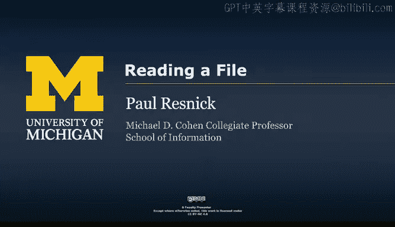
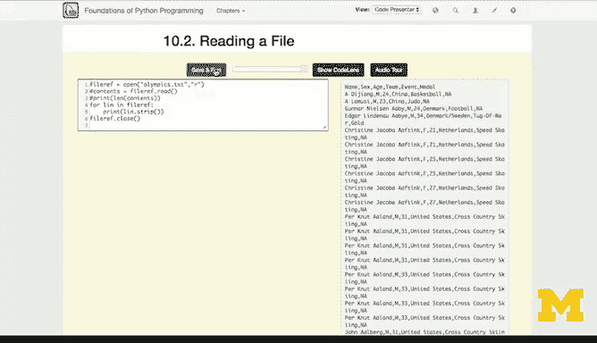

# 密歇根大学《Python3编程》课程1、2｜P95：07_01_02_文件读取操作 📂





## 概述

在本节课中，我们将要学习如何使用Python读取文本文件。我们将了解什么是文件，如何打开和关闭文件，以及读取文件内容的几种不同方法。

文件是保存在硬盘或其他存储设备上、随时间持久存在的数据集合。每个文件都有一个名称，并且可以组织到文件夹或目录中。本节课我们将专注于处理文本文件。

## 文件是什么？

文件是保存在硬盘或其他存储设备上、随时间持久存在的数据集合。文件具有名称，并且可以组织到文件夹或目录中。我们将处理文本文件，而不是图像、声音或视频文件。

这里有一个名为`Olympic.txt`的文件示例。该文件在Runestone环境中可用。文件的每一行都包含关于一名运动员参加奥运会的信息。这实际上是一个模拟文件。出于安全和隐私原因，Runestone无法访问您计算机上的真实文件，因此我们在runestone环境中模拟了几个文件的存在，以便说明文件读取的工作原理。

## 打开和关闭文件

Python提供了一些函数来从现有文件中读取数据。这个过程分为两个步骤。

第一步是调用`open`函数来打开文件。以下是调用`open`函数的示例。

我们传入两个参数。第一个参数是一个字符串，它是文件的名称，例如`Olympics.txt`。第二个参数说明要对文件执行什么操作。在我们的例子中是`'r'`，表示读取。稍后我们将看到`'w'`，表示写入。

`open`函数返回一个对象。这是一个文件对象，我们将其赋值给名为`file_ref`的变量。

实际上，要读取文件内容，我们还需要一个额外的步骤。目前展示的这一步只是创建了文件对象。然后，我们将编写一些尚未编写的代码行，这些代码将实际从文件中获取内容并对其进行处理。

最后，有一个对应的关闭操作，它让Python知道我们已经完成了对这个文件对象的操作，可以停止跟踪它了。因此，在第3行有`file_ref.close()`。

如果运行这段代码，我们实际上不会看到任何输出。因为我们所做的只是打开文件然后关闭它。我们实际上没有读取内容，当然也没有打印任何内容，所以输出窗口中看不到任何东西。

以下是打开和关闭文件的代码示例：
```python
file_ref = open('Olympics.txt', 'r')
# ... 读取文件内容的代码将放在这里
file_ref.close()
```

## 读取文件内容

如果我们确实想读取内容并打印出来，该怎么办？有几种不同的方法来处理文件对象。

### 方法一：使用 `.read()` 方法

我们将使用的第一种方法是`.read()`，它将把文件的全部内容作为一个单独的字符串读入。

让我展示一下它的样子。我们在`file_ref`对象上调用`.read()`方法，它返回一个字符串，我将其赋值给名为`contents`的变量。然后，我可以打印出来。让我们打印它的前100个字符。

现在，我们将在输出窗口中看到一些内容。我们看到的是文件的前100个字符，这得到了三行和第四行的一小部分。

现在，你很少会使用这种一次性将整个文件内容作为一个大字符串读入的方法。部分原因是，如果你有一个非常大的文件，你的计算机一次性在内存中处理所有这些内容会成为一个问题。

我们使用这种`.read()`方法的唯一情况是，如果你想将整个文件作为一个字符串抓取，并将其传递给其他一些解析它的函数。即便如此，通常也会有其他可用的函数，可以直接从文件对象中一点一点地读取并解析其内容。

以下是使用`.read()`方法的代码示例：
```python
file_ref = open('Olympics.txt', 'r')
contents = file_ref.read()
print(contents[:100])  # 打印前100个字符
file_ref.close()
```

### 方法二：使用 `.readlines()` 方法

我要展示的第二种方法不是一次性全部读取，而是使用`.readlines()`方法。它不是将所有内容作为一个字符串获取，而是返回一个字符串列表，文件中的每一行对应一个字符串。

让我们以这种方式打印出文件的前四行。我忘了重命名变量，我们称它为`lines`，因为我在第2行也把它叫做`lines`。

现在你可以看到我们正在打印一个列表。我们有方括号。在列表内部，有四个字符串。这是第一个字符串。第二个字符串从这里开始，到这里结束。依此类推。

请注意，每个字符串都以这个特殊的反斜杠`n`字符结尾。那是换行符，因为在文件中，我们有多行文本。所以当我们读入这些行时，每个字符串的末尾都有一个`\n`。

以下是使用`.readlines()`方法的代码示例：
```python
file_ref = open('Olympics.txt', 'r')
lines = file_ref.readlines()
print(lines[:4])  # 打印前四行
file_ref.close()
```

## 处理文件行

上一节我们介绍了如何将文件内容读入列表，本节中我们来看看如何更优雅地处理和显示这些行。

不仅仅是打印出所有这些行，我可以遍历它们以获得稍微漂亮一点的打印输出。

所以，对于`lines`中的`line`，也许我再次只取前四行，或者前五行，然后我将打印出单独的行。现在当我运行它时，它将遍历这四行，每一行都将打印在自己的行上。我们将不再显示方括号，因为我们不是在打印整个列表。我们正在遍历单个字符串。我们也不会得到这些引号，因为我们将传递字符串，当我们打印它们时，我们只是在输出窗口中显示它们的内容。

让我们看看运行时的样子。果然，我们得到了每一行。

现在你可能会注意到一些奇怪的事情，就是我们得到了这些空行。原因是，你记得每个字符串的末尾都有那个换行符，这意味着回车。而`print`函数总是会执行一个回车。所以我们得到了两个回车，一个让我们换到新行，另一个又让我们换到新行，所以我们得到一个空行。

如果我们不想要那个额外的空行怎么办？你以前见过`.strip()`方法，我可以从每行的开头和结尾去除空白字符。所以`.strip()`方法会去除开头或结尾的任何空白字符，空白字符包括空格字符、制表符或换行符。所以如果我调用这个方法，现在我将得到没有空行的打印输出。果然，我们得到了文件的前四行。

以下是遍历并处理行的代码示例：
```python
file_ref = open('Olympics.txt', 'r')
lines = file_ref.readlines()
for line in lines[:4]:
    print(line.strip())  # 使用strip去除首尾空白字符
file_ref.close()
```

## 直接迭代文件对象

有一种更简短的方法来遍历所有行，如果我们所要做的就是遍历所有行的话。

让我展示一下，因为这是更符合Python风格的方式，而不是将整个文件读入列表。我们可以直接通过`for line in file_ref`来迭代所有行。

这里`file_ref`是一个文件对象，不是一个列表，但它知道如何被迭代，每次我们得到一行。所以这将完全实现我们之前的功能，但现在我们将得到文件中的所有行。

因此，我们可以直接迭代这个文件对象。我们不能像处理列表那样对其进行切片操作。那样会出错。所以文件对象支持迭代，但不支持切片。因此，如果我们只想处理前四行，我们必须使用`.readlines()`，而不是直接迭代文件对象。但如果我们准备处理所有行，这是处理文件时通常要做的事情，那么这就是标准的Python惯用方法。

以下是直接迭代文件对象的代码示例：
```python
file_ref = open('Olympics.txt', 'r')
for line in file_ref:
    print(line.strip())
file_ref.close()
```

## 何时使用 `.readlines()` 或 `.read()`

那么，什么时候应该实际调用`.readlines()`或`.read()`呢？

调用`.readlines()`的一个原因是如果你想进行切片操作。另一个原因可能是你只想获取文件中有多少行。所以，如果我获取所有行并将它们放入一个变量，我现在可以打印出`lines`的长度，它会告诉我文件中有多少行。我先把另外两个注释掉。结果显示文件中有60行。

如果我想找出文件中有多少个字符，我可以将整个文件作为一个字符串读入，然后询问它的长度。

因此，除了这些特殊情况，你更常见想要做的事情是直接迭代文件对象本身。现在，我们将不使用`.read()`或`.readlines()`，而是直接迭代文件对象本身。这是处理文件时最常见的方式。

以下是计算文件行数和字符数的代码示例：
```python
file_ref = open('Olympics.txt', 'r')

# 计算行数
lines = file_ref.readlines()
print(f"文件共有 {len(lines)} 行。")
file_ref.close()

# 重新打开文件以计算字符数
file_ref = open('Olympics.txt', 'r')
# 计算字符数
contents = file_ref.read()
print(f"文件共有 {len(contents)} 个字符。")
file_ref.close()
```

## 总结

本节课中我们一起学习了Python读取文件的基础操作。我们了解了文件的基本概念，掌握了使用`open()`函数打开文件和用`close()`方法关闭文件的流程。我们探讨了三种读取文件内容的方法：使用`.read()`一次性读取整个文件为字符串，使用`.readlines()`读取所有行到一个列表，以及最常用、最符合Python风格的方法——直接迭代文件对象本身。我们还学习了如何使用`.strip()`方法处理行尾的换行符，以及如何根据需求（如切片或计数）选择不同的读取方法。记住，在处理完文件后，务必关闭文件以释放系统资源。




