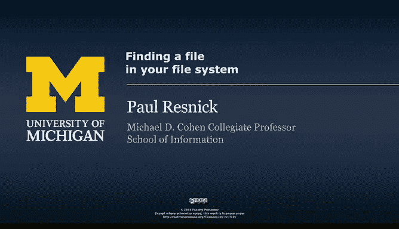
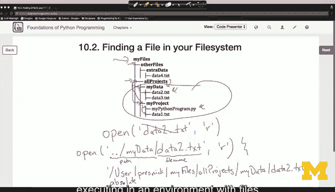

# 96：08_01_03_文件系统路径定位 📂




## 概述

在本节课中，我们将要学习如何在Python程序中定位和管理位于不同文件夹或目录中的文件。到目前为止，我们假设所有文件都位于同一个目录中，但实际项目中，文件通常被组织在多层目录结构里。本节将介绍如何使用相对路径和绝对路径来精确地找到并打开这些文件。

## 文件组织与目录结构

上一节我们介绍了在同一目录下操作文件的方法。本节中我们来看看当文件被组织到多层目录时，Python程序如何找到它们。

大多数人会将文件组织到文件夹或目录中。否则，一个目录下会有数百个文件，导致难以管理。

例如，下图展示了一个目录和文件的层级结构。


有一个顶级目录名为“My files”。在该目录下，有两个子目录：“Other files”和“All projects”。“All projects”目录下又有两个子目录：“my data”和“my project”。在“my data”目录中，有一个名为“data2.txt”的文件。在“my project”目录中，有“data1.txt”文件和我们的Python程序“my_program.py”。

按照惯例，我们将Python程序保存在以`.py`结尾的文件中。

## Python程序与当前工作目录

一个Python程序在运行时，会自动连接到它被调用时所在的目录。我们在Runestone书籍中直接调用Python，因此无法直观看到这个过程。但如果你在自己电脑上安装并本地运行Python，可以这样理解它。

在`open`函数中，我们可以像之前一样只传递一个文件名。

```python
open('data1.txt', 'r')
```

但我们也可以指定一个完整的路径，该路径既说明了文件的位置，也包含了文件名。

## 使用相对路径

通常，我们使用**相对路径**。相对路径指定了如何从当前程序所连接的目录出发，到达另一个目录。

假设我们正在“my project”目录中运行“my_program.py”程序，并且我们想要打开“data2.txt”文件。

我们不能直接写`open('data2.txt')`，因为“data2.txt”不在当前目录。我们必须告诉程序如何找到它。

以下是错误的做法，它将无法工作：

```python
open('data2.txt', 'r')  # 错误：文件不在当前目录
```

我们必须提供路径指引。从当前目录“my project”出发，需要先向上移动一级到其父目录“All projects”。在路径中，使用`..`表示向上移动到父目录。

然后，在“All projects”目录中，我们需要向下进入“my data”子目录。

最后，在“my data”目录中，我们就能找到“data2.txt”文件。

因此，正确的相对路径写法如下：

```python
open('../my data/data2.txt', 'r')
```

路径`../my data/`部分被称为**路径**，`data2.txt`是**文件名**。其他操作与之前完全相同。

## 使用绝对路径

还有一种指定**绝对路径**的方法。绝对路径意味着给出文件在计算机上的完整位置，而不是相对于当前目录的位置。

绝对路径通常以根目录符号（如`/`在Unix/Linux/macOS系统，或`C:\`在Windows系统）开头。

例如，一个绝对路径可能看起来像这样：

```
/user/P.Resnk/My files/All projects/my data/data2.txt
```

以下是使用绝对路径的示例：

```python
open('/user/P.Resnk/My files/All projects/my data/data2.txt', 'r')
```

## 相对路径与绝对路径的选择

我不推荐使用这些所谓的**绝对路径**。因为它会使你的代码和数据缺乏可移植性。

如果我使用相对路径，并且将整个文件夹结构复制到另一台计算机的不同位置，代码仍然能够找到文件。

而如果使用绝对路径，路径`/user/P.Resnk/...`在另一台计算机上很可能不存在，导致程序运行失败。

因此，人们通常更喜欢使用**相对路径**，因为这使得代码和数据更具可移植性，可以轻松转移到其他计算机。

## 给初学者的提示

如果你一直在Runestone教科书环境中运行Python，可能还没有机会在打开文件时使用这些文件路径。不必担心。

只需记住，当你在一个将文件分组到目录的环境中执行程序时，可以回看本视频或书中对应的页面来复习路径的使用方法。


## 总结

本节课中我们一起学习了如何在Python中处理位于不同目录的文件。我们了解了目录的层级结构，并掌握了两种定位文件的方法：**相对路径**和**绝对路径**。相对路径从程序当前所在目录出发进行导航，而绝对路径则提供文件在系统中的完整地址。为了代码的可移植性和灵活性，我们推荐优先使用相对路径。记住，`..`表示上级目录，而路径和文件名共同构成了文件的完整访问地址。

下次见。



