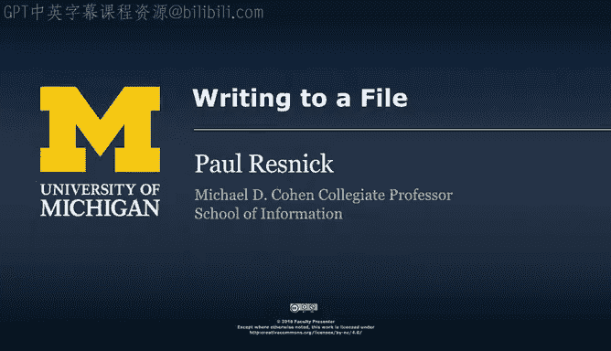
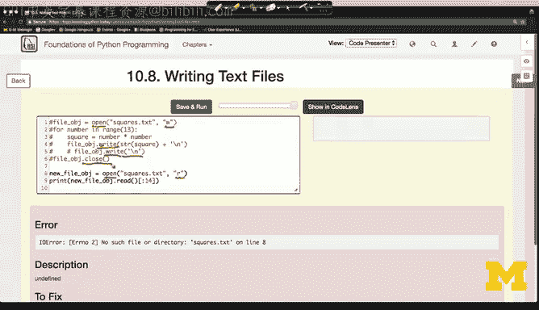

# 97：09_01_04_文件写入操作 📝




在本节课中，我们将要学习如何将数据写入文件。这是将程序输出永久保存到磁盘上的关键技能。

## 概述

上一节我们介绍了如何从文件中读取数据。本节中我们来看看如何将数据写入文件。写入文件的操作与读取文件在结构上非常相似，但有几个重要的区别需要注意。

## 写入文件的基本步骤

写入文件与读取文件类似。你仍然需要基于文件名打开一个文件对象。但区别在于，你不是从文件对象中读取，而是向它写入。

让我们看一个例子。以下代码会打印出从0到12（不包括13）所有数字的平方。

```python
for i in range(13):
    print(i * i)
```

运行这段代码，我们会在输出窗口看到0、1、4、9等结果。

## 将输出写入文件

假设我们不想把这些结果打印到输出窗口，而是想将它们永久存储到一个文件中。那么，让我们开始编写代码。

以下是读取或写入文件的一个通用模板：

```python
file_obj = open('squares.txt', 'w')
# ... 写入操作 ...
file_obj.close()
```

我们打开一个名为 `squares.txt` 的文件用于写入（`'w'`）。我倾向于在打开文件后立即写上关闭文件的语句，以免忘记。

如果现在运行这段代码，什么也不会发生，因为我们仍然只是在向输出窗口打印内容。

## 使用 `.write()` 方法

为了写入文件，我们需要使用 `file_obj.write()` 方法，而不是 `print` 语句。并且，我们必须将要写入的数字（如0、1、4）转换为字符串。

`print` 函数比较灵活，它可以接受数字或字符串并自动处理。但 `.write()` 方法要求我们必须提供一个字符串。

以下是修改后的代码：

```python
file_obj = open('squares.txt', 'w')
for i in range(13):
    file_obj.write(str(i * i))
file_obj.close()
```

运行后，文件 `squares.txt` 中将包含所有数字的平方：0, 1, 4, 9等。

## 处理换行符

你可能会注意到，文件中的输出与在输出窗口中的显示有所不同。在输出窗口中，每个结果都单独占一行。但在文件中，所有数字都连在一起，没有换行。

造成这种差异的原因是：当你调用 `print('4')` 时，它会自动在输出中添加一个换行符。而调用 `.write('4')` 时，只写入内容“4”，不包含换行符。你必须自己决定何时需要换行。

因此，我们需要在写入每个平方数后，显式地写入一个换行符 `\n`。

以下是添加换行符的代码：

```python
file_obj = open('squares.txt', 'w')
for i in range(13):
    file_obj.write(str(i * i))
    file_obj.write('\n')  # 显式添加换行符
file_obj.close()
```

现在，保存并运行代码，文件中的数据看起来就更清晰了，每个值都独占一行。

当然，你也可以将字符串拼接和换行符写在同一行：

```python
file_obj.write(str(i * i) + '\n')
```

效果是一样的。对于初学者，我喜欢将换行符单独写一行，因为这能明确提醒我们：在使用 `.write()` 时，必须显式地创建换行符，这与 `print` 函数自动添加换行符的行为不同。

## 读取我们写入的文件

文件写入后，在本页面显示期间都是可用的。我们可以读取它来验证内容。

以下是读取 `squares.txt` 文件前10个字符的代码：

```python
new_file_obj = open('squares.txt', 'r')
content = new_file_obj.read(10)  # 读取前10个字符
print(content)
new_file_obj.close()
```

运行后，输出窗口会显示前10个字符。第一个字符是“0”，第二个字符是换行符，依此类推。

这个文件是真实存在的。即使我不每次都运行写入代码来重新创建它，只要不重新加载页面，我仍然可以直接读取它。

## 重要注意事项

写入文件在结构上与读取相似，但有几点关键区别：

以下是核心步骤和注意事项：
1.  我们像读取一样打开文件，但在写入时使用模式 `'w'` 而不是 `'r'`。
2.  我们根据需要调用 `.write()` 方法。
3.  如果需要换行，必须显式写入 `\n` 字符。
4.  最后必须关闭文件。对于写入操作，这一点尤其重要，否则内容可能不会完全写入磁盘，导致数据丢失。

## 总结



本节课中我们一起学习了Python的文件写入操作。我们了解了如何打开文件进行写入、使用 `.write()` 方法输出数据、以及如何显式地添加换行符来格式化文件内容。记住，完成写入后关闭文件是确保数据安全保存的必要步骤。通过将数据写入文件，我们可以让程序的输出结果得以持久化保存。