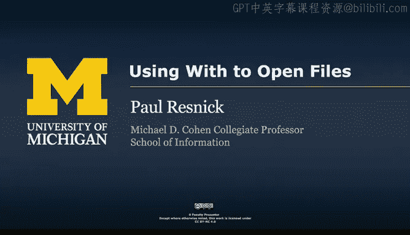
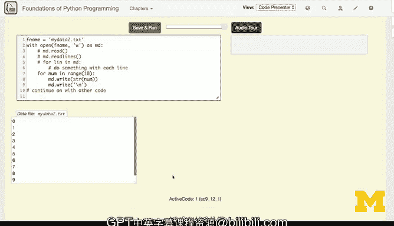

# 98讲：使用 `with` 语句进行文件操作 📂




## 概述

在本节课中，我们将学习 Python 中一个非常实用的高级特性——`with` 语句。这个特性可以让我们更轻松、更安全地处理文件，因为它能自动管理文件的打开和关闭，避免我们忘记关闭文件而导致资源泄露。

---

## 什么是 `with` 语句？

`with` 语句是 Python 提供的一种上下文管理器。虽然我们不需要深入理解其全部原理，但我们可以利用它来简化文件操作。

它的基本语法结构如下：

```python
with open('文件名', '模式') as 变量名:
    # 在此代码块中操作文件
```

这个结构等价于先打开文件，然后在操作完成后手动关闭文件。但在 `with` 语句中，文件的关闭是自动完成的。

---

## 读取文件的通用方法

以下是使用 `with` 语句读取文件的通用步骤。

首先，我们使用 `with` 语句打开文件，并将其赋值给一个变量（例如 `md`）。然后，在缩进的代码块中，我们可以使用三种方法来处理文件内容：

1.  使用 `.read()` 方法将整个文件内容作为一个字符串读取。
2.  使用 `.readlines()` 方法将文件内容按行读取为一个字符串列表。
3.  直接对文件对象进行迭代，逐行处理。

让我们看一个具体的例子。假设我们有一个名为 `mydata.txt` 的文件，我们可以这样读取它：

```python
with open('mydata.txt', 'r') as md:
    for line in md:
        print(line)
```

运行这段代码，它会逐行打印出文件中的内容。

---

## 写入文件的通用方法

同样的方法也适用于写入文件。我们只需要将打开文件的模式从 `'r'`（读取）改为 `'w'`（写入）即可。

例如，如果我们想向一个文件中写入数字 0 到 9，每个数字占一行，可以这样做：

```python
with open('output.txt', 'w') as md:
    for number in range(10):
        md.write(str(number) + '\n')
```

运行这段代码后，`output.txt` 文件中将包含数字 0 到 9，每个数字单独一行。

**注意**：在写入文件时，请确保文件名不与 Python 内置模块或当前目录中的重要文件重名，以避免意外覆盖。

---

## 总结

本节课我们一起学习了 Python 中 `with` 语句的用法。通过 `with open(...) as ...:` 的结构，我们可以更优雅、更安全地处理文件，因为它能确保文件在使用后被正确关闭。



虽然不使用 `with` 语句也能进行文件操作，但熟练的程序员通常会使用它。你在 Stack Overflow 等编程社区也会经常看到这种写法。因此，理解并掌握 `with` 语句对编写高质量的 Python 代码非常有帮助。