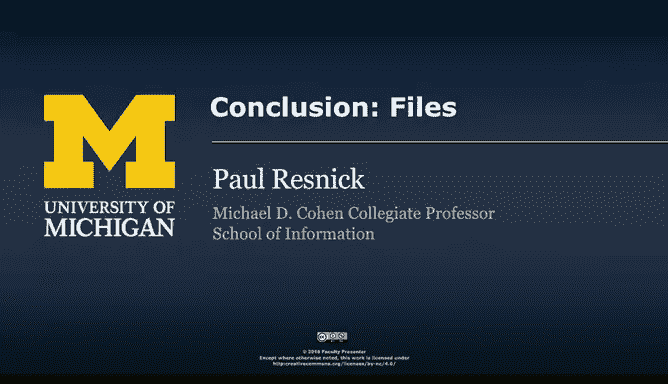

# 密歇根大学《Python3编程》课程1、2｜P99：11_01_06_文件处理总结 📂

在本节课中，我们将总结Python文件处理的基础知识，并指出两个常见的易错点，帮助你巩固所学内容。

---

## 文件处理基础回顾

上一节我们介绍了文件的读取和写入操作。你已经掌握了文件处理的基本方法。

## 两个常见易错点

以下是两个在文件处理过程中容易混淆的地方，请务必牢记。

1.  **调用`open`函数时，第一个参数必须是表示文件名的字符串。**
    *   如果文件名存储在一个变量中，调用时**不要**加引号。
    *   如果直接使用文件名的字面值，则**必须**加引号。

2.  **必须清楚区分三个概念：文件名、文件对象和文件内容。**
    *   **文件名**是一个字符串。
    *   **文件对象**是调用`open()`函数后返回的对象。
    *   **文件内容**是通过对文件对象进行操作（如`.read()`）获得的数据。

---

## 轻松一刻 😊

**关于“读取”**：我曾计划读一本关于天坑的书，但这个计划“落空”了。

**关于“写入”**：从前有个年轻人，声称渴望成为一名伟大的作家。当被问及如何定义“伟大”时，他说：“我想写出让全世界都读的东西，让人们产生真正的情感共鸣，让他们尖叫、哭泣、痛苦和愤怒地咆哮。”现在，他为Python解释器编写错误信息。

---

本节课中我们一起学习了文件处理的核心要点和两个关键注意事项。恭喜你坚持学习到这里，我们下次再见。