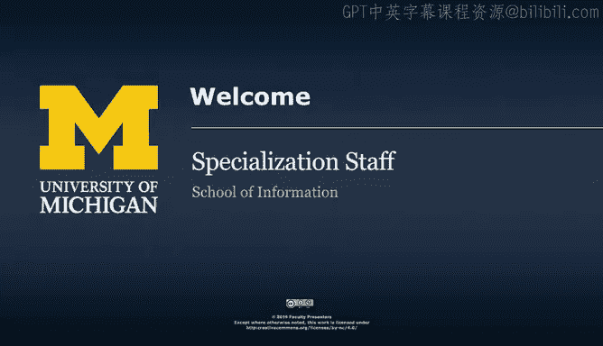
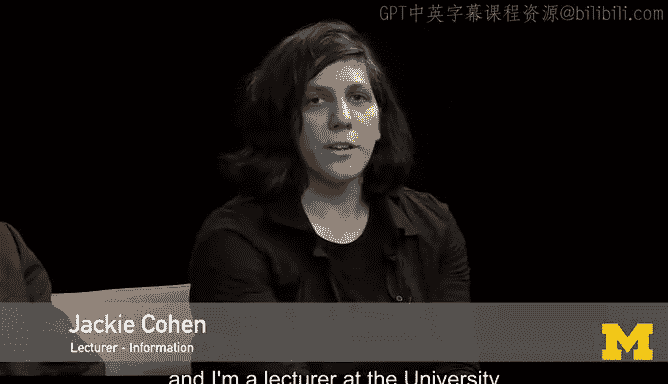
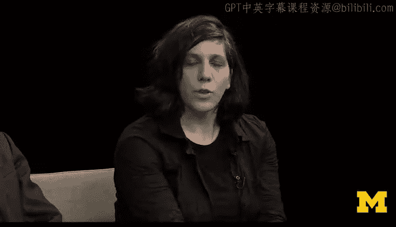
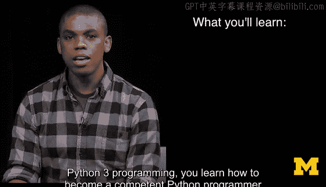
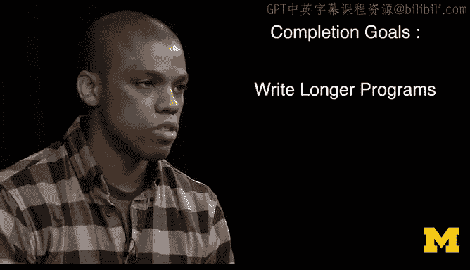
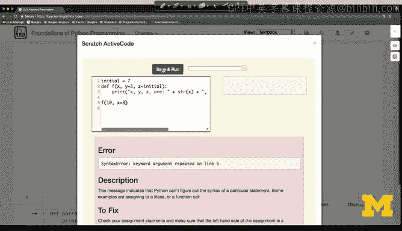
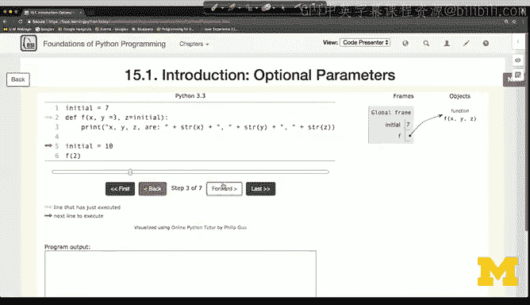

# 课程1：专业导论 👨‍🏫

在本节课中，我们将认识密歇根大学信息学院的教师团队，并了解《Python 3 编程》专项课程的整体目标与特色。本课程将从零开始，深入讲解 Python 的基础知识，帮助你成为一名合格的 Python 程序员。

---

大家好，我是 Steveonni，密歇根大学信息学院的助理教授。我在信息学院教授一些编程入门课程。编程将日益成为一种基础且重要的素养，也是处理我们日常生活中日益增长的数据的关键方式，因此我非常高兴你能加入我们。

在我的个人生活中，我喜欢踢足球，和 Resnick 教授一样，我也是一名狂热的自行车爱好者。你将在课程一、二和四中看到我。

我的大部分研究致力于提高编程工具的可用性，换句话说，是围绕人们的思维方式和我们实际的编程方式来设计编程工具。

---

大家好，我是 Paul Resnick，密歇根大学信息学院的教授兼研究副院长。

作为院长，我授课的机会不多。但我非常享受在这个专项课程中将要教授给你们的内容，也很高兴有机会与你们分享。你将在课程一、二、几乎整个课程三以及课程四的一部分中看到我。

我喜欢书呆子式的双关幽默，也就是所谓的“老爸笑话”，我将在一些课程结束时与你们分享一些。

在我的研究中，我最出名的可能是现在所谓的“推荐系统”。我早在 90 年代初就发表了相关文章，例如亚马逊网站上显示的“购买此书的顾客也购买了这些书”。

最近，我一直在研究在线社区和教育技术。

在我的个人生活中，我喜欢打网球和骑自行车。我骑得很慢。四年前，我骑上了环法自行车赛的标志性爬坡路段旺图山；两年前，我骑上了比利牛斯山脉的图尔马莱山口。

我的旅行远不如 Chuck 博士多。但我期待在旅行时尝试采纳他的做法，在当地举行实时办公时间，也许我有机会见到你。课程中见。

---

大家好，我叫 Jackie Cohen，是密歇根大学信息学院的讲师。我教授很多编程课程，包括与你们在这里看到的非常相似的课程。

我也负责构建、设计和支持许多课程资源。所有这些意味着我见过许多不同的学生完成许多不同的编程项目。我在这里的工作是引导你了解期末项目，并为你提供一些在完成项目时可能有用的提示和建议。

我希望你们喜欢这些项目，因为我认为它们非常有趣，并且会为你在日常生活中使用编程提供很多工具。

---

大家好，我是 Chris Brooks，密歇根大学的教员。

在这个专项课程中，我将教授最后一门课程。在那门课程中，你将学习使用图像处理库和大型图像集，并利用 Python 将其转化为有用的信息。

我的研究重点是教育技术，我教授许多数据科学课程，包括这个平台上的一些课程。我对像你们这样的学习者如何接触技术、与技术互动并利用技术促进学习非常感兴趣。

我期待在最后一门课程中见到你们。

---

大家好，我叫 Charles Severance。你们可能之前在《Python for Everybody》专项课程中见过我。你们中的一些人可能上过那门课，然后来到了这个班级。我真的很喜欢我在这门课中所做的事情，实际上我并不教授任何核心内容，而是扮演我们所说的“程序员之道”的角色。这有点像我可以稍微玩一下，而不是真正教你们什么，而是向你们展示一些很酷的东西，这给了我很大的自由来展示我认为有趣的东西。

你们有些人可能知道，我的研究领域是教育技术。我对你们正在使用的这个平台非常好奇，我们如何改进它，如何让它变得更好。我有很多爱好，但我最近的爱好是在赛道上开赛车。如果你留意，可能会找到一张我在赛车里的照片。

---

大家好，我是 Lauren Murphy。几年前我参加了这个课程的校园版本，后来作为教学助理帮助其他学生学习这些材料。之后我回来帮助建设这门课程，构建你们将要完成的测验、评估和项目。

我非常高兴你们有机会学习同样的材料，希望你们学得愉快。

---

在这个《Python 3 编程》专项课程中，你将通过详细学习语言的基础知识，成为一名合格的 Python 程序员。你将学习如何导航复杂的数据结构并从中累积结果。你还将学习如何将数据转换为可供其他程序使用的格式。

在专项课程结束时，你将能够编写几百行的 Python 程序。你将能够在代码中使用和集成 Python 模块。你也将能够通过阅读文档来使用外部工具，如 API。

---

我们从零开始，不预设任何先验知识，但我们会深入 Python 的基础知识，以确保你理解代码的每一个方面。

关于我们的 Runestone 交互式环境，它允许你将学习材料与主动代码评估交织在一起，让你能够实际编写代码。我们发现编写代码非常重要，因为即使你可以在理论上理解一个概念是如何工作的，比如知道 Python 的某个特定功能，但实际编写代码对于获得更多实践理解和知道如何在实践中应用这些概念至关重要。

---

此外，还有“程序员之道”环节。课程的大部分内容是关于如何使用 Python 和学习 Python 功能。“程序员之道”环节则更多是关于程序员可以且应该如何工作。编程更像是一门艺术而非科学，做事情有很多正确的方法，但存在最佳实践。

例如，在“程序员之道”环节中，你将学习如何逐步编写程序。你还将学习如何编写良好的自动化测试用例。

---

那将在课程四中出现。在此之前，我们将为你编写这些测试用例。Lauren 创建了大量的评估，你不仅可以在浏览器中运行代码，它还会告诉你是否正确，你会得到即时反馈，并且可以随意尝试多次。

事实上，我们已经设定了评估，你必须全部做对，达到 100% 正确才能通过评估。这样做的原因是我们真的希望你建立精通，这样你就不会在早期材料没有真正扎实掌握的情况下继续学习后面的内容。

你还会注意到，在你完成的所有项目中，你会发现将你在课程和整个专项课程中学到的概念转化为现实生活的方法。例如，构建可能对你的工作、学习或其他活动有用的程序的不同方式。

---

我真的很喜欢的一点是，在《Python for Everybody》中，我主要关注程序本身。如果你完成了程序，就像你赢了，得到了金星。我们没有时间或条件去真正理解程序内部发生了什么，我们只是完成了程序，然后必须继续下一件事。

但在 Runestone 中，你可以探究程序内部到底发生了什么，以及它是如何工作的。这种精通的一部分在于，如果你不能作为一个程序员，将自己置身于程序内部，理解程序实际上是如何运行的，那么就很难编写更复杂的程序。

因此，尽管从技术上讲这是一门入门课程，但我认为人们参加不止一门入门课程真的很重要，因为你必须一遍又一遍地学习相同的材料，每次学习都要有更深的理解。

---

我们有一个很棒的代码透镜工具，我想你指的就是它。它可以让你可视化程序执行过程中每一行发生的事情，你可以前进和后退，查看变量的实际值，以及我的列表内容何时发生了变化。这为你提供了一种思考方式。

它对于调试非常有用，这样你就不必只是通过反复试验来修改代码，你可以真正思考程序是什么。另一件学生们总是在课程结束时问我的事情是“接下来做什么”。我认为很酷的是，你们在这个专项课程中内置了指向他们接下来要做什么的步骤。

---

是的，我们在课程最后增加了一门项目课程，重点是让人们学习如何利用外部现有的 API 或软件包，并用它们做一些新颖的事情，而不仅仅是学习。这涉及到你提到的重复练习。

为此，我们实际上是在 Jupyter 环境中进行的。就像你需要对 API 和 Python 基础进行重复练习一样，有很多不同的地方可以编写和运行 Python 代码。Runestone 是其中之一，你在《Python for Everybody》中使用的工具也是其中之一。Jupyter 是一个相当常见的环境，我们在数据科学专项课程中教授它，学生可以接着学习。还有其他环境。

因此，我们试图展示 Python 编程学习和生产环境的多样性。编程环境不止一个。在现实世界中，每份工作通常都有不同种类的环境。练习在编程环境中非常重要。

我认为 Lauren 为你们编写了一些很好的练习题，供你们在整个课程中练习。我们还有一个很棒的练习工具，你会看到它为了复习而向你呈现一些你过去见过的问题。如果你遇到困难，它会更频繁地呈现这些问题；如果你表现出精通，则会减少频率。这是一种真正巩固你所学知识的方式。

请留意那个练习工具，它还有有趣的烟花效果，会在你完成当天所有练习问题时显示。

---

正如你所看到的，我们都非常兴奋能与你们分享这些材料，我们希望你们学得开心，并祝你们好运。

在密歇根大学，我们的校色是 maize 和 blue。你可能会认为它们是黄色和蓝色，但我们称之为 maize 和 blue。

无论我旅行到哪里，只要我身上有密歇根大学的标志，就会有人在机场走过来对我说“Go Blue”。那么，数到三，一、二、三，Go Blue！