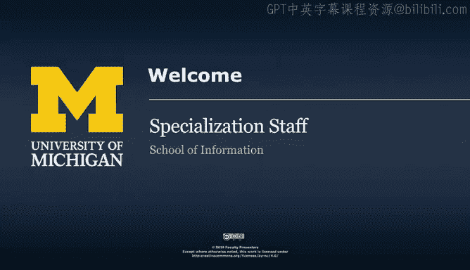
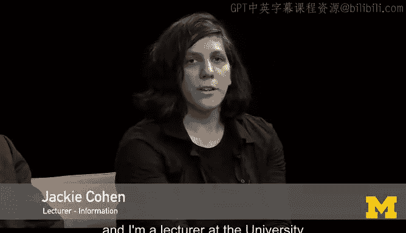
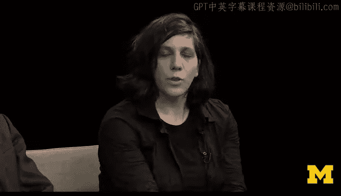
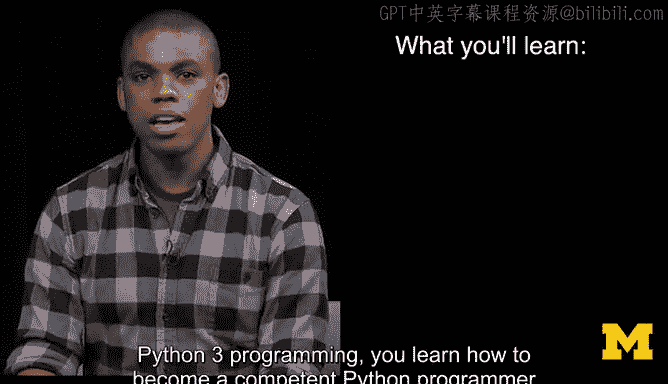
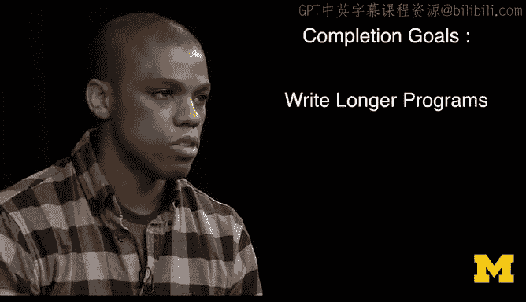
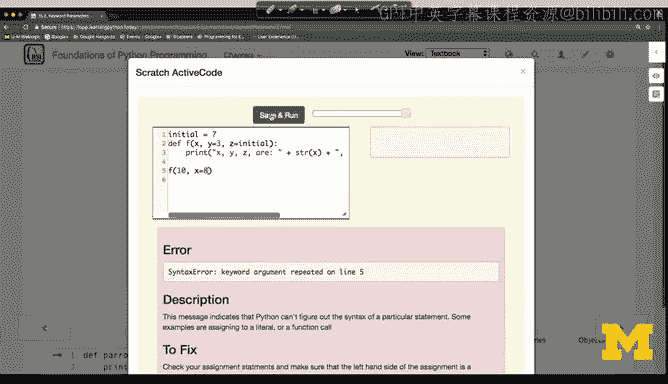
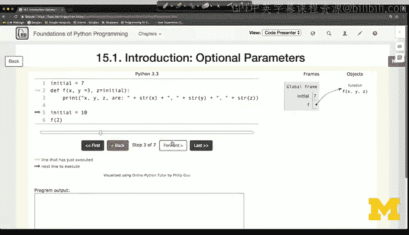

# 课程1：专业导论 👨‍🏫

在本节课中，我们将认识密歇根大学信息学院的教师团队，并了解《Python 3编程》专项课程的整体目标、特色学习方法以及你将掌握的核心技能。

大家好，我是密歇根大学信息学院的助理教授 Steve Oney。我在信息学院教授一些编程入门课程。我非常高兴你能加入我们，因为我认为编程将日益成为一种根本性的重要素养，也是我们处理日常生活中日益增长的数据的一种方式。在我的个人生活中，我喜欢踢足球。和 Resnick 教授一样，我也是一名狂热的自行车爱好者。你们将在课程一、二和四中看到我。我的大部分研究致力于提高编程工具的可用性，换句话说，就是围绕人们的思维方式和我们实际的编程方式来设计编程工具。

大家好，我是 Paul Resnick。我是密歇根大学信息学院的教授兼研究副院长。作为院长，我授课的机会不多。但我非常享受在这个专项课程中将要教给你们的内容，也很高兴有机会与你们分享。你们将在课程一、二、几乎整个课程三以及课程四的一小部分中看到我。我喜欢书呆子式的双关幽默，也就是所谓的“老爸笑话”，所以我会在一些课程结束时与你们分享一些。在我的研究中，我可能以现在所谓的“推荐系统”而闻名。我最早在90年代初就发表了相关文章，比如亚马逊网站上显示的“购买此书的顾客也购买了这些书”。最近，我一直在研究在线社区和教育技术。在我的个人生活中，我喜欢打网球和骑自行车。我骑得很慢。四年前，我骑上了环法自行车赛的标志性爬坡路段旺图山；几年前，我又骑上了比利牛斯山脉的图尔马莱山口。我的旅行远不如 Chuck 博士多。但我期待在旅行时尝试采纳他的做法，在当地举行实时办公时间，所以也许我有机会见到你们。课程中见。

大家好，我是 Jackie Cohen，我是密歇根大学信息学院的讲师。我教授很多编程课程，包括与你们在这里看到的非常相似的课程。我还构建、设计和支持许多课程资源。所有这些意味着我见过很多不同的学生完成很多不同的编程项目。我在这里要做的是引导你们了解最终的课程项目，并给你们一些在完成项目时可能有用的提示和建议。我希望你们喜欢这些项目，因为我认为它们真的很有趣，并且会为你们在日常生活中使用编程提供很多工具。

大家好，我是 Chris Brooks，我是密歇根大学的教员。在这个专项课程中，我将教授最后一门课程。在那门课程中，你们将学习图像处理库和大型图像集，并使用 Python 将其转换为有用的信息。我的研究重点是教育技术，我教授很多数据科学课程，包括这个平台上的一些课程。我对像你们这样的学习者如何接触技术、与技术互动并利用技术促进学习非常感兴趣。我期待在最后一门课程中见到你们。

大家好，我是 Charles Severance。你们可能之前在《Python for Everybody》专项课程中见过我，你们中的一些人可能上过那个课程然后来到了这个班级。我真的很喜欢我在这门课里做的事情，那就是我实际上并不教授任何核心内容，而是做我们称之为“程序员之道”的部分。这有点像我可以稍微玩一下，而不是真正教你们什么，而是向你们展示一些很酷的东西，这给了我很大的自由来展示我认为有趣的东西。正如你们一些人可能知道的，我的研究领域是教育技术。你们正在使用的这个平台是我非常好奇如何改进、如何让它变得更好的东西。我有很多爱好，但我最近的爱好是在赛道上开赛车。所以如果你找找看，可能会发现一张我在赛车里的照片。

大家好，我是 Lauren Murphy。几年前我参加了这个课程的校园版本，并最终作为教学助理帮助其他学生学习这些材料。后来我回来帮助建设这门课程，构建你们将要完成的测验、评估和项目。我非常高兴你们有机会学习同样的材料，我希望你们学得愉快。

在这个《Python 3编程》专项课程中，你们将通过学习语言的细节基础，学会如何成为一名合格的 Python 程序员。你们将学习如何浏览复杂的数据结构并从中累积结果。你们还将学习如何将数据转换为可供其他程序使用的格式。在专项课程结束时，你们将能够编写几百行的 Python 程序。你们将能够在代码中使用和集成 Python 模块。你们也将能够通过阅读文档来使用外部工具，如 API。

## 课程特色与学习方法 🛠️

上一节我们认识了教学团队，本节中我们来看看这门课程独特的学习方法和支持工具。

我们从零开始，不预设任何先验知识，但我们会深入 Python 的基础知识，以确保你们理解代码的每一个方面。关于我们的 Runestone 交互式环境，它允许你将学习材料与主动的代码评估交织在一起，让你能够实际编写代码。我们发现编写代码非常重要，因为即使你可以在理论上理解一个概念是如何工作的，比如你可能知道 Python 的某个特定功能如何工作，但实际编写代码对于获得更多实践理解以及知道如何在实践中应用这些概念至关重要。

以下是课程的核心学习方法：
*   **交互式学习**：通过 Runestone 交互式教科书，边学边练。
*   **即时反馈**：在浏览器中运行代码后，系统会立即告诉你是否正确，你可以多次尝试。
*   **掌握式学习**：评估要求你必须全部做对才能通过，确保你在进入后续内容前扎实掌握前期知识。

## “程序员之道”与项目实践 🧑‍💻

上一节我们介绍了交互式学习环境，本节中我们来看看课程中另一个特色部分——“程序员之道”，以及如何将所学应用于实践。

课程大部分内容是关于如何使用 Python 和学习 Python 功能。“程序员之道”部分则更多是关于程序员可以且应该如何工作。编程更像是一门艺术而非纯粹的科学，做事情有很多正确的方法，但存在最佳实践。例如，如何以增量的方式编写程序。在“程序员之道”部分，你们还将学习如何编写良好的自动化测试用例。

测试用例的编写将在课程4中深入讲解。在此之前，我们会为你们编写这些测试用例。Lauren 创建了大量的评估，你们不仅可以在浏览器中运行代码，它还会告诉你们是否正确，你们会得到即时反馈，并且可以随意尝试多次。事实上，我们已经设定了评估方式，要求你们必须全部做对，达到100%正确才能通过评估。这样做的原因是我们真的希望你们建立扎实的掌握能力，这样你们就不会在早期材料还没真正掌握的情况下就进入后面的内容。

你们还会注意到，在你们完成的所有项目中，都会找到将课程和整个专项课程中学到的概念转化为现实生活应用的方法。例如，构建程序的不同方式，可能对你的工作、学习或你所做的任何事情都很有趣。

## 深入理解与可视化工具 🔍

上一节提到了项目实践，本节中我们将探讨如何深入理解程序内部运行机制，这是编写复杂程序的关键。

我真的很喜欢看你们所有人把这些整合起来。在《Python for Everybody》中，我真的专注于程序本身。如果你完成了程序，就像你赢了，得到了金星。我们没有时间或条件去真正理解程序内部发生了什么，我们只是完成了程序，然后必须继续下一件事。但在 Runestone 中你们拥有的一些工具，可以让你们了解程序内部到底发生了什么，以及这究竟是如何工作的。这种掌握能力的一部分在于，如果你作为一个程序员，不能将自己置身于程序之中并理解程序实际上是如何运行的，那么就很难编写更复杂的程序。因此，尽管这 technically 是一门入门课程，但我认为人们参加不止一门入门课程真的很重要，因为你需要一遍又一遍地学习相同的材料，每次都以更深层次的理解去学习。

是的，我们有一个很棒的代码透镜工具，我想你指的就是它。它可以让你可视化程序执行过程中每一行发生了什么，你可以前进和后退，查看那个变量的实际值是什么，我的列表内容是什么时候改变的。所以它给了你一种思考方式。它对于调试非常有用，这样你就不必只是通过试错来修改代码，你可以真正地思考程序是什么。

## 后续步骤与多样化环境 🚀

上一节我们介绍了帮助深入理解的工具，本节中我们来看看课程结束后你可以做什么，以及接触不同的编程环境的重要性。

学生们总是在课程结束时问我“接下来做什么？”。我认为你们在这个专项课程中内置了一个进入下一步的阶梯，这很酷。是的，我们在这门课程的最后增加了一个项目课程，这真的是为了专注于让人们学习如何利用外部现有的 API 或软件包，并用它们做一些新颖的事情，而不仅仅是学习。这也触及了你提到的重复练习这一点。为此，我们实际上是在 Jupyter 环境中进行的。就像你需要对 API 和 Python 基础进行重复练习一样，有很多不同的地方可以编写和运行 Python 代码。Runestone 是其中之一，你在《Python for Everybody》中使用的工具也是其中之一。Jupyter 是一个相当常见的环境，我们在学生可以接着学习的数据科学专项课程中教授它。还有其他环境。因此，我们试图真正展示 Python 编程学习和生产环境的多样性。编程环境不止一个，对吧？并不是说你只有这一个东西，你把东西输进去，这就是所有的编程。当你在现实世界中，每份工作通常都有不同种类的环境。

练习在编程环境中非常重要，我认为 Lauren 为你们编写了一些很好的练习题，供你们在整个课程中练习。我们还有一个很棒的练习工具，你们会看到，它会向你们展示一些过去已经见过的问题以供复习。如果你遇到困难，它会更频繁地呈现它们；如果你表现出掌握，它就会减少呈现频率。这是一种真正巩固你所学知识的方式。所以，请留意那个练习工具，它还有这些有趣的烟花效果，会在你完成当天所有练习题时显示。

## 总结与祝福 🎓

本节课中，我们一起认识了《Python 3编程》专项课程的教学团队，了解了课程从零开始、注重深度掌握的核心目标。我们探讨了通过 Runestone 交互式环境进行边学边练、即时反馈的学习方法，以及“程序员之道”部分对培养编程思维和最佳实践的重要性。课程还提供了代码透镜等可视化工具，帮助深入理解程序运行机制。最后，课程设计了项目实践和多样化环境（如 Jupyter）的体验，为你后续的学习和应用铺平了道路。

正如你们所看到的，我们都非常兴奋能与你们分享这些材料，我们希望你们学得开心，并祝你们好运。在密歇根大学，我们的校色是 maize 和 blue。你们可能认为它们是黄色和蓝色，但我们称之为 maize 和 blue。无论我旅行到哪里，只要我身上有密歇根大学的标志，就会有人在机场走过来对我说“Go Blue”。那么，数到三，一，二，三，加油！