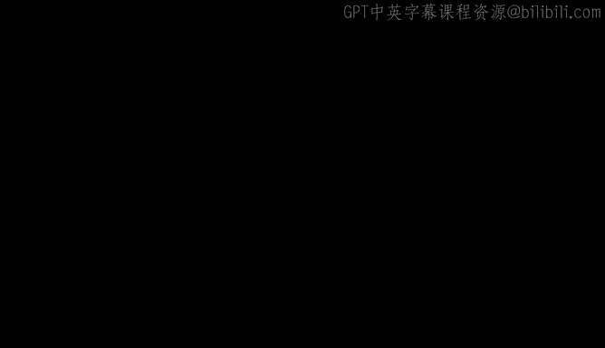

# 课程3、4、5：Python 3 编程第二版新内容介绍 🚀

在本节课中，我们将要学习密歇根大学《Python 3 编程》专项课程（课程3、4、5）第二版的主要更新与改进内容。本次更新包含了大量新内容、对Python最新变化的反映，以及根据数十万学习者反馈所做的优化。

## 新版内容概览 📋

我们很高兴向大家介绍本Python 3专项课程的第二版。我们新增了大量内容和新讲师。

大家好，我的名字是迈克尔·赫斯。我在密歇根大学信息学院担任讲师已有约10年。我教授的课程涵盖敏捷项目管理、机器学习流水线、应用机器学习导论、SQL与数据库、服务器与Shell脚本等。我很高兴能加入这里。

## 内容改进与更新 🔄

上一节我们介绍了新版课程的概况，本节中我们来看看具体的内容改进。

我们根据原版课程数十万学习者的反馈，进行了许多细微的内容改进，因此你可以感谢他们。我们还增加并更新了内容，以反映Python的最新变化。

我们也会在专项课程中更早地引入Jupyter开发环境，以便你能获得更多实践，使用数百万专业Python程序员每日使用的相同开发环境。

我将讲解如何在你的本地设备上运行Python，以及如何构建一个云API来运行Python。

## 课程5的核心项目变更 🎮

在了解了整体更新后，我们重点关注课程5的重大变化。

我最兴奋的事情之一是我们对课程5所做的一些更改，这次我们引入了一个不同的项目。我们将一起构建一个游戏，并尝试构建一个AI来解决这个游戏。

## 新增特色与总结 🎉

最后，也许最重要的是，我们听到了大家对保罗的“老爸笑话”的反馈，我决定亲自加入一些。这对我来说很合适，因为在这个版本和第一版之间，我自己也成为了一名父亲。

尽管成为了父亲，我仍然有时间做有趣的事情。例如，我最近参加了一场音乐会，只花了45美分。你可能会认为这涉及某个你从未听说过的艺术家，但实际上，是50 Cent和Nickelback的合作演出。

这样的笑话还有很多，你将在课程中赢得它们。在专项课程每一周的结束时，我们都会以“加油，密歇根，加油蓝色！”（Go Blue!）作为结束。

---

**本节课总结**

本节课中我们一起学习了《Python 3编程》专项课程第二版的主要更新：包括新讲师迈克尔·赫斯的加入、根据反馈和Python发展所做的内容优化、Jupyter环境的提前引入、课程5中游戏与AI构建的新项目，以及新增的“老爸笑话”趣味环节。