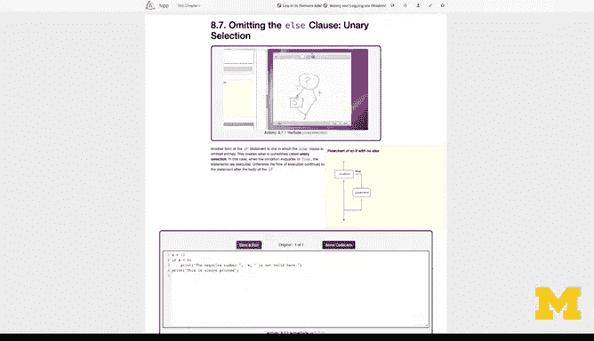

# 课程 5：04_01_05_可选 - 如何使用交互式教材 📚

在本节课中，我们将学习如何使用本专项课程提供的免费交互式教材。我们将介绍教材的核心功能，包括交互式代码窗口、代码透镜、练习题工具和自动评分作业，帮助你更高效地学习Python。

---

## 教材概览与访问方式

上一节我们介绍了课程的整体结构，本节中我们来看看配套的交互式教材。

该教材名为Runestone交互式教材，由Brad Miller主导开发。前四门课程的内容与教材内容紧密对应。无论你从哪门课开始，本视频都将展示重要的交互功能。如果你在之前的课程中已经看过，可以跳过。

每次访问Runestone教材，你都需要通过Coursera页面上的链接进入。点击链接后，系统会自动登录并跳转到指定的教材页面。

---

## 核心交互功能

教材中不仅包含文本和图表，还内置了多种交互元素。

### 活动代码窗口

以下是活动代码窗口的功能介绍：
*   **运行代码**：窗口内预置了代码，点击“保存并运行”按钮即可执行，结果会显示在输出窗口中。
*   **修改与保存**：你可以修改代码并再次运行。所有保存过的代码版本都会被永久记录。
*   **查看历史**：通过窗口旁的滑动条，你可以查看并恢复到之前保存的任何代码版本。即使刷新页面，点击“加载历史”后仍能找回。

### 代码透镜

代码透镜是一个强大的工具，由加州大学圣地亚哥分校的Philip Ge教授开发。它允许你逐行跟踪程序的执行过程。

点击“前进”按钮，代码透镜会逐步显示每一行代码执行后的状态。这个功能对于理解包含条件判断、循环和自定义函数的复杂程序逻辑至关重要，能帮助你通过理解而非试错来调试代码。

在教材中，部分页面直接内置了代码透镜示例。对于任何活动代码窗口，你都可以通过点击“显示/隐藏代码透镜”按钮来启用此功能。

### 选择题与进度标记

教材中嵌入了选择题。你可以选择答案并点击“检查我”按钮获得即时反馈。

在页面底部，有一个“标记页面完成”的按钮。点击后，该页面在教材目录中的颜色会发生变化，便于你追踪学习进度。此功能完全可选。

---

## 导航与搜索

虽然Coursera通常会提供指向特定页面的链接，但你也可以在Runestone网站内自由导航。

以下是导航与搜索的方法：
*   **翻页**：使用页面上的“前进”和“后退”按钮浏览教材。
*   **目录**：点击教材标题可以进入详细的目录页，其中列出了每一页甚至子章节。
*   **搜索**：使用搜索框可以查找特定关键词（如“变量”），系统会列出所有相关页面。
*   **索引**：教材还提供了索引功能，你可以查找特定概念并直接跳转到对应位置。

---

## 练习题工具

练习题工具是巩固知识的关键。有两种方式可以从Coursera进入该工具：一是通过课程中多处设置的“练习活动”链接；二是在任何Runestone教材页面点击“练习”按钮。

该工具会根据你已打开的教材页面，向你推送相关题目。它的核心机制是**间隔重复**：
*   答对题目后，系统会记住，并在一段时间内不再询问同一主题。
*   答错题目，系统可能会在第二天再次提问。
*   随着你对某个主题的掌握越来越牢固，再次提问的间隔时间会越来越长。

研究表明，定期使用此工具的学生在课程考试中表现显著更好。因此，虽然在本课程中不是强制要求，但强烈建议你每天使用它进行练习。

完成每日的5个问题后，系统会显示烟花动画作为奖励。但你也可以继续回答当天计划内的更多问题。

---

## 评分作业

对于报名证书课程的学习者，课程中会提供评分作业的链接，通常位于每课或每组课程结束时。

在前四门课程中，所有评估和项目都位于Runestone教材中，并由系统自动评分。评分作业通常要求获得100%的正确率才能通过，但你可以多次尝试，直到完全掌握。我们这样设置是因为早期知识的扎实掌握对后续学习至关重要。

在作业中，对于编程题，你可以在代码窗口中编写代码，点击“保存并运行”后获得即时反馈。系统在最终评分时会采用你历史提交中的最佳答案。

---

## 教材内的视频

教材的许多页面顶部都包含视频。以下是视频类型说明：
*   **推荐观看**：由Steve制作的精美动画，以及由Google教育团队在Brad Miller指导下制作的旁白动画，都非常出色，建议观看。
*   **可选观看**：一些仅仅是教材内容的讲解视频，且部分视频分辨率较低。对于这些，建议你跳过，转而观看我们在Coursera上提供的教材内容讲解。

---

## 总结与建议

本节课中我们一起学习了Runestone交互式教材的各项功能。这是一个由多人倾注热情开发的开源项目，尤其是项目发起人Brad Miller。希望它能帮助你扎实掌握Python基础。

最后，分享一点幽默的建议：**不要拖延，今天就行动起来，开始学习本课程的第一课吧！**

我们下次再见。