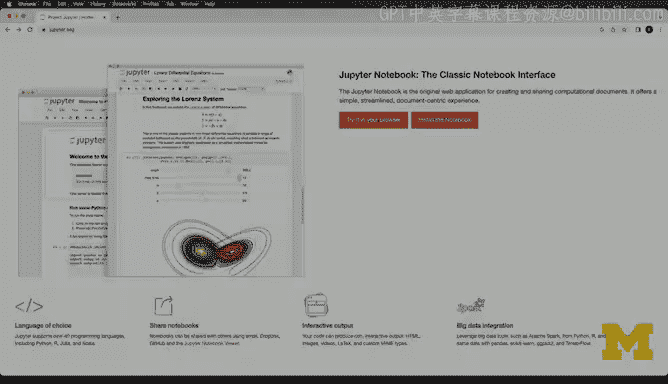
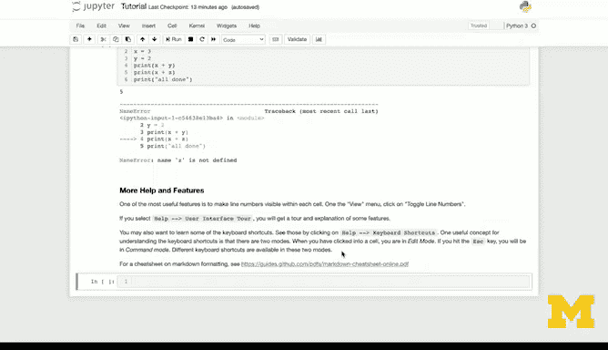

# 课程3：Python 3编程 - 第6讲：Jupyter Notebook环境入门 🚀




在本节课中，我们将学习如何使用Jupyter Notebook这一强大的交互式环境来执行Python代码。我们将了解其基本结构、核心功能以及与之前使用的Runestone环境的主要区别。

---

## 概述

Jupyter Notebook是一种将代码、文本和可视化内容结合在一起的交互式计算环境。它通过“单元格”来组织内容，使得编写、运行和展示代码变得非常直观。本节将引导你熟悉Jupyter Notebook的基本操作。

---

## Jupyter Notebook简介

上一节我们介绍了Python编程的基础，本节中我们来看看一个全新的代码执行环境——Jupyter Notebook。

Coursera平台提供了无需在本地安装任何额外软件即可运行Jupyter Notebook的方式。课程提供了一系列称为“实验”（Labs）的Notebook文件。完成这些实验是可选的，但它们对于巩固所学知识非常有用。

这些实验最初是为校园课程设计的，学生在有讲师指导的线下实验课中共同完成。你可能会发现Notebook中的一些问题颇具挑战性，因此我们鼓励你利用Coursera论坛与同学讨论。你甚至可以找到学习伙伴，同步协作完成Notebook。

每周的评估和课程结束时的大型项目也将以Jupyter Notebook的形式进行。因此，即使你不完成可选实验，在本课程中你也会使用到Jupyter Notebook。

本视频将引导你浏览一个介绍Jupyter环境的Notebook。建议你打开标题为“Lab Mechanics using Jupyter Notebooks”的实验活动，跟随视频一起操作。

---

## Notebook的单元格结构

Jupyter Notebook由单元格（Cells）构成。主要有两种类型的单元格：Markdown单元格和代码单元格。

### Markdown单元格

位于顶部的这个单元格就是一个Markdown单元格。它允许你生成格式化的文本，可以包含项目符号列表、粗体等内容。我们稍后会学习如何编写这种格式化文本。

### 代码单元格

另一种是代码单元格，就像下面这个。如果你点击一个代码单元格，然后点击“运行”（Run）按钮，它就会执行该单元格中的代码。这类似于Runestone中的活动代码窗口，但两者之间存在一些重要区别。

---

## 与Runestone环境的核心区别

以下是Jupyter Notebook代码单元格与Runestone活动代码窗口的两个主要不同点。

### 1. 表达式输出

在Jupyter中，如果单元格的最后一行代码是一个表达式，例如：
```python
x + 1
```
当我们执行该单元格时，会直接得到该表达式的输出结果。而在Runestone中，你必须使用显式的`print`语句才能看到输出。当然，在Jupyter中你也可以使用`print`语句。

例如，在这个单元格中：
```python
x = 9
print(x)
print(x + 1)
x + 2
```
运行后，我们会得到`print`语句的输出（9和10），以及最后一个表达式`x + 2`的计算结果11，它会作为单元格的输出显示出来。

### 2. 变量绑定的持久性

第二个重要区别是，在Jupyter中，变量绑定在不同单元格之间是持久保留的。

当我们运行上面的单元格后，变量`x`被赋值为9。如果我转到另一个单元格，并直接计算`x + 10`：
```python
x + 10
```
它会查找`x`的值，即使我们并没有在这个单元格中为`x`赋值。而在Runestone教科书中，每个活动代码窗口都是独立的，不会记住你执行过的其他窗口中的任何变量绑定。

所以，运行这个单元格会得到19。

我可以在下面插入另一个代码单元格，并设置`x = 100`。运行后，这会改变变量绑定。此时`x`的值不再是9，而是100。如果我回到之前的单元格再次执行，它将使用新的变量绑定，打印出110。

大多数时候，你会非常欣赏这种跨单元格执行的变量绑定持久性。但如果你不按顺序执行单元格，可能会忘记之前的操作，从而得到一些令人困惑的结果。

---

## 执行顺序与重置

Notebook会通过为单元格的输出编号来帮助你，这指示了单元格被执行的顺序。

例如，在这个案例中，我们可以看到在上下两个单元格执行之间，下面的单元格被执行了。我们可以通过输出编号来判断：这个输出标记为[1]，表示它先被执行；然后得到[2]；这个是[5]，而这个是[4]。由于4小于5，我们知道标记为[4]的单元格在标记为[5]的单元格之前执行。

这有时会有所帮助。但如果你真的感到困惑，你总是可以清除所有输出，丢弃所有变量绑定，然后从头开始重新运行Notebook。

为此，你可以点击“内核”（Kernel） -> “重启并清空输出”（Restart & Clear Output）。这将清除所有单元格的输出。现在我们有了一个干净的版本，可以按顺序逐个运行单元格，而不会对任何变量绑定感到困惑。

此时运行，我们得到了预期的结果19。

---

## 保存与检查点

Jupyter会在不同时间点自动保存你的Notebook。

但如果你想，也可以显式保存。有几种方法：一种是“保存并创建检查点”（Save and Checkpoint），然后你可以“恢复到检查点”（Revert to Checkpoint）。在其他一些环境中，通常会为你保存多个检查点，你可以回退到不同的检查点。在Coursera中，似乎只保存一个检查点。因此，你可能需要进行另一种保存，即“另存为”（Save As），为你的Notebook指定一个具体的名称，之后可以通过某种方式再次找到它。

不过大多数时候，你会乐于使用Jupyter自动为你保存的最新版本。

---

## 错误信息解读

Jupyter Notebook使用的Python解释器与Runestone中的略有不同，它实际上是官方的Python解释器。这对你来说大多是好事，但你需要适应它的错误信息。

在Runestone中，错误信息经过翻译，对新手程序员更友好。在Jupyter中，你会看到原始的错误信息。

例如，让我们看看运行这段代码会发生什么：
```python
print(5)
print(x + z)  # 假设z未定义
```
我们首先会得到`print(5)`的输出5。但当它尝试执行`print(x + z)`时，由于`z`没有绑定值，我们会得到一个错误信息。它会告诉我们发生了**NameError**（名称错误），并指出`z`未定义。同时，它还会显示发生问题的整个代码上下文，指出问题出现在第4行。

你会发现学会解读这些信息非常有用。我发现一个很有帮助的技巧是**开启行号显示**。当你首次打开Jupyter Notebook时，行号可能默认是关闭的。你可以进入“视图”（View）菜单，选择“切换行号”（Toggle Line Numbers）。神奇的是，行号就出现了。这很有帮助，因为我们知道问题出在第4行，可以轻松地在这里找到第4行，并意识到是变量`z`出了问题。

---

## Markdown格式化功能

我们可以在代码单元格中使用注释，就像在任何Python环境中一样。但现在，我们还可以使用这些格式精美的Markdown单元格。

如果你双击一个Markdown单元格，可以看到用于指定格式的标记语言，它被称为Markdown。

*   如果你在一行的开头加上一个`#`（井号），它会变成大字体标题。
*   使用多个`##`，会生成级别更低的标题（例如三级标题），字体稍小。
*   点击“运行”，你就能看到它被漂亮地格式化后的样子。双击它，你又能看到背后的原始Markdown标记。

还有其他一些好用的功能：
*   用反引号 \` 包围一些文本，会使文本高亮显示，就像这里的`编辑模式`。
*   如果你想得到*斜体*，可以用星号包围文本，例如 `*编辑模式*`。
*   当你输入一个URL时，它会自动变成链接，就像这个指向Markdown速查表的[链接](https://www.markdownguide.org/cheat-sheet/)。我鼓励你探索更多功能，包括点开那个链接。

---

## 键盘快捷键与进阶环境

在这个视频中，我通过点击菜单和运行按钮来操作，以便观众更清楚地了解我在做什么。但当我平时使用Jupyter Notebook时，大部分操作都使用键盘快捷键。😊

我希望你会享受创建和使用Jupyter Notebook的过程。它们非常适合你将在本课程及本专业后续课程中创建的程序规模。

对于更大型的程序，你可能需要使用不同的开发和执行环境，即那种将大量代码放入一个文件，然后一次性执行整个文件的工具。这被称为**IDE**（集成开发环境），例如PyCharm或VS Code。在本专业的后续课程中，你将会对这类IDE有一个简短的介绍。

---

## 总结

本节课中我们一起学习了Jupyter Notebook的基本使用。我们了解了其单元格结构（Markdown与代码单元格），掌握了运行代码、查看输出的方法，并理解了它与Runestone环境在变量作用域和错误信息上的关键区别。我们还简单接触了Markdown的格式化功能。Jupyter Notebook是一个强大的交互式工具，非常适合数据分析和学习编程。



下次见。