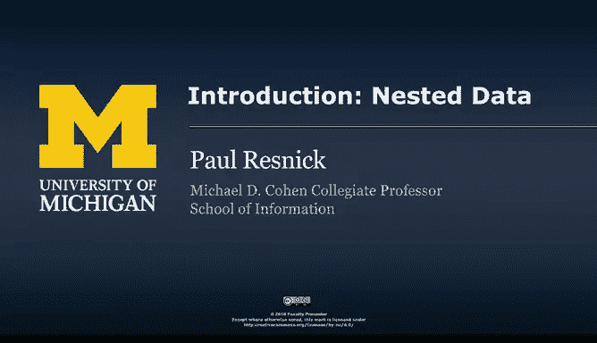

# 课程3：Python 3编程 - P7：06_02_01_嵌套数据结构简介 🪆

在本节课中，我们将要学习如何处理嵌套数据结构，即列表和字典相互包含的复杂数据组织形式。我们还将初步了解JSON数据格式，它允许我们将这些嵌套结构存储为文本。


---



## 嵌套数据结构简介

上一节我们介绍了基础的列表和字典。本节中我们来看看当它们相互组合时会发生什么。

我们称这种结构为嵌套数据结构。它有点像俄罗斯套娃，一个大的娃娃里面装着另一个娃娃。在编程中，一个外层的列表或字典，其内部元素可以是另一个列表或字典。最终，你会深入到不再是容器的基本元素，比如字符串、整数或一个对象实例。但你可能需要向下探索好几层才能找到它。

---

## JSON数据格式初探

除了嵌套结构本身，我们还将首次接触JSON数据格式。

JSON格式允许你将一个高度嵌套的列表或字典表示为一个长文本字符串。这样，你就可以将其存储在文件中供以后读取，或者发送到另一台计算机。

---

## 本节课的学习目标

在本节课结束时，你应该能够掌握以下技能：

以下是本节课的核心技能点：

*   能够**重复使用方括号**从嵌套数据结构中提取数据元素。
*   能够使用Python的`json`模块**读取和写入**JSON格式的字符串。

---

## 核心概念与操作

### 1. 访问嵌套数据
要访问嵌套在多层结构中的数据，你需要连续使用方括号来指定每一层的索引或键。

**代码示例：**
```python
# 一个嵌套列表的例子
nested_list = [["a", "b"], ["c", "d"]]
# 访问内部列表的第一个元素
element = nested_list[0][0]  # 结果为 "a"

# 一个嵌套字典的例子
nested_dict = {"key1": {"inner_key": "value"}}
# 访问内部字典的值
value = nested_dict["key1"]["inner_key"]  # 结果为 "value"
```

### 2. 使用JSON模块
Python内置的`json`模块提供了在Python对象和JSON字符串之间转换的工具。

**代码示例：**
```python
import json

# 将Python字典转换为JSON字符串
python_dict = {"name": "Alice", "age": 30}
json_string = json.dumps(python_dict)  # 结果为字符串 '{"name": "Alice", "age": 30}'

# 将JSON字符串解析为Python字典
parsed_dict = json.loads(json_string)  # 结果变回字典 {"name": "Alice", "age": 30}
```

---

## 总结

本节课中我们一起学习了嵌套数据结构的核心概念。我们了解到列表和字典可以相互嵌套，形成复杂的数据组织方式。我们学会了通过连续使用方括号来访问这些深层数据。此外，我们还初步掌握了JSON数据格式，以及如何使用Python的`json`模块在字符串和Python数据结构之间进行转换，这对于数据存储和传输至关重要。

我们将在课程结尾再会，进行回顾并分享一些有趣的双关语笑话。暂时再见。