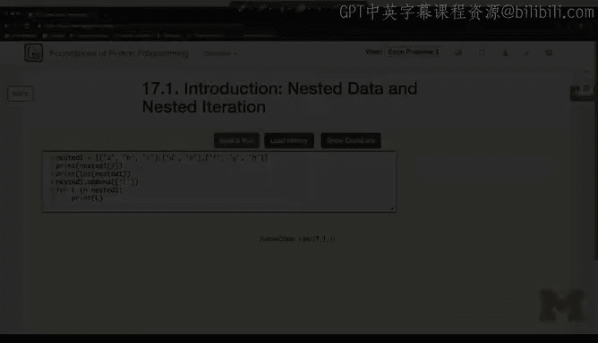
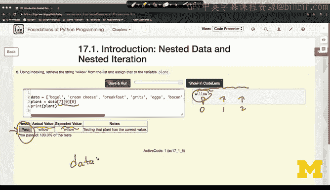

# 密歇根大学《Python3编程》课程3、4、5｜第8课：嵌套列表 🧩




在本节课中，我们将要学习Python中的嵌套列表。嵌套列表是指列表中的元素本身也是列表。我们将学习如何创建、访问和修改嵌套列表中的元素。

## 概述

嵌套列表是Python中一种常见的数据结构，它允许我们在一个列表中存储其他列表。这种结构在处理多维数据（如矩阵、表格）时非常有用。本节我们将深入探讨嵌套列表的基本概念和操作方法。

## 嵌套列表的基本概念

我们有一个名为 `nested1` 的列表，它的每个元素本身也是一个列表。第一个元素是列表 `['A', 'B', 'C']`，第二个是 `['D', 'E']`，第三个是 `['F', 'G', 'H']`。我们将整个大列表称为**外层列表**，将其中的小列表称为**内层列表**。

外层列表的第一个元素是内层列表 `['A', 'B', 'C']`。

## 访问嵌套列表

以下是访问嵌套列表元素的基本操作。

```python
nested1 = [['A', 'B', 'C'], ['D', 'E'], ['F', 'G', 'H']]
```

*   打印外层列表的第一个元素（即第一个内层列表）：
    ```python
    print(nested1[0])  # 输出: ['A', 'B', 'C']
    ```
*   获取外层列表的长度：
    ```python
    print(len(nested1))  # 输出: 3
    ```
*   在外层列表末尾添加一个新元素（一个列表）：
    ```python
    nested1.append(['I'])
    ```
*   遍历外层列表并打印每个内层列表：
    ```python
    for inner_list in nested1:
        print(inner_list)
    ```

## 修改内层列表

我们可以像操作普通列表一样修改内层列表。

*   向第一个内层列表添加元素：
    ```python
    nested1[0].append('Z')
    ```
*   向第二个内层列表添加元素：
    ```python
    nested1[1].append('W')
    ```

## 双重索引

使用两个方括号可以提取内层列表中的具体元素。

```python
y = nested1[1]  # y 现在绑定到列表 ['D', 'E']
print(y)        # 输出: ['D', 'E']
print(y[0])     # 输出: 'D'
```

Python解释器根据上下文判断方括号的含义。如果方括号前有一个列表，则表示索引操作；否则，表示创建列表。

```python
print([10, 20, 30][1])  # 输出: 20 (先创建列表，再索引)
print(nested1[1][0])    # 输出: 'D' (对外层列表索引，再对内层列表索引)
```

## 为嵌套列表赋值

我们可以为外层列表或内层列表中的特定位置赋值。

```python
# 将外层列表的第二个元素（原为['D', 'E']）替换为新列表
nested1[1] = [1, 2, 3]

# 将上一步新列表中的第一个元素（原为1）替换为100
nested1[1][0] = 100
```

## 更复杂的数据结构

列表的元素可以是其他复杂对象，例如字典。

```python
nested2 = [{'a': 1, 'b': 3}, {'a': 5, 'c': 7, 'd': 9}, {'a': 11, 'c': 13, 'd': 15}]
```

## 提取深层嵌套的数据

当数据结构多层嵌套时，我们需要使用多个方括号来提取最深层的元素。建议采用**渐进式**的方法构建提取表达式。

假设我们有如下数据结构，目标是提取单词 `'willow'`：

```python
data = [0, 1, 2, 3, 4, 5, ['bacon', 'eggs'], ['bagel', 'cream', 'cheese'], [['swiss', 'gruyere', 'brie'], ['willow', 'birch', 'elm']]]
```

`'willow'` 位于第三层嵌套中。我们可以分步提取：

1.  首先，提取包含 `'willow'` 的那个列表（索引为7）：
    ```python
    plant = data[7]
    print(plant)  # 输出: [['swiss', 'gruyere', 'brie'], ['willow', 'birch', 'elm']]
    ```
2.  然后，从这个列表中提取包含 `'willow'` 的子列表（索引为1）：
    ```python
    plant = data[7][1]
    print(plant)  # 输出: ['willow', 'birch', 'elm']
    ```
3.  最后，从这个子列表中提取 `'willow'`（索引为0）：
    ```python
    plant = data[7][1][0]
    print(plant)  # 输出: 'willow'
    ```

通过这种渐进的方式，可以准确无误地定位到深层数据。

## 深层修改

我们同样可以对深层嵌套的数据进行修改。

*   **追加**：假设 `data[7][1]` 是一个列表，可以向其末尾添加元素。
    ```python
    data[7][1].append(29)
    ```
*   **赋值**：可以替换深层嵌套位置的值。
    ```python
    data[7][1] = 42  # 将整个内层列表替换为整数42
    ```



## 总结

本节课中我们一起学习了Python的嵌套列表。我们了解了嵌套列表的结构，掌握了如何使用双重或多重索引来访问和修改深层数据。关键点在于理解每个方括号操作都对应着向数据结构内部深入一层。对于复杂的嵌套结构，采用渐进式的方法逐步构建索引表达式是最可靠的方式。嵌套列表是构建更复杂数据结构（如矩阵、树形结构）的基础。