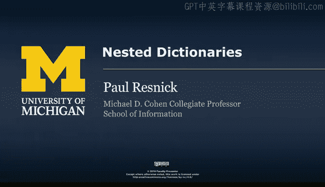
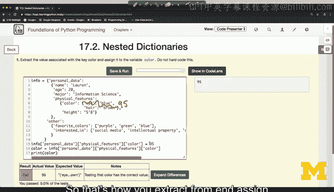

# 课程3：Python 3编程 - 08_02_03_嵌套字典 📚




在本节课中，我们将要学习如何处理嵌套的字典和列表数据结构。我们将通过一个具体的例子，逐步提取嵌套在多层结构中的数据，并了解如何修改这些数据。

---

## 概述

嵌套字典是指字典中包含其他字典或列表作为其值。这种数据结构可以表示非常复杂的信息。本节课我们将学习如何逐层访问和修改嵌套字典中的数据。

上一节我们介绍了字典的基本操作，本节中我们来看看如何处理多层嵌套的字典。

## 提取嵌套数据

我们有一个相当复杂的数据结构。我们的任务是从中提取与“color”键关联的值。

该值位于第六行，是一个包含“eye: blue”和“hair: brown”的字典。我们将采用增量方法，从深度嵌套的字典中提取数据。

每深入一层嵌套，我们就需要一个方括号。因此，我们需要一个方括号来获取与“personal data”关联的内容，然后在其内部需要另一个方括号来获取与“physical features”关联的内容，最后再需要一个方括号来获取“color”本身。

让我们一步一步来完成这个任务。我们将创建一个名为`color`的变量，其值最终将是那个包含“eye: blue”和“hair: brown”的字典。我们无法一步到位，而是需要从`info`字典中逐步提取。

首先，我们提取与“personal data”键关联的所有内容。

```python
color = info['personal data']
print(color)
```

运行此代码时，我们可能会遇到错误。例如，如果忘记闭合字符串，会出现语法错误。修正错误后，再次运行。

现在，`color`变量绑定到了一个比原始`info`更小的字典，它包含了“personal data”下的内容。测试显示我们尚未完成问题，因为我们只深入了一层嵌套，还没有提取出目标值。

## 深入下一层

在当前的`color`字典中，“color”值出现在哪里？它出现在与“physical features”键关联的部分。

因此，我们的第二层嵌套是请求“physical features”。每深入一层，任务就变得简单一些，因为数据结构变得更小，更容易定位。

```python
color = info['personal data']['physical features']
print(color)
```

现在，我们得到了一个更小的数据结构。我们想要获取与“color”键关联的字典。

## 获取目标值

让我们再进行一层提取，直接请求“color”。

```python
color = info['personal data']['physical features']['color']
print(color)
```

现在我们成功通过了测试，因为我们获取到了与“color”关联的值。请注意，这个值本身仍然是一个字典，而不是一个简单的值，但这正是我们想要获取的目标。

关于这个复杂的数据结构，需要注意一点：我们有一层套一层的字典嵌套。字典永远是一个值，与某个键关联。字典的键必须是不可变对象，如字符串、数字或元组，不能是列表或字典。

## 修改嵌套数据

接下来，我们尝试修改与“color”键关联的值。我们将其改为95。

我们可以使用之前相同的技巧。表达式`info['personal data']['physical features']['color']`指向了这个复杂数据结构深处的一个位置。

我们可以将这个表达式放在赋值语句的左侧，为其赋予新值。

```python
info['personal data']['physical features']['color'] = 95
color = info['personal data']['physical features']['color']
print(color)  # 输出将是 95
```

当然，这样做之后我们会无法通过最初的测试，因为我们改变了原始值。但这演示了如何定位并修改嵌套结构中的值。

`info['personal data']['physical features']['color']` 是指向数据结构深处某个位置的方法。我们可以读取它，也可以为其赋值，就像在第15行所做的那样，将其值改为95。

---

## 总结

本节课中我们一起学习了如何处理嵌套的字典和列表。我们掌握了通过多层方括号逐层访问嵌套数据的方法，也学会了如何修改嵌套结构深处的值。记住，字典的键必须是不可变类型，而值可以是任何对象，包括另一个字典或列表，从而形成复杂的数据结构。

这就是从复杂的嵌套列表和字典中提取数据以及为其赋值的方法。

---



下次见 👋