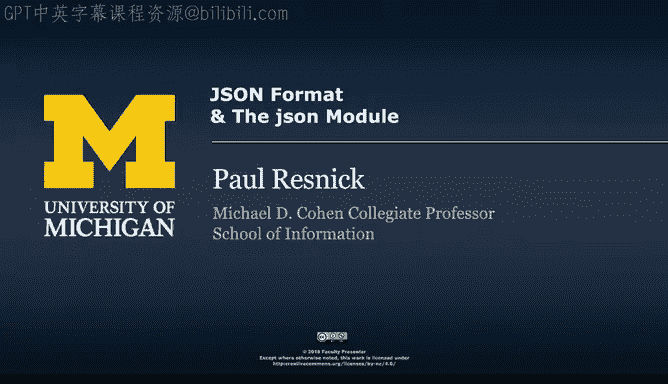
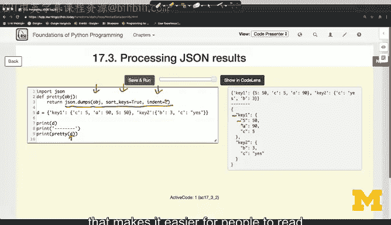

# 课程10：JSON格式与json模块 📄




在本节课中，我们将要学习JSON格式以及如何使用Python的`json`模块来读取和写入JSON数据。JSON是一种在计算机系统之间共享嵌套列表和字典数据的常用标准格式。

---

## JSON格式简介

上一节我们介绍了嵌套列表和字典，本节中我们来看看如何在系统间共享这类数据。JSON（JavaScript Object Notation）就是一种为此定义的标准格式。它起源于JavaScript语言，但Python可以非常方便地读写JSON格式的数据。

实际上，JSON格式看起来几乎和Python列表或字典的打印输出完全一样。在大多数情况下，你很难看出区别，但存在一些细微差异，例如Python的`None`值在JSON中表示为`null`，而`True`和`False`在JSON中是小写的`true`和`false`。

我们将使用`json`模块来读写JSON格式的数据。请注意，Runestone环境中的`json`模块只实现了完整Python环境中`json`模块功能的一个子集，但它包含了两个最实用的函数。

---

## 从字符串加载JSON数据：`json.loads()`

接下来，我们来看看第一个实用函数。`json.loads()`函数接受一个字符串作为输入，并返回一个字典或列表。

以下是使用`json.loads()`的代码示例：

```python
import json

# 这是一个包含JSON格式数据的字符串
string_var = '{"result_count": 25, "results": [{"track": "Song A"}, {"track": "Song B"}]}'

# 使用 json.loads() 将字符串转换为Python对象
data_dict = json.loads(string_var)

# 打印转换后对象的类型
print(type(data_dict))  # 输出: <class 'dict'>

# 因为是字典，我们可以访问其键
print(data_dict.keys())  # 输出: dict_keys(['result_count', 'results'])
print(data_dict['result_count'])  # 输出: 25
```

这里有一个重要概念需要区分：字符串和字典。我们从一个字符串开始，通过将其传递给`json.loads()`函数，我们得到了一个字典作为输出。如果你混淆了它们，例如尝试对一个字符串使用字典的键访问方式，就会导致错误。

---

## 将数据转换为JSON字符串：`json.dumps()`

现在，我们来看看第二个实用函数，它执行相反的操作。`json.dumps()`函数接受一个Python列表或字典（即使是嵌套的），并将其转换为JSON格式的字符串。得到JSON格式的字符串后，我们就可以将其写入文件或进行其他字符串操作。

`json.dumps()`函数总是接受一个列表或字典作为输入，但它也可以接受其他参数。如果你传递`sort_keys=True`，那么输出字典时，键会按字母顺序排列。如果你传递`indent`参数，它会“美化”输出字符串，添加缩进和换行，使人们更容易阅读。

以下是使用`json.dumps()`的代码示例：

```python
import json

# 一个Python字典
data_dict = {"name": "Alice", "age": 30, "city": "New York"}

# 使用 json.dumps() 转换为字符串，无美化
json_string_simple = json.dumps(data_dict)
print(json_string_simple)

# 使用 json.dumps() 转换为字符串，带排序和缩进美化
json_string_pretty = json.dumps(data_dict, sort_keys=True, indent=2)
print(json_string_pretty)
```

运行上述代码，你会看到美化后的字符串层次分明，更易于阅读。

---

## 函数名记忆技巧

你可能注意到了我对函数名的特殊读法：`dump S` 和 `load S`（强调“S”）。这是为了提醒自己，这里的“S”代表“字符串”（String），而不是复数形式。

以下是我记忆它们的方法：
*   **`loads`**：从字符串加载（Load from a **S**tring）。
*   **`dumps`**：转储到字符串（Dump to a **S**tring）。

将对象转储到字符串是合理的，但从字符串转储则没有意义，这有助于我区分它们。

---

## 总结



本节课中我们一起学习了JSON格式和Python的`json`模块。`json.loads()`用于将JSON格式的字符串加载为Python对象（列表或字典），而`json.dumps()`用于将Python列表或字典转储为JSON格式的字符串。使用`json.dumps()`并设置`indent`参数可以生成带缩进的字符串，使人更易阅读和理解。我们将在后续学习从互联网服务器（如iTunes或OMDB）获取数据的REST API时，更多地接触到JSON格式。