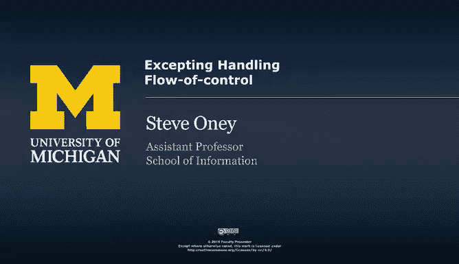
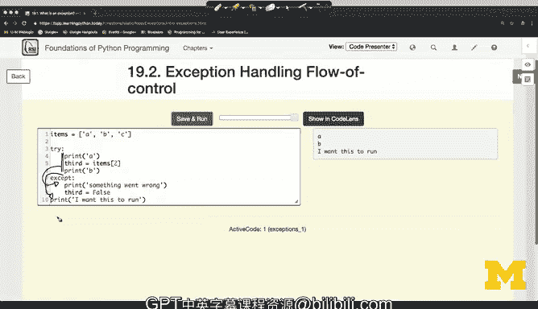

# 课程3：Python 3编程 - P100：43_04_02_异常处理控制流 🐍




在本节课中，我们将要学习Python中的异常处理，特别是如何使用 `try` 和 `except` 语句来控制程序流程，使其在遇到运行时错误时不会立即崩溃。

## 概述 📋

编写Python代码时，我们可能会遇到三种主要类型的错误。理解这些错误是学习如何处理它们的第一步。

## 三种主要错误类型

以下是三种主要的错误类型：

1.  **语法错误**
    当Python无法理解程序中的指令时，就会发生语法错误。例如，如果忘记写括号或引号并尝试运行程序，Python会报出语法错误，表明它不理解给出的指令。

2.  **运行时错误**
    当Python理解了给出的指令，但在尝试执行这些指令时出现问题，就会发生运行时错误。例如，下面的代码会产生一个运行时错误（更具体地说是索引错误）：
    ```python
    items = [‘A‘, ‘B‘]
    third = items[2]  # 索引错误，因为列表只有两个元素
    ```
    换句话说，Python知道你想做什么，但在执行代码时出了问题。

3.  **语义错误**
    语义错误是指Python成功运行了代码，但代码的行为并非你的本意。例如，你写了一个函数本意是相加两个数字，但它实际上执行了除法操作。Python不会报错，但结果不是你想要的。

## 运行时错误的影响

通常，当程序遇到运行时错误时，Python会立即停止运行代码。例如，在下面的代码中，第三行的打印语句不会被执行：
```python
print(“这行会执行”)
third = items[2]  # 这里发生运行时错误
print(“这行不会被执行”)  # 程序在此处停止
```
如果错误发生前有打印语句，那么它会成功执行。

上一节我们介绍了错误的类型及其影响，本节中我们来看看如何使用 `try` 和 `except` 来优雅地处理这些错误。

## 使用 Try-Except 处理错误

`try-except` 语句允许我们处理运行时错误，并告诉Python在遇到错误时该做什么，从而避免程序每次遇到错误就突然停止。

假设我们希望在赋值 `third` 之后继续运行代码，即使第二行遇到了运行时错误。我们可以使用 `try-except` 块来实现。

最简单的 `try-except` 块写法如下：
```python
try:
    # 尝试运行的代码
    third = items[2]
except:
    # 如果发生运行时错误，则运行这里的代码
    third = False
```

## Try-Except 执行流程

为了更清楚地了解执行过程，我们添加一些打印语句。

```python
print(“A“)
try:
    third = items[2]  # 可能引发运行时错误
    print(“B“)  # 如果发生错误，这行不会执行
except:
    print(“出错了“)
    third = False
print(“我希望这行能运行“)
```

**执行过程（当 `items` 只有两个元素时）：**
1.  打印 “A”。
2.  尝试执行 `third = items[2]`，这会引发运行时错误。
3.  程序立即跳转到 `except` 块，因此打印 “B” 的语句被跳过。
4.  在 `except` 块内，打印 “出错了”，并将 `third` 赋值为 `False`。
5.  继续执行 `try-except` 块之后的代码，打印 “我希望这行能运行”。

**执行过程（当 `items` 有三个元素时）：**
1.  打印 “A”。
2.  成功执行 `third = items[2]`，未发生错误。
3.  打印 “B”。
4.  完全跳过 `except` 块，因为一切正常。
5.  打印 “我希望这行能运行”。

## 总结 ✨



本节课中我们一起学习了Python的异常处理机制。简单来说，`try-except` 的作用是：尝试运行 `try` 块内的代码，如果在运行过程中出现问题，程序不会停止整个执行流程，而是跳转并运行 `except` 块内的代码。如果一切顺利，没有错误发生，那么程序会完全跳过 `except` 块，继续执行 `try-except` 结构之后的代码。这使我们能够编写出更健壮、容错性更好的程序。