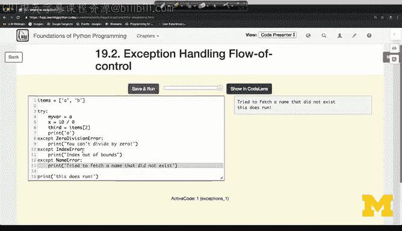

# Python 3 编程（课程 3、4、5）｜第 44 课：处理不同类型的异常 🐍


## 概述

在本节课中，我们将要学习如何通过 `try...except` 语句来处理程序运行时可能出现的不同种类的错误（异常）。我们将了解如何捕获特定的异常类型，以便针对不同的错误情况执行不同的处理逻辑。

---

## 回顾：使用 `try...except` 处理异常

上一节我们学习了可以通过 `try...except` 代码块来处理运行时错误。

例如，以下代码创建了一个包含两个元素的列表，然后尝试获取第三个元素，这将导致一个索引错误（`IndexError`）。

```python
my_list = [1, 2]
third = my_list[2]  # 这行代码会引发 IndexError
print("这行不会运行")
```

当程序尝试执行 `my_list[2]` 时，会立即引发 `IndexError`，程序停止运行，因此第 4 行的 `print` 语句永远不会执行。

我们可以使用 `try...except` 来处理这个错误：

```python
my_list = [1, 2]
try:
    third = my_list[2]  # 尝试运行可能出错的代码
except:
    third = False       # 如果出错，则执行这里的代码
    print("出错了，将 third 赋值为 False")
print(third)
```

现在，当我们保存并运行代码时，第 7 行的 `print` 语句会执行。因为第 4 行引发的运行时异常被 `except` 块捕获并处理了。

一旦代码在第 4 行遇到运行时错误，程序就会跳转到 `except` 块执行。需要注意的是，在 `try` 块中，异常发生点之后的代码（例如第 5 行）将不会被执行。

---

## 捕获所有类型的异常

我们之前编写的 `try...except` 块中的 `except` 语句会捕获代码可能抛出的**任何**类型的异常。

例如，考虑以下会产生除零错误（`ZeroDivisionError`）的代码：

```python
try:
    x = 10 / 0  # 这行代码会引发 ZeroDivisionError
    print(x)    # 这行不会运行
except:
    print("处理了异常")
```

这段代码仍然可以工作，因为一旦在第 4 行遇到 `10 / 0` 引发的异常，Python 就会跳转到 `except` 块，跳过 `try` 块中剩余的代码。

如果将这段可能出错的代码放在 `try...except` 块之外运行，我们就能看到具体的错误类型：

```python
x = 10 / 0  # 这会直接导致 ZeroDivisionError 并终止程序
```

我们之前通用的 `except:` 写法可以处理任何运行时异常，包括 `ZeroDivisionError`、`IndexError` 等等。

---

## 捕获特定类型的异常

现在，假设我们想更精确地处理错误：针对除零错误做一件事，针对索引错误做另一件事。

我们可以通过在 `except` 语句后指定异常类型来实现更精确的捕获。

最通用的异常类型是 `Exception`（注意首字母大写）。`except Exception:` 可以捕获几乎所有运行时错误。

但我们可以更具体。以下是针对不同异常类型进行不同处理的示例：

```python
try:
    # 假设这里可能引发不同类型的错误
    # my_list[2]  # 可能引发 IndexError
    x = 10 / 0    # 可能引发 ZeroDivisionError
except ZeroDivisionError:
    # 专门处理除零错误
    print("不能除以 0")
except IndexError:
    # 专门处理索引错误
    print("索引超出范围")
```

运行这段代码时，如果第 4 行引发了 `IndexError`，Python 会跳转到对应的 `except IndexError:` 块并执行其中的代码。

如果我们调整代码顺序，让除零错误先发生：

```python
try:
    x = 10 / 0    # 先引发 ZeroDivisionError
    my_list[2]    # 这行不会运行
except ZeroDivisionError:
    print("不能除以 0")
except IndexError:
    print("索引超出范围")
```

那么 Python 会跳转到 `except ZeroDivisionError:` 块并打印“不能除以 0”。

---

## 处理其他类型的异常

假设我们的代码中出现了另一种类型的错误，例如尝试使用一个未定义的变量（`NameError`）。

```python
try:
    my_var = a  # 变量 a 未定义，会引发 NameError
except Exception:
    # 通用的 Exception 可以捕获任何错误
    print("其他错误发生了")
```

运行代码，你会看到“其他错误发生了”被打印出来。

如果我们想专门处理 `NameError`，而不是通用的 `Exception`，可以这样做：

```python
try:
    my_var = a  # 引发 NameError
except NameError:
    # 专门处理名称错误
    print("尝试获取了一个不存在的名称")
```

当代码在第 4 行引发 `NameError` 时，程序会直接跳转到第 12 行对应的异常处理器执行。

以下是处理多种异常类型的完整结构示例：

```python
try:
    # 可能出错的代码块
    pass
except ZeroDivisionError:
    # 处理除零错误
    pass
except IndexError:
    # 处理索引错误
    pass
except NameError:
    # 处理名称错误
    pass
except Exception:
    # 处理所有其他未明确捕获的异常
    pass
```

---

## 总结

本节课中我们一起学习了如何更精细地处理 Python 程序中的异常。

*   我们回顾了使用 `try...except` 基础结构来防止程序因运行时错误而崩溃。
*   我们了解到 `except:` 可以捕获所有异常，而 `except Exception:` 是其更明确的写法。
*   **核心进阶内容**是：我们可以通过 `except SpecificErrorType:`（例如 `except ZeroDivisionError:`）来捕获和处理**特定类型**的异常。
*   这使得我们可以针对不同的错误情况（如除零、索引越界、变量未定义）编写不同的错误恢复或提示逻辑，让程序更加健壮和友好。



通过为不同类型的异常设置专门的处理器，你可以构建出能够优雅地应对各种意外情况的程序。