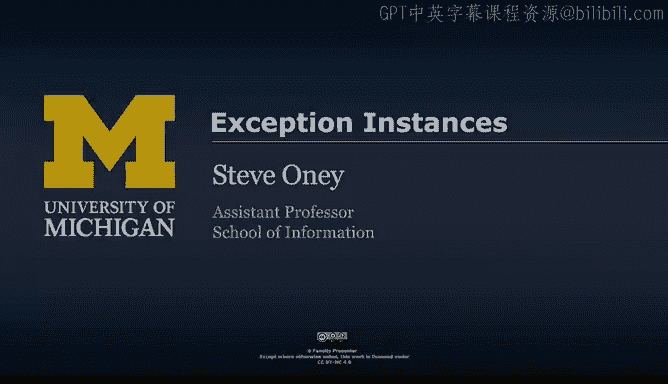
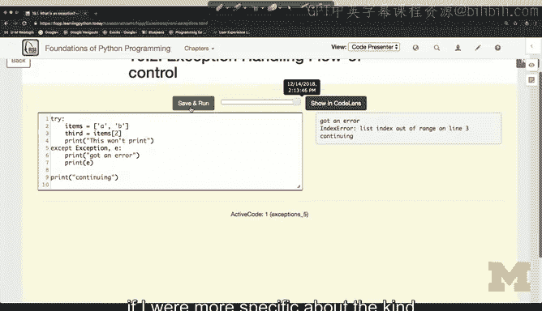

# 课程3：Python 3编程 - P102：45_04_04_异常实例 🐍




在本节课中，我们将学习如何在Python中捕获和处理运行时异常，特别是如何获取并打印出具体的错误信息，以便在不中断程序执行的情况下进行调试。

## 概述

上一节我们介绍了使用 `try...except` 块来捕获异常的基本方法。本节中我们来看看如何获取异常的具体实例，从而在捕获错误的同时，也能打印出详细的错误信息，帮助开发者进行调试。

## 捕获特定异常

当我们需要捕获和处理运行时异常时，可以使用 `try` 语句。我们将可能抛出异常的代码放入 `try` 块中，然后使用 `except` 来指定我们希望处理的异常类型。

所有异常类型都继承自 `Exception` 类。因此，我们有通用的 `Exception`，也有更具体的异常类型，例如 `IndexError`、`ZeroDivisionError`、`NameError` 等等。

以下是一个示例代码，我们尝试捕获一个 `IndexError`：

```python
try:
    my_list = [1, 2, 3]
    print(my_list[5])  # 这将引发 IndexError
except IndexError:
    print("捕获到一个错误")
    print("程序继续执行")
```

运行这段代码，异常会被我们指定的方式处理：打印出“捕获到一个错误”，然后程序继续执行，打印“程序继续执行”。

## 获取并打印异常信息

有时，我们不仅希望捕获异常，还希望在不中断程序的情况下，获取并打印出错误的详细信息，例如错误类型和行号。

如果我们不将代码放入 `try` 块中，直接运行：

```python
my_list = [1, 2, 3]
print(my_list[5])  # 这将引发 IndexError
print("程序继续执行")
```

程序会在第二行抛出 `IndexError: list index out of range` 并停止，后面的 `print` 语句不会执行。我们虽然获得了完整的错误信息，但程序中断了。

为了既获得错误信息又不中断程序，我们可以在 `except` 语句中捕获异常实例。

具体做法是：在 `except` 关键字后指定异常类型，然后添加一个逗号，并为捕获到的异常实例赋予一个变量名（例如 `e`）。

```python
try:
    my_list = [1, 2, 3]
    print(my_list[5])  # 这将引发 IndexError
except IndexError as e:
    print("捕获到一个错误")
    print(e)  # 打印异常实例 e 的信息
    print("程序继续执行")
```

运行这段代码，程序会尝试执行 `try` 块中的代码。在第三行遇到 `IndexError` 后，会跳转到 `except` 块。

我们为捕获到的 `IndexError` 实例命名为 `e`。代码首先打印“捕获到一个错误”，然后打印 `e` 的值（即具体的错误信息）。最后，程序会继续执行，打印“程序继续执行”。

这样，我们既没有牺牲错误信息的完整性，又能让程序在出错后继续运行。

## 关键概念总结

以下是实现上述功能的核心步骤：

1.  **使用 `try...except` 块**：将可能出错的代码放入 `try` 块。
2.  **指定异常类型**：在 `except` 后指定要捕获的异常类（如 `IndexError`）。
3.  **捕获异常实例**：使用 `as` 关键字（例如 `except IndexError as e:`）将捕获到的异常对象赋值给一个变量（如 `e`）。
4.  **访问错误信息**：通过打印该变量（如 `print(e)`），可以获取并输出错误的详细描述。

这种方法同样适用于捕获通用异常（`Exception`）或其他任何特定的异常类型。

## 总结



本节课中我们一起学习了如何更精细地处理Python中的异常。我们不仅复习了使用 `try...except` 捕获错误的基础，还重点掌握了通过 `except ... as e:` 语法来获取异常实例的方法。这使得我们能够在保证程序健壮性（不因错误而崩溃）的同时，获得充分的调试信息，是编写高质量代码的重要技巧。


下次课再见。